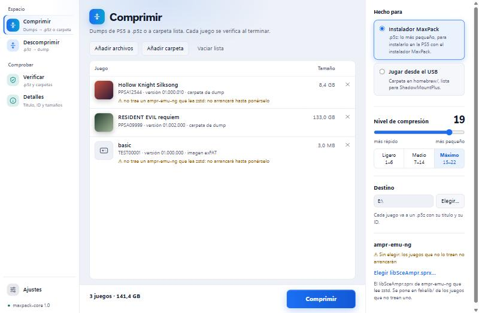

# MaxPack

MaxPack lets you play compressed PS5 game dumps. It packs a game you own into zstd packs that the
console reads while you play, so nothing is decompressed on the PS5: Hollow Knight: Silksong goes from
8.4 GB to 2.3 GB, and RESIDENT EVIL requiem from 133 GB to 79 GB, as a single `.p5z` file. You can
keep the `.p5z` on a USB drive and play it directly on the console, with no install step.



**Full guide, from download to playing on the PS5: [docs/guide.md](docs/guide.md).**
Games tested so far:
[compatibility list](https://github.com/DeLFuS77/maxpack-ps5/blob/main/docs/compatibility.md).

## The three repositories

| Piece | What it is | Where |
|---|---|---|
| **MaxPack** (this repository) | The PC app (Windows, macOS, Linux), the `maxpack` command line and the guide | https://github.com/DeLFuS77/maxpack |
| **MaxPack for the console** | The PS5 payload: mounts games, plays a `.p5z` as it is and installs games | https://github.com/DeLFuS77/maxpack-ps5 |
| **ampr-emu-ng** | The runtime (`libSceAmpr.sprx`) that reads the zstd packs on the console | https://github.com/DeLFuS77/ampr-emu-ng |

The PC compresses and verifies (this repository); the console plays and installs (maxpack-ps5, with
ampr-emu-ng inside). The version of this repository is the version of the engine, the window and their
packages: **1.0.0**.

## Download

Packages are in **[Releases](https://github.com/DeLFuS77/maxpack/releases)**, with a `SHA256SUMS` file
to check them:

- Windows: `maxpack-windows-x64-setup.exe` (installer) or `maxpack-windows-x64-portable.zip`.
- macOS: `maxpack-macos-apple-silicon.dmg` (M1 or later) or `maxpack-macos-intel.dmg`.
- Linux: `maxpack-linux-x64.tar.gz`, with an `install.sh`.

The programs are not signed (Windows warns you with SmartScreen, and on macOS you open them the first
time with a right click, Open); the guide explains it. For the console, download `maxpack.elf` from the
[maxpack-ps5 Releases](https://github.com/DeLFuS77/maxpack-ps5/releases).

## Quick start

1. Download MaxPack for your system and `maxpack.elf` (see above).
2. Open MaxPack and drop your game dumps on **Compress**. Leave **Made for** on **MaxPack installer**.
3. Choose the **Destination** (the root of an exFAT USB drive is fine) and press **Compress**. Each game
   is verified when it finishes and ends up as `<Title> [<TITLE_ID>].p5z`.
4. Plug the USB drive into the PS5 and send `maxpack.elf` to your ELF loader (port 9021).
5. Open `http://<PS5 IP>:8095` in a browser, open the game and press **Play**.

Details for each step, ShadowMountPlus and Kraken Mount, and troubleshooting: [the guide](docs/guide.md).

## What it does

- `maxpack analyze` measures how much each compression technique saves on a given game.
- `maxpack pack` packs it into zstd packs that ampr-emu-ng serves on the console: into a folder ready to
  copy to the PS5, or into a single `.p5z` file to keep on the PC.
- `unpack`, `verify` and `info` complete the cycle: the `.p5z` gives back the original dump bit for bit.
- The PC window does all of that by dropping the games on it. Its guide, with screenshots, is
  [docs/pc-window.md](docs/pc-window.md); the code is in [gui/](gui/) and it uses `maxpack-core` (this
  same engine) next to it.

`maxpack` never writes to the source game and does not touch keys, encryption or DRM.

The format of the `.p5z` is in [docs/p5z-format.md](docs/p5z-format.md), the design in
[docs/design/maxpack.md](docs/design/maxpack.md) and how to read the `analyze` report in
[docs/analyze-report.md](docs/analyze-report.md). The command line is explained in
[the guide](docs/guide.md#6-the-command-line).

## Build from source

You need git, CMake 3.20 or later and a C compiler. zstd 1.5.6 and zlib 1.3.1 come as submodules, so
clone with `--recursive` (or run `git submodule update --init` after cloning).

```
git clone --recursive https://github.com/DeLFuS77/maxpack.git
cd maxpack
```

### Windows

Visual Studio 2022/2026 (or Build Tools) with the **Desktop development with C++** workload,
**including the Windows 11 SDK component**: without the SDK, CMake says "No CMAKE_C_COMPILER could be
found". Python 3 is also needed for the tests.

```
cmake -S . -B build
cmake --build build --config Release
ctest --test-dir build -C Release --output-on-failure
```

The executable ends up in `build\Release\maxpack.exe`.

### Linux

```
sudo apt install build-essential cmake python3
cmake -S . -B build -DCMAKE_BUILD_TYPE=Release
cmake --build build -j
ctest --test-dir build --output-on-failure
```

### macOS

```
xcode-select --install
brew install cmake python
cmake -S . -B build -DCMAKE_BUILD_TYPE=Release
cmake --build build -j
ctest --test-dir build --output-on-failure
```

> GitHub Actions, on every change:
> - on Windows and Linux, builds the engine and runs all its tests (`ctest`);
> - on Windows, Linux and macOS (Apple silicon and Intel), builds `maxpack` and the window, runs the
>   window's tests (Go) with that engine and makes the packages;
> - with a `vX.Y.Z` tag, puts all that in a draft release with its `SHA256SUMS`.
>
> The engine tests (`ctest`) are not run on macOS: there the engine is only tested through the window's
> tests.

## Tests

`ctest` generates synthetic exFAT images (`tests/tools/make_exfat.py`) with long and emoji names,
fragmented files, ValidDataLength smaller than the size, truncated images and a looping FAT.
`tools/exfat_ref.py` is an independent exFAT reader in Python, to cross-check the C reader against real
images (`tests/tools/compare_ranges.py`).

## Reporting problems

Open an issue: a bug, a game report for the compatibility list, or a feature request. You can write in
English or Spanish. Security problems: see [SECURITY.md](SECURITY.md). Changes between versions are in
[CHANGELOG.md](CHANGELOG.md).

## Legal

MaxPack is for backing up the games you own. It does not include, and does not distribute, any
copyrighted content: no games, no keys and nothing to get around protections. It never touches keys,
encryption or DRM. MaxPack is not affiliated with or endorsed by Sony Interactive Entertainment.

## Licence

GPL-3.0-or-later. See [LICENSE](LICENSE). The third-party software that the packages include (zstd,
zlib, Wails and the window's Go libraries) and its licences are in
[THIRD_PARTY_NOTICES](THIRD_PARTY_NOTICES), which is regenerated with
`python tools/gen_third_party.py`.

## Credits

- **quer3q**: [Kraken Mount](https://github.com/quer3q/kraken-mount) (the base of MaxPack for the
  console), [ampr-emu-ng](https://github.com/quer3q/ampr-emu-ng) (the runtime that DeLFuS77/ampr-emu-ng
  builds on) and [PS5 Dump Forge](https://github.com/quer3q/ps5-dump-forge) (whose zstd packs MaxPack
  writes).
- **drakmor**: [ShadowMountPlus](https://github.com/drakmor/ShadowMountPlus) and
  [ampr_emu](https://github.com/drakmor/ampr_emu), where the ampr-emu-ng runtime and the
  `ampr_emu.index` format come from.
- [zstd](https://github.com/facebook/zstd) (Meta) and [zlib](https://github.com/madler/zlib)
  (Jean-loup Gailly and Mark Adler), the compression.
- [Wails](https://wails.io) and the window's Go libraries (full list in `THIRD_PARTY_NOTICES`).
- The PC window follows the design of [NXPress](https://github.com/DeLFuS77/NXPress).
