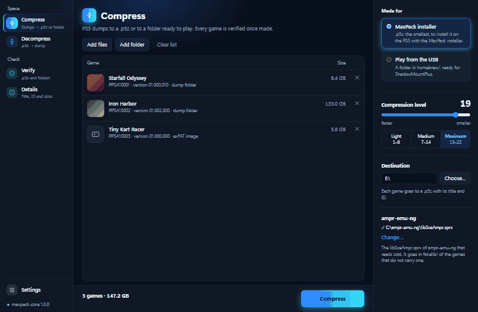
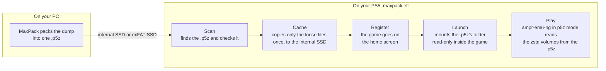
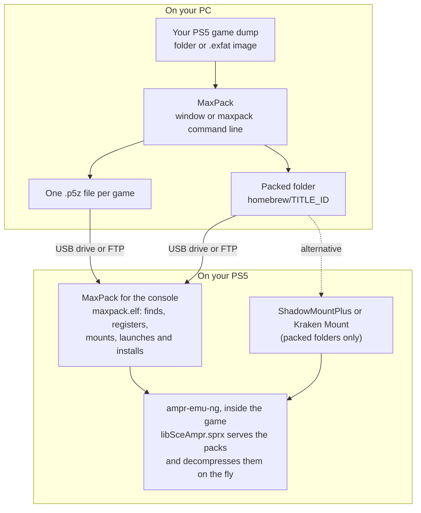

<p align="center"></p>

<h1 align="center">MaxPack</h1>

<p align="center"><b>Pack a PS5 game you own into one <code>.p5z</code> file, about half its size, and play it straight from that file on the console, without unpacking it.</b></p>

<p align="center">
  <a href="https://ko-fi.com/delfus77"></a>
  <a href="LICENSE"></a>
  <a href="https://github.com/DeLFuS77/maxpack/releases"></a>
  <a href="https://github.com/DeLFuS77/maxpack/actions/workflows/build.yml"></a>
  
</p>

<p align="center">
  <a href="https://github.com/DeLFuS77/maxpack/releases/latest"><b>Download</b></a> ·
  <a href="docs/guide.md"><b>User guide</b></a> ·
  <a href="https://github.com/DeLFuS77/maxpack-ps5"><b>MaxPack for the console</b></a> ·
  <a href="https://github.com/DeLFuS77/maxpack-ps5/blob/main/docs/compatibility.md"><b>Compatibility</b></a>
</p>



- **Played on a real PS5.** Three games started straight from their `.p5z` on firmware 13.60, from the
  internal SSD and from an external M.2 SSD over USB-C ([results](#tested-on-a-real-ps5)).
- **40–70 % smaller** on the games tested: 7.8 → 2.3 GiB, 69.0 → 33.2 GiB and 124.4 → 74.1 GiB.
- **Ready in seconds.** Only the small loose files are copied to the console, once (213 MB in 3.4 s,
  337 MB in 6.4 s); the packs are read from the `.p5z` while you play.
- **Checked and reversible.** A `.p5z` holds the SHA-256 of every file: `maxpack verify` checked a
  35.5 GB one in 70 s, and `maxpack unpack --original` gives the dump back bit for bit.
- **Repair data, if you want it.** A `.p5z` can carry standard PAR2 repair data next to it (1, 5 or
  10 % of its size), and MaxPack repairs a damaged `.p5z` with it back to the exact bytes it was made
  with.

> [!NOTE]
> **Status: first public release, help us test.** MaxPack 1.0.0 is the first public release. It has
> been tested on one console (firmware 13.60) with a handful of games, so expect rough edges. Testing
> on other firmwares, games and drives is the most useful help right now:
> [here is how](#help-test-maxpack).

<p align="center">
  <a href="https://ko-fi.com/delfus77"></a>
  <br>
  <sub>❤️ Free and open source, and it will stay free. If it saves you time, a coffee helps keep it going.</sub>
</p>

MaxPack packs a PS5 game you own into **zstd packs** that the console reads *while you play*: the game
is never decompressed to full size, not on the PC and not on the PS5. You get one `.p5z` file per game
(or a folder ready to play), you can keep it on a USB drive and play it straight from there with
[MaxPack for the console](https://github.com/DeLFuS77/maxpack-ps5), and you can always turn it back
into the original dump, bit for bit.

This repository is the **PC side** and the **hub** of the project: the desktop app for Windows, macOS
and Linux, the `maxpack` command line, the [complete user guide](docs/guide.md) and the
[`.p5z` format](docs/p5z-format.md). New here? Start with the [quick start](#quick-start) below.

## Contents

- [Why MaxPack exists](#why-maxpack-exists)
- [Quick start](#quick-start)
- [Why .p5z](#why-p5z)
- [How playing a .p5z works](#how-playing-a-p5z-works)
- [Tested on a real PS5](#tested-on-a-real-ps5)
- [Compressed and playable at once](#compressed-and-playable-at-once)
- [The MaxPack family](#the-maxpack-family)
- [Features](#features)
- [Numbers](#numbers)
- [Requirements](#requirements)
- [Download](#download)
- [What goes on the internet](#what-goes-on-the-internet)
- [Documentation](#documentation)
- [FAQ](#faq)
- [Status](#status)
- [Build from source](#build-from-source)
- [Help test MaxPack](#help-test-maxpack)
- [Legal and disclaimer](#legal-and-disclaimer)
- [Credits and licence](#credits-and-licence)

## Why MaxPack exists

The goal was to make PS5 games take less space and still play them. It went like this:

1. **Dumps are huge.** A PS5 game dump is often 70–130 GB, and the console's SSD fills up after a
   handful of them.
2. **Measure first.** `maxpack analyze` sorts every file of a dump into what the console must load as
   a plain file (`eboot.bin`, modules, `sce_sys/`, `fakelib/`) and what can be packed, measures how well
   a sample compresses at each zstd level, and finds duplicate blocks and files.
3. **zstd, read while playing.** zstd decompresses fast enough to feed a running game, and
   ampr-emu-ng, quer3q's replacement for the system's `libSceAmpr`, serves the packs from inside the
   game: they are never decompressed to disk.
4. **One file per game.** The `.p5z` holds the packs and the SHA-256 of every file, and is 40–70 %
   smaller on the games tested.
5. **Play it as it is.** MaxPack for the console, built on quer3q's Kraken Mount, plays the `.p5z`
   from its drive, and a new p5z mode in ampr-emu-ng reads the packs from inside the file.
6. **Test on a real PS5.** A mechanical USB hard drive was too slow; an SSD was fine, at about 2 ms per
   read. Some dumps' backport libraries, or a bundled emulator, stopped a game at a black screen or
   at its add-on check on newer firmware: hence the per-game **Fakelib** setting.

## Quick start

1. **Download** MaxPack for your PC and `maxpack.elf` for the console (see [Download](#download)).
2. **Pack your dump.** Open MaxPack, drop the dump on **Compress**, leave **Made for** on **MaxPack
   installer** and press **Compress**. The game is verified when it finishes and ends up as
   `<Title> [<TITLE_ID>].p5z`.
3. **Copy the `.p5z`** to `homebrew/` on the console's internal SSD (`/data/homebrew`, over FTP in
   [binary mode](docs/guide.md#copy-files-over-ftp)) or on an exFAT SSD that you plug into the PS5.
4. **Load `maxpack.elf`** on the PS5: with kstuff loaded, send it to your ELF loader on port 9021.
5. **Play.** MaxPack copies the game's loose files to its cache and puts the game on the home screen.
   Start it there, or press **Play** on `http://<PS5 IP>:8095` from the PS5 browser or your phone.

Step by step, with every screen and the common problems: [the guide](docs/guide.md#2-the-quick-way).
Using ShadowMountPlus or Kraken Mount instead? Choose **Play from the USB** in step 2 and follow
[way C of the guide](docs/guide.md#c-with-shadowmountplus-or-kraken-mount-without-maxpack-on-the-console).

## Why .p5z

A `.p5z` is one game in one file: compressed, checked and still playable. Compared with the usual ways
of keeping a dump:

| | Dump folder | `.exfat` image | `.ffpkg` image | **`.p5z`** |
|---|---|---|---|---|
| Files per game | A folder, often thousands of files | One | One | **One** |
| Size | The dump's full size | The dump's full size | The dump's full size | **40–70 % smaller** on the games tested |
| Checks its own contents | No | No | No | **Yes:** the SHA-256 of every file, checked by `maxpack verify` |
| Played on the PS5 with | MaxPack for the console, ShadowMountPlus or Kraken Mount | ShadowMountPlus | ShadowMountPlus | **MaxPack for the console**, straight from the file |

What a `.p5z` gives you:

- **One file per game**, easy to back up, copy and carry on the PC or on a USB drive.
- **About half the size**: 40–70 % smaller on the games tested ([results](#tested-on-a-real-ps5)).
- **Checked**: it records the SHA-256 of every file of the dump, and `maxpack verify` checks them all.
- **Repairable**: with standard PAR2 repair data next to it, a damaged `.p5z` is repaired back to its
  exact bytes (the PC window makes and uses it; any PAR2 tool can too).
  A cut or damaged `.p5z` is detected as soon as it is opened.
- **Plays without unpacking**: only the small loose files (`eboot.bin`, modules, `sce_sys/`...) are
  copied once to the console's cache on the internal SSD; the packs are read from the `.p5z` while you
  play.
- **Never a dead end**: `maxpack unpack --folder` turns it into a packed folder, and
  `maxpack unpack --original` into the original dump, bit for bit, whenever you want.

Keep in mind:

- A `.p5z` is played by **MaxPack for the console**, not by ShadowMountPlus or Kraken Mount. For them,
  unpack it on the PC (`--folder`), or let the installer of MaxPack for the console turn it into a
  packed folder on the console (it also works while ShadowMountPlus runs).
- A `.p5z` over 4 GiB needs an **exFAT** drive or the internal SSD: FAT32 cannot hold it.

## How playing a .p5z works



1. **Pack, on the PC.** The zstd volumes go into the `.p5z` raw, as they are; the loose files and the
   indexes go in compressed frames, with the SHA-256 of every file ([format](docs/p5z-format.md)).
2. **Scan.** `maxpack.elf` finds the `.p5z` in `homebrew/` of the internal SSD, an M.2 or a USB drive
   (or in a USB drive's root), and checks it. A damaged one is listed apart, never as a game.
3. **Cache.** Only the loose files (`eboot.bin`, modules, `sce_sys/`, the indexes) are copied, once, to
   `/data/maxpack/caches/<TITLE_ID>` on the internal SSD, which needs their size plus 256 MiB free. A
   small `maxpack.image` next to them says where each volume sits inside the `.p5z`.
4. **Register.** The game goes on the home screen like any other. If you move the `.p5z` to another
   drive, MaxPack recognises it and copies nothing again.
5. **Launch and play.** MaxPack mounts the folder that holds the `.p5z` read-only inside the game, with
   MaxPack's ampr-emu-ng in its `fakelib/`. It starts in **p5z mode**
   (`ampr-emu-ng: v0.5.1 (p5z) running`), checks the `.p5z`, and reads the zstd volumes from inside it,
   decompressing each 256 KiB block only when the game asks for it.

## Tested on a real PS5

24 November 2026, one PS5 on firmware 13.60, with MaxPack for the console. Each game was played straight
from its `.p5z`, without unpacking it:

| | Original → `.p5z` | Smaller by | Volumes | Drive | Loose files in the cache | Result |
|---|---|---|---|---|---|---|
| **Game A** | 7.8 → 2.3 GiB | 70 % | 1 | Internal SSD | 213 MB, ready in 3.4 s | Plays, saves and loads |
| **Game B** | 69.0 → 33.2 GiB | 51 % | 9 | External M.2 SSD over USB-C | 337 MB, ready in 6.4 s | Played without problems |
| **Game C** | 124.4 → 74.1 GiB | 40 % | 19 | The same M.2 SSD | | Reaches the main menu and opens its saves, with only ampr-emu-ng in its `fakelib/` (what Fakelib **Off** does) |

<sub>Sizes in GiB, as the console page shows them.</sub>

- **On the PC**, game B (74 GB) became a 35.5 GB `.p5z` in 14.5 minutes at zstd 19 on a 32-thread
  PC, and `maxpack verify` checked it in 70 s.
- **Reads from the `.p5z`** took about 2 ms each on average on the M.2 SSD. A launch reads about
  1.5–2.5 GB in its first 20 s.
- **A mechanical USB hard drive is far too slow** for a large `.p5z`: the game never got past its first
  screen. Use the internal SSD, or an SSD on a 10 Gbps USB port.
- **Game C needed Fakelib Off.** With the backport libraries its dump carries, or with a bundled
  emulator, it did not get that far on this console. During the test its `fakelib/` was set by hand to
  hold only ampr-emu-ng, which is what the per-game
  [Fakelib](https://github.com/DeLFuS77/maxpack-ps5#fakelib-per-game) setting **Off**, new in 1.0.0,
  does for you.

Every game tried, with firmware, mounter and result, goes into the
[compatibility list](https://github.com/DeLFuS77/maxpack-ps5/blob/main/docs/compatibility.md). Tried
one? On the console page, open the game's sheet, press **Copy report** (it has the row ready) and paste
it in a [Game report](https://github.com/DeLFuS77/maxpack-ps5/issues/new?template=game_report.yml),
whether it worked or not.

## Compressed and playable at once

PS5 games are **huge**. A single modern game can take well over 100 GB, the console's internal SSD
fills up after a handful of them, and every extra terabyte of fast storage costs money.

Plain compression (a `.zip`, a `.7z`) does not help: the console cannot play from it, so you would
have to unpack the whole game again before every session. What is needed is a way to keep a game
**compressed and playable at the same time**:

- **small on the PC**, as a single file that is easy to store, copy and verify;
- **small on the console**, where only the few files the system must load directly (executables,
  `sce_sys/`, `fakelib/`...) are stored as they are, and everything else stays packed;
- **decompressed only when the game reads it**, a block at a time, by a runtime that lives inside the
  game;
- **reversible**: the original dump can always be rebuilt and checked, file by file, with SHA-256.

MaxPack does exactly that. It builds on the zstd pack format that
[ampr-emu-ng](https://github.com/quer3q/ampr-emu-ng) already reads on the console, squeezes it harder
(zstd level 19 by default instead of the usual low levels, every packable file packed), wraps the
result in a single verifiable `.p5z` file and adds the tools to play that file directly on the PS5.

## The MaxPack family

MaxPack is made of three projects that work together. Each one lives in its own repository and has
its own releases. **This one is the hub**: the guide, the downloads for the PC and the quick start.



| Repository | Runs on | What it does |
|---|---|---|
| [**DeLFuS77/maxpack**](https://github.com/DeLFuS77/maxpack) | PC: Windows, macOS, Linux | Compresses a dump into zstd packs (one `.p5z` or a ready-to-play folder), verifies it and gives back the original bit for bit. Hosts the user guide. |
| [**DeLFuS77/maxpack-ps5**](https://github.com/DeLFuS77/maxpack-ps5) | PS5, as a payload | `maxpack.elf`: finds games, puts them on the home screen, mounts and launches them, plays a `.p5z` without unpacking it and installs games, from a web page on port 8095. |
| [**DeLFuS77/ampr-emu-ng**](https://github.com/DeLFuS77/ampr-emu-ng) | PS5, inside each game | `libSceAmpr.sprx`: answers the game's reads from the packs and decompresses them on the fly. MaxPack's copy adds the `p5z` mode. |

**Why three pieces?**

- **Compress on the PC, where it is fast.** Packing is heavy, multi-threaded work: a desktop CPU packs
  and checks a 133 GB game in under half an hour. It is done once, and the console never compresses
  anything.
- **The console only mounts and plays.** The payload finds games, registers them on the home screen
  and mounts them when they start. It does not rewrite the game, so a `.p5z` can stay on its USB
  drive as it is.
- **The runtime must live inside the game.** A PS5 game asks the system library `libSceAmpr` and the
  file system for its data. Only a library loaded into the game's own process, from its `fakelib/`
  folder, can answer those reads from compressed packs. That library is ampr-emu-ng, and it is a
  project of its own so that it also works under ShadowMountPlus and Kraken Mount.
- **Each piece follows its upstream.** The payload is based on quer3q's Kraken Mount and the runtime
  on quer3q's ampr-emu-ng. Keeping them apart keeps their history and their licences, and makes it
  easy to merge what upstream improves.

## Features

### A window anyone can use

Drop your dumps on the window, choose what they are for and press **Compress**. Everything the command
line does is there, without typing a command.

| Light theme | Dark theme |
|---|---|
|  |  |

- **Five sections:** **Compress** (dumps to `.p5z` or folder), **Decompress** (`.p5z` back to a dump),
  **Verify** (`.p5z` files and folders), **Details** (title, ID, version, sizes, files, packs) and
  **Rename** (names `.p5z` files, dump folders and images by what each holds, shown before anything
  changes).
- **Two outputs**, chosen in **Made for**: **MaxPack installer** (one `.p5z` per game, the smallest)
  or **Play from the USB** (a folder in `homebrew/<TITLE_ID>`, ready for ShadowMountPlus or Kraken
  Mount).
- **Compression level** 1 to 22 (19 by default), with the shortcuts Light, Medium and Maximum.
  **Compare the levels on this PC** compresses a sample of a game at levels 3, 9, 15 and 19 and shows
  the size, the saving and the time of each here, to choose one from the table.
- **Folders and `.exfat` images** as input; **Add folder** takes several folders at once, and each one
  can be a game or a folder full of games. Games added to a section while its queue runs join the
  queue.
- **File names by a template** (Settings > File names): `{title} [{id}]` by default, or with the
  version and the region (`{title} [{id}] [{region}] [v{version}]`), with a preview.
- **Low priority** (Settings): the engine runs below the other programs, so the PC stays usable.
- **Measure this PC** (Settings): about half a minute, with no game, to find the fewest threads that
  compress as fast as all of them, and the speed of the destination's disk; Compress then uses them.
- **Copy report** (Details, the end of a queue, Settings > About): a text for an issue with the
  versions, the system and the settings, and no game names.
- **Eleven languages** (English, Russian, Chinese, German, Spanish, French, Japanese, Portuguese,
  Italian, Korean and Arabic, written right to left), starting in your system's language.
- **In the Windows Explorer**, if you want (Settings or the installer, each off until you turn it on,
  for you only): **Compress with MaxPack** on a right click of a folder or an image, **Verify with
  MaxPack** and **Details** on a `.p5z`, **Send to › MaxPack**, and a double click on a `.p5z` that shows
  its card in Details, with Verify and Decompress. The portable version writes nothing in Windows.
- **Light and dark themes**, a single window (opening more games adds them to it, from the Explorer too),
  progress on the Windows taskbar or the macOS Dock, a system notification when it ends, and the PC kept
  awake while there is work.

<p align="center"> </p>
<p align="center"><sub>Left: work in progress, with speed and time left. Right: the summary at the end. The games in the screenshots are made-up samples.</sub></p>

### Every game verified, nothing half made

- **Verified when it finishes.** Each game is read back and checked as soon as it is packed.
- **Cancel is clean.** It stops the game in progress, deletes what was written and leaves the
  destination as it was.
- **Every output is written apart.** The new `.p5z` or folder is written as `<name>.maxpack-tmp`
  (hidden on Windows) and verified there; only then does it take its name. With **Replace**, only then
  is the old one deleted. If anything fails, nothing is left half made, and what a crash leaves apart is
  offered for deletion the next time MaxPack opens.
- **Originals deleted only once checked**, if you turn it on (off by default): each one goes to the
  recycle bin, or for good if you choose so, only after its new copy is made, verified and in its place,
  and never when decompressing or verifying. A folder is listed with its size before the queue starts,
  and what was removed is written to a log.
- **Repair data** (Compress, off by default): each `.p5z` can get a standard PAR2 set next to it, of 1,
  5 or 10 % of its size, made by `maxpack-par2` (par2cmdline-turbo, which comes with MaxPack) once the
  `.p5z` is made, verified and in its place. **Verify** then says how much each one can repair, offers
  **Repair** on a damaged one and repairs it back to the exact bytes it was made with, checks the
  repaired one before it replaces the damaged one, and leaves the `.p5z` as it was when it cannot. It
  can also add repair data to `.p5z` files you already have. A set is only ever used for the `.p5z` it
  was made for, and is renamed with it. See [Repair data](docs/guide.md#repair-data).
- **The space of the whole queue** is checked before anything starts, drive by drive, with the
  numbers.
- **Warnings before trouble:** a FAT32 destination for a game over 4 GiB, too little free space, a
  destination inside the game itself, two games going to the same place, and a `libSceAmpr.sprx` that
  cannot read zstd packs.
- **The source is never touched.** MaxPack never writes to the dump it reads, refuses an output that is
  not empty, and refuses games that are already packed.

### Two ways to take a game to the PS5

| | **`.p5z` file** (Made for: MaxPack installer) | **Packed folder** (Made for: Play from the USB) |
|---|---|---|
| What you get | One file, `<Title> [<TITLE_ID>].p5z` | A folder, `homebrew/<TITLE_ID>` |
| Size | The smallest: loose files and indexes are compressed too | Slightly larger: loose files stay as they are |
| Played with | [MaxPack for the console](https://github.com/DeLFuS77/maxpack-ps5), straight from the file, or installed by it | MaxPack for the console, ShadowMountPlus or Kraken Mount |
| Rebuild the original dump | Yes, bit for bit, every file checked against its SHA-256 | No, but `verify --against` compares it with the original |
| Needs exFAT for big games | Yes, if the file is over 4 GiB | No: every part fits FAT32 |

### The `maxpack` command line

The same engine, for scripts and for measuring a game before you pack it.

| Command | What it does |
|---|---|
| `maxpack analyze <dump>` | Measures, from a sample or the whole game, what each zstd level, deduplication, small-file grouping and the `.p5z` would save, without writing anything. [How to read it](docs/analyze-report.md). |
| `maxpack analyze <dump> --levels` | Compares levels (3, 9, 15 and 19, or the ones given) on this PC: a sample packed with `pack`'s own code tells the `.p5z` and folder sizes and the time to pack the whole game. |
| `maxpack pack <dump> -o <out>` | Packs into a folder (`--folder`, the default) or a single file (`--p5z`). Options for the level, threads, the runtime to put in `fakelib/`, files to keep loose and a size cap for FAT32. |
| `maxpack unpack <game.p5z>` | `--folder` gives the folder for the console; `--original` rebuilds the original dump bit for bit and checks every SHA-256. |
| `maxpack verify <game.p5z or folder>` | Checks every file; `--against <dump>` also compares a folder with the original. |
| `maxpack info`, `info --json`, `icon` | Title, ID, version, files, packs and sizes, for people or as JSON (which also says the content ID); extracts the game's icon. |
| `maxpack measure [<folder>]` | Measures this PC with no game: packing speed at 25, 50, 75 and 100 % of its threads, the threads to use, and the disk of a folder (a temporary file, deleted). |
| `--version`, `--capabilities` | The engine and library versions; what this build can do, as JSON. |

- **Deterministic:** the same input and options give the same bytes with any number of threads.
- **Made to be driven:** `--progress json` prints one JSON line per event and `--control stdin`
  cancels cleanly. Exit codes: 0 success, 1 error, 2 wrong usage, 130 cancelled.
- Full reference, with examples: [the guide, section 6](docs/guide.md#6-the-command-line).

### The `.p5z` format

One file per game: a 64-byte header, the zstd volumes **stored raw** (so installing them is copying,
and the console can read them in place), the loose files and indexes in independent zstd frames, a
compressed index with the **SHA-256 of every file** of the original dump, and a footer written last,
so a truncated or damaged file is detected as soon as it is opened. Fully documented in
[docs/p5z-format.md](docs/p5z-format.md).

### What happens on the console

On the PS5, [MaxPack for the console](https://github.com/DeLFuS77/maxpack-ps5) finds your `.p5z`
files and folders, puts them on the home screen and plays them. A `.p5z` stays on its USB drive or
disk: only its few loose files are copied to the internal SSD, and the packs are read from the file
itself ([how](#how-playing-a-p5z-works)). The same C engine as this repository is built into it, for
the installer and for reading `.p5z` files. If a game shows a black screen or stalls while checking
add-ons, its [Fakelib](https://github.com/DeLFuS77/maxpack-ps5#fakelib-per-game) setting, new in 1.0.0,
chooses which libraries go into it.


## Numbers

Measured on the PC with real dumps, at the default level (zstd 19), on Windows 11 with a
16-core / 32-thread desktop CPU and an NVMe drive:

| Game | Original | Packed by MaxPack | Saved | Packing time |
|---|---|---|---|---|
| An indie game (2,165 files) | 8.39 GB | **2.33 GB** as one `.p5z` | **−72 %** | 128 s (95 s as a folder) |
| A large AAA game (49 files, the biggest 72 GB) | 133.59 GB | **79.32 GB** as one `.p5z` | **−41 %** | about 24 minutes |

- Both were verified with zero failures: 2,168 files for the first, every stored and packed file
  against its SHA-256 for the second.
- The first was also rebuilt to the original dump, and every file matched an independent SHA-256.
- `maxpack analyze`, from a small sample, predicted the result within 2.7 % and 0.9 %.
- How much you save depends on the game: already-compressed video and audio shrink little, while
  textures, levels and data often shrink a lot. Run `maxpack analyze` to know before you pack.

The full measurements are in [docs/reports/phase1.md](docs/reports/phase1.md). What happened when
`.p5z` files were played on a console is in [Tested on a real PS5](#tested-on-a-real-ps5), and every
game tried is in the
[compatibility list](https://github.com/DeLFuS77/maxpack-ps5/blob/main/docs/compatibility.md).

## Requirements

**On the PC**

- 64-bit Windows; macOS 13 or later (Apple silicon or Intel); or 64-bit Linux with GTK 3 and
  WebKitGTK 4.1.
- Your own game dump, as a folder or an `.exfat` image. PKG, `.ffpkg`, `.ffpfs` and `.ffpfsc` cannot be
  compressed yet.
- Free space at the destination. MaxPack warns you before it starts when the queue may not fit.
- Nothing else for the runtime: the window comes with
  [MaxPack's ampr-emu-ng](https://github.com/DeLFuS77/ampr-emu-ng) (`libSceAmpr.sprx`) and puts it in the
  `fakelib/` of games that do not carry one that reads zstd.

**On the PS5**

- A jailbroken PS5 with kstuff and an ELF loader on port 9021 (elfldr, etaHEN or a payload manager).
- [MaxPack for the console](https://github.com/DeLFuS77/maxpack-ps5/releases) to play a `.p5z`, or
  ShadowMountPlus or Kraken Mount for packed folders.
- For a `.p5z`, a fast drive: the internal SSD, or an SSD on a 10 Gbps USB port, formatted **exFAT**
  for any `.p5z` over 4 GiB (FAT32 cannot hold files that big). A mechanical hard drive is too slow
  for a large `.p5z`.

## Download

Packages are in **[Releases](https://github.com/DeLFuS77/maxpack/releases)**.

| System | File |
|---|---|
| Windows | `maxpack-windows-x64-setup.exe` (installer, no administrator rights) or `maxpack-windows-x64-portable.zip` |
| macOS, Apple silicon (M1 or later) | `maxpack-macos-apple-silicon.dmg` |
| macOS, Intel | `maxpack-macos-intel.dmg` |
| Linux | `maxpack-linux-x64.tar.gz`, with an `install.sh` |

The programs are not signed: Windows shows "Windows protected your PC" (press **More info**, then
**Run anyway**) and on macOS you open them the first time with a right click, **Open**.
[The guide](docs/guide.md#3-download-and-install) explains each system. For the console, download
`maxpack.elf` from the [maxpack-ps5 Releases](https://github.com/DeLFuS77/maxpack-ps5/releases).

### Check what you download

- **`SHA256SUMS`.** Every release has one: `sha256sum -c --ignore-missing SHA256SUMS` checks the files
  you downloaded (on Windows, compare with `Get-FileHash <file>`).
- **Build attestation.** Each file also has one, signed through GitHub, which proves it was built by
  this repository's workflow from the tagged commit: `gh attestation verify <file> -R DeLFuS77/maxpack`
  checks it.
- **Immutable releases.** Once a release is published, its files cannot be replaced.
- **On the console**, the self-update of MaxPack for the console only takes that repository's
  releases, checks the download against their `SHA256SUMS`, and stays off until the console has passed
  **Check secure connections** (it must refuse forged certificates).

## What goes on the internet

Nothing, from MaxPack itself:

- **The window** makes no connection of its own. It does not look for new versions, sends nothing about
  you or your games, and loads its page from inside the program. That is why Settings has no switch
  for it: there is nothing to turn off.
- **The command line** (`maxpack`, the engine) never goes on the internet.
- **The links** of the window (Settings > About: Report a bug, Report a game) open in your browser, and
  only when you click them.
- **Windows only:** the window is drawn by Microsoft's WebView2, which Windows 10 and 11 already have.
  If it is missing or too old, MaxPack asks before its window opens whether to install it; only if you
  say yes does Microsoft's installer, which comes inside MaxPack, download it from Microsoft.

MaxPack for the console is another program, with its own self-update: see
[maxpack-ps5](https://github.com/DeLFuS77/maxpack-ps5).

## Documentation

| Document | What is in it |
|---|---|
| [docs/guide.md](docs/guide.md) | **The complete user guide**: download, the PC window, the console, ShadowMountPlus and Kraken Mount, the command line, common problems, what is tested. |
| [docs/pc-window.md](docs/pc-window.md) | The PC window section by section, with every warning it can show. |
| [docs/p5z-format.md](docs/p5z-format.md) | The `.p5z` file format, byte by byte. |
| [docs/analyze-report.md](docs/analyze-report.md) | How to read the `maxpack analyze` report. |
| [docs/test-on-ps5.md](docs/test-on-ps5.md) | Trying a packed game by hand on the console. |
| [docs/design/](docs/design/maxpack.md) | The design documents: goals, constraints, the window, the installer. |
| [CHANGELOG.md](CHANGELOG.md) | What changed in each version. |
| [SECURITY.md](SECURITY.md) | How to report a vulnerability, and what to keep in mind. |

The console side has its own documents in [maxpack-ps5](https://github.com/DeLFuS77/maxpack-ps5#documentation),
and the runtime's p5z mode is in [ampr-emu-ng](https://github.com/DeLFuS77/ampr-emu-ng/blob/main/docs/p5z-mode.md).

## FAQ

<details>
<summary><b>Is the game decompressed on the console?</b></summary>

No. Only the files the system must load as plain files stay loose: executables and modules
(`eboot.bin`, `*.elf`, `*.self`, `*.prx`, `*.sprx`), `sce_sys/`, `sce_module/`, `fakelib/` and `.ini`
files. Everything else stays in the packs, and ampr-emu-ng decompresses each 256 KiB block only when
the game reads it.
</details>

<details>
<summary><b>Does a compressed game load slower?</b></summary>

zstd decompresses about as fast at level 19 as at low levels, so the high level costs time on the PC,
not on the console. On a real PS5, reads from a `.p5z` on an external M.2 SSD took about 2 ms each,
and two of the three games tested played without problems ([results](#tested-on-a-real-ps5)). What
matters most is the drive: see the next question. A side-by-side timing of the same game as a packed
folder and as a `.p5z` has not been done yet.
</details>

<details>
<summary><b>Which drive should I play a <code>.p5z</code> from?</b></summary>

- **The internal SSD** is the best.
- **An external SSD or M.2 over USB 3, on a 10 Gbps port**, works well: games of 33 and 74 GiB ran
  from an M.2 SSD over USB-C.
- **A mechanical hard drive** is not recommended for a `.p5z`: with a large game it was far too slow to
  get past the first screen.
- Format external drives **exFAT**: FAT32 cannot hold a file over 4 GiB.

Wherever the `.p5z` is, its loose files go to the internal SSD, which needs their size plus 256 MiB free.
</details>

<details>
<summary><b>A game shows a black screen or stalls while checking add-ons</b></summary>

Open its sheet on the console page and change **Fakelib** (new in 1.0.0): try **Emulators only**, then
**Off**. The backport libraries a dump carries, or a bundled emulator, may not suit every console;
**Off** keeps only ampr-emu-ng, which a `.p5z`, a `.pkg` or a packed folder needs.
[More](https://github.com/DeLFuS77/maxpack-ps5#fakelib-per-game).
</details>

<details>
<summary><b>Can I get my original dump back?</b></summary>

Yes. **Decompress** a `.p5z` to "Original dump (bit for bit)", or run
`maxpack unpack game.p5z --original -o <folder>`. Every file is checked against the SHA-256 recorded
when it was packed. An `.exfat` image comes back as a folder with its files, not as an image.
</details>

<details>
<summary><b>Does MaxPack touch my saves or trophies?</b></summary>

No. A game dump contains no saves, and MaxPack only reads the dump and writes the packed copy. On the
console, saves and trophies are kept by the console's own services, outside the game files, so packing
or unpacking a game does not change them. Back up your saves anyway: see the
[disclaimer](#legal-and-disclaimer).
</details>

<details>
<summary><b>Does it work with ShadowMountPlus or Kraken Mount?</b></summary>

Yes, for **packed folders** ("Play from the USB"): the game must carry MaxPack's ampr-emu-ng in its
`fakelib/` (the window puts the one that comes with it there by itself), and with ShadowMountPlus you
leave its `auto_update_ampr` option off ([why](docs/guide.md#shadowmountplus-replaces-ampr-emu-ng-and-the-game-does-not-start)).
Playing a **`.p5z`** without unpacking it needs MaxPack for the console, which can also run next to
them: it simply waits while another mounter is running.
</details>

<details>
<summary><b>FAT32 or exFAT?</b></summary>

exFAT. FAT32 cannot hold a file over 4 GiB, and most `.p5z` files are bigger. MaxPack warns you before
it starts; you can switch to a packed folder (every part fits FAT32) or go on, and MaxPack stops and
cleans up if the file reaches the limit.
</details>

<details>
<summary><b>Which games work?</b></summary>

The ones tested so far, with firmware, mounter and result, are in the
[compatibility list](https://github.com/DeLFuS77/maxpack-ps5/blob/main/docs/compatibility.md). If a
game opens a file with `mmap`, that file cannot be packed: pack again with `--keep-loose "<pattern>"`.
Tried a game? Please [report it](#help-test-maxpack), whether it worked or not.
</details>

<details>
<summary><b>Can it compress PKG or ShadowMountPlus images?</b></summary>

Not yet: the input is a dump folder or an `.exfat` image. MaxPack for the console can still *install*
`.ffpkg`, `.ffpfs` and `.ffpfsc` images as they are.
</details>

## Status

MaxPack **1.0.0** is the first public release. Honestly, this is where it stands:

| Area | State |
|---|---|
| Packing, verifying and rebuilding on the PC | Tested with real dumps (from 8 GB to 133 GB, zero failures) and on every change in GitHub Actions, on Windows, Linux and macOS. |
| A packed folder on a real PS5 | **Tested**: firmware 13.60, ShadowMountPlus 1.7beta12, with MaxPack's ampr-emu-ng; the game boots, saves and loads. The first build of MaxPack for the console mounted, launched and cleaned up that game 3 times. |
| Playing a `.p5z` without unpacking it | **Tested on a real PS5**: firmware 13.60, three games with 1, 9 and 19 volumes, from the internal SSD and an external M.2 SSD over USB-C ([results](#tested-on-a-real-ps5)). Still to do: a side-by-side timing against a packed folder, and more games, firmwares and drives. |
| The console's library, Play, installer, hide, crash report, self-update | Done and tested on the PC; their pass through the console checklist is still under way. |
| The Windows installer | Tested automatically, not yet by hand with the wizard. If it fails, use the portable zip. |

The console checklist still to go is in
[docs/console-tests.md](https://github.com/DeLFuS77/maxpack-ps5/blob/main/docs/console-tests.md)
(maxpack-ps5). Always keep your original dump until a packed game has worked for you.

## Build from source

You need git, CMake 3.20 or later and a C compiler. zstd 1.5.6 and zlib 1.3.1 come as submodules, so
clone with `--recursive` (or run `git submodule update --init` after cloning).

```
git clone --recursive https://github.com/DeLFuS77/maxpack.git
cd maxpack
```

<details>
<summary><b>Windows</b></summary>

Visual Studio 2022/2026 (or Build Tools) with the **Desktop development with C++** workload,
**including the Windows 11 SDK component**: without the SDK, CMake says "No CMAKE_C_COMPILER could be
found". Python 3 is also needed for the tests.

```
cmake -S . -B build
cmake --build build --config Release
ctest --test-dir build -C Release --output-on-failure
```

The executable ends up in `build\Release\maxpack.exe`.
</details>

<details>
<summary><b>Linux</b></summary>

```
sudo apt install build-essential cmake python3
cmake -S . -B build -DCMAKE_BUILD_TYPE=Release
cmake --build build -j
ctest --test-dir build --output-on-failure
```
</details>

<details>
<summary><b>macOS</b></summary>

```
xcode-select --install
brew install cmake python
cmake -S . -B build -DCMAKE_BUILD_TYPE=Release
cmake --build build -j
ctest --test-dir build --output-on-failure
```
</details>

The window is a [Wails](https://wails.io) app in [gui/](gui/) that drives this same engine
(`maxpack-core`) next to it, and `maxpack-par2` for the repair data: par2cmdline-turbo, a submodule
(`third_party/par2cmdline-turbo`) that the CI builds with its own build files (MSBuild on Windows,
autotools on Linux and macOS: see `.github/workflows/build.yml`).

**Continuous integration.** GitHub Actions, on every change: builds the engine and runs all its tests
(`ctest`) on Windows and Linux; builds `maxpack`, `maxpack-par2` and the window on Windows, Linux and
macOS (Apple silicon and Intel), runs the window's Go tests with that engine and `maxpack-par2` and makes
the packages; and, with a
`vX.Y.Z` tag, puts them in a draft release with their `SHA256SUMS` and a build attestation for each.

**Tests.** `ctest` generates synthetic exFAT images (`tests/tools/make_exfat.py`) with long and emoji
names, fragmented files, a ValidDataLength smaller than the size, truncated images and a looping FAT.
`tools/exfat_ref.py` is an independent exFAT reader in Python, used to cross-check the C reader against
real images (`tests/tools/compare_ranges.py`).

## Help test MaxPack

MaxPack has run on one console so far. Every report from another firmware, game or drive helps, and a
game that works is as useful to know as one that does not. English or Spanish are both fine.

- **Tried a game?** Open a
  [Game report](https://github.com/DeLFuS77/maxpack-ps5/issues/new?template=game_report.yml). On the
  console page, the game's **Copy report** fills most of it and has the row ready for the
  [compatibility list](https://github.com/DeLFuS77/maxpack-ps5/blob/main/docs/compatibility.md), where
  the result goes.
- **Found a bug?** Open a Bug report where it happens:
  [on the PC](https://github.com/DeLFuS77/maxpack/issues/new?template=bug_report.yml),
  [on the console](https://github.com/DeLFuS77/maxpack-ps5/issues/new?template=bug_report.yml) (paste
  the game's **Copy report**: it fills most of the form) or
  [in the runtime](https://github.com/DeLFuS77/ampr-emu-ng/issues/new/choose).
- **Always say** which firmware, drive (internal SSD, USB SSD, hard drive, M.2) and loader you used,
  and the mounter if it was not MaxPack.

An idea? Open a [feature request](https://github.com/DeLFuS77/maxpack/issues/new?template=feature_request.yml).
Security problems go privately: see [SECURITY.md](SECURITY.md).

## Legal and disclaimer

> [!IMPORTANT]
> MaxPack is for backups of games you own. Piracy is not supported.

- **Your own games only.** MaxPack (the PC app, MaxPack for the console and MaxPack's copy of
  ampr-emu-ng) is meant for backups of games you own, dumped from your own console, and for homebrew.
- **No content included.** It includes and distributes no games, firmware, keys or other copyrighted
  content, and it does not help you obtain any.
- **No circumvention.** It does not bypass, remove or weaken encryption, keys or DRM. It compresses,
  stores and serves the files of a dump, and never touches keys, encryption or DRM.
- **Piracy is not supported.** Issues, reports and questions about pirated content will not be
  answered.
- **No warranty.** It is free software provided "as is", without warranty of any kind, under the GNU
  General Public License v3.0 or later (see its sections 15 and 16). You use it at your own risk.
- **No liability.** The authors and contributors are not responsible for data loss, lost or damaged
  saves, damage to your console or your storage, bans of accounts or consoles, or any other problem
  that comes from using it. Keep your original dumps and back up your saves.
- **Not affiliated.** MaxPack is not affiliated with, endorsed or sponsored by Sony Interactive
  Entertainment. "PlayStation" and "PS5" are trademarks of their respective owners, as are any other
  names mentioned.

## Credits and licence

MaxPack is free software by DeLFuS77 under the **GPL-3.0-or-later** licence ([LICENSE](LICENSE)). The
third-party software that the packages include (zstd, zlib, ampr-emu-ng, Wails and the window's Go
libraries, and par2cmdline-turbo as `maxpack-par2`) and its licences are in
[THIRD_PARTY_NOTICES](THIRD_PARTY_NOTICES), regenerated with
`python tools/gen_third_party.py`.

MaxPack stands on the work of others:

- **quer3q**: [Kraken Mount](https://github.com/quer3q/kraken-mount) (the base of MaxPack for the
  console), [ampr-emu-ng](https://github.com/quer3q/ampr-emu-ng) (the runtime that
  DeLFuS77/ampr-emu-ng follows) and [PS5 Dump Forge](https://github.com/quer3q/ps5-dump-forge) (whose
  zstd pack format MaxPack writes).
- **drakmor**: [ShadowMountPlus](https://github.com/drakmor/ShadowMountPlus) and
  [ampr_emu](https://github.com/drakmor/ampr_emu), where the ampr-emu-ng runtime and the
  `ampr_emu.index` format come from.
- [zstd](https://github.com/facebook/zstd) (Meta) and [zlib](https://github.com/madler/zlib)
  (Jean-loup Gailly and Mark Adler), the compression.
- [Wails](https://wails.io) and the window's Go libraries (full list in `THIRD_PARTY_NOTICES`).
- [par2cmdline-turbo](https://github.com/animetosho/par2cmdline-turbo) (Anime Tosho, on
  [par2cmdline](https://github.com/Parchive/par2cmdline)), the repair data of a `.p5z`.
- The PC window follows the design of [NXPress](https://github.com/DeLFuS77/NXPress), by the same
  author.
