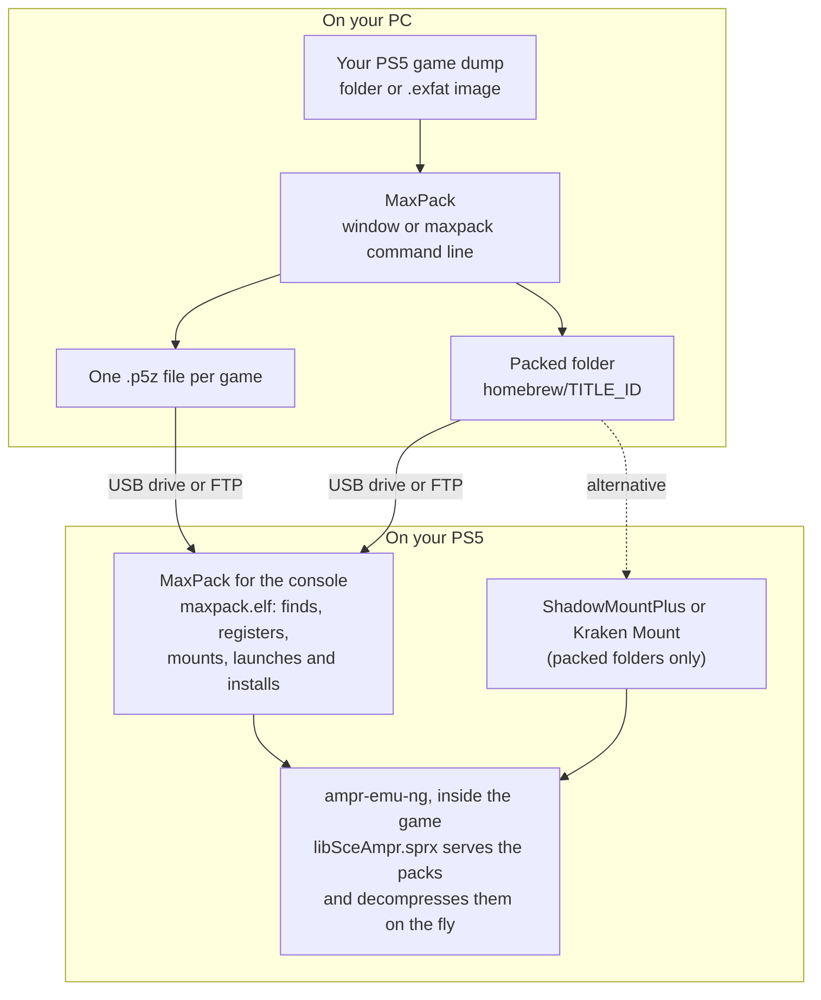
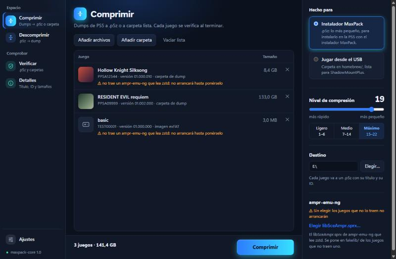
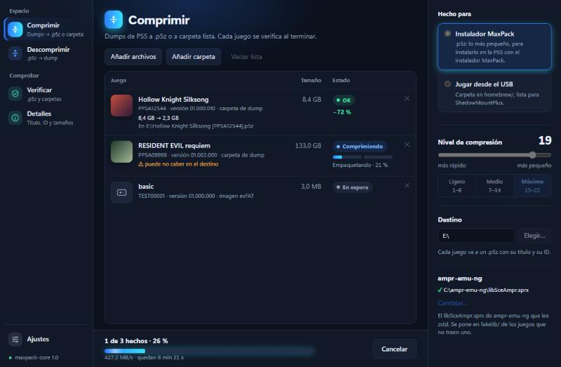
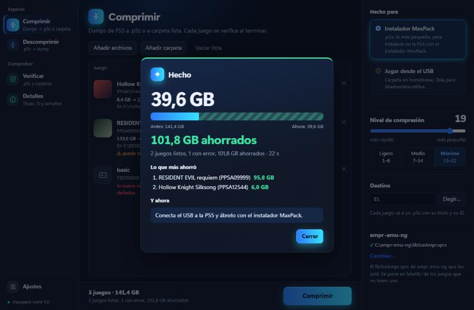

<p align="center"></p>

<h1 align="center">MaxPack</h1>

<p align="center"><b>Compress your PS5 game dumps to a fraction of their size, and still play them.</b></p>

<p align="center">
  <a href="LICENSE"></a>
  <a href="https://github.com/DeLFuS77/maxpack/releases/latest"></a>
  <a href="https://github.com/DeLFuS77/maxpack/actions/workflows/build.yml"></a>
  
</p>

<p align="center">
  <a href="https://github.com/DeLFuS77/maxpack/releases/latest"><b>Download</b></a> ·
  <a href="docs/guide.md"><b>User guide</b></a> ·
  <a href="https://github.com/DeLFuS77/maxpack-ps5"><b>MaxPack for the console</b></a> ·
  <a href="https://github.com/DeLFuS77/maxpack-ps5/blob/main/docs/compatibility.md"><b>Compatibility</b></a>
</p>


MaxPack packs a PS5 game you own into **zstd packs** that the console reads *while you play*: the game
is never decompressed to full size, not on the PC and not on the PS5. You get one `.p5z` file per game
(or a folder ready to play), you can keep it on a USB drive and play it straight from there, and you
can always turn it back into the original dump, bit for bit.

This repository is the **PC side** and the **hub** of the project: the desktop app for Windows, macOS
and Linux, the `maxpack` command line, the [complete user guide](docs/guide.md) and the
[`.p5z` format](docs/p5z-format.md).

## Contents

- [Why it exists](#why-it-exists)
- [The MaxPack family](#the-maxpack-family)
- [Features](#features)
- [Numbers](#numbers)
- [Requirements](#requirements)
- [Download](#download)
- [Quick start](#quick-start)
- [Documentation](#documentation)
- [FAQ](#faq)
- [Status](#status)
- [Build from source](#build-from-source)
- [Reporting problems](#reporting-problems)
- [Legal and disclaimer](#legal-and-disclaimer)
- [Credits and licence](#credits-and-licence)

## Why it exists

PS5 games are **huge**. A single modern game can take well over 100 GB, the console's internal SSD
fills up after a handful of them, and every extra terabyte of fast storage costs money.

Plain compression (a `.zip`, a `.7z`) does not help: the console cannot play from it, so you would
have to unpack the whole game again before every session. What is needed is a way to keep a game
**compressed and playable at the same time**:

- **small on the PC**, as a single file that is easy to store, copy and verify;
- **small on the console**, where only the few files the system must load directly (executables,
  `sce_sys/`, `fakelib/`...) are stored as they are, and everything else stays packed;
- **decompressed only when the game reads it**, a block at a time, by a runtime that lives inside the
  game;
- **reversible**: the original dump can always be rebuilt and checked, file by file, with SHA-256.

MaxPack does exactly that. It builds on the zstd pack format that
[ampr-emu-ng](https://github.com/quer3q/ampr-emu-ng) already reads on the console, squeezes it harder
(zstd level 19 by default instead of the usual low levels, every packable file packed), wraps the
result in a single verifiable `.p5z` file and adds the tools to play that file directly on the PS5.

## The MaxPack family

MaxPack is made of three projects that work together. Each one lives in its own repository and has
its own releases.



| Repository | Runs on | What it does |
|---|---|---|
| [**DeLFuS77/maxpack**](https://github.com/DeLFuS77/maxpack) | PC: Windows, macOS, Linux | Compresses a dump into zstd packs (one `.p5z` or a ready-to-play folder), verifies it and gives back the original bit for bit. Hosts the user guide. |
| [**DeLFuS77/maxpack-ps5**](https://github.com/DeLFuS77/maxpack-ps5) | PS5, as a payload | `maxpack.elf`: finds games, puts them on the home screen, mounts and launches them, plays a `.p5z` without unpacking it and installs games, from a web page on port 8095. |
| [**DeLFuS77/ampr-emu-ng**](https://github.com/DeLFuS77/ampr-emu-ng) | PS5, inside each game | `libSceAmpr.sprx`: answers the game's reads from the packs and decompresses them on the fly. MaxPack's copy adds the `p5z` mode. |

**Why three pieces?**

- **Compress on the PC, where it is fast.** Packing is heavy, multi-threaded work: a desktop CPU packs
  and checks a 133 GB game in under half an hour. It is done once, and the console never compresses
  anything.
- **The console only mounts and plays.** The payload finds games, registers them on the home screen
  and mounts them when they start. It does not rewrite the game, so a `.p5z` can stay on its USB
  drive as it is.
- **The runtime must live inside the game.** A PS5 game asks the system library `libSceAmpr` and the
  file system for its data. Only a library loaded into the game's own process, from its `fakelib/`
  folder, can answer those reads from compressed packs. That library is ampr-emu-ng, and it is a
  project of its own so that it also works under ShadowMountPlus and Kraken Mount.
- **Each piece follows its upstream.** The payload is based on quer3q's Kraken Mount and the runtime
  on quer3q's ampr-emu-ng. Keeping them apart keeps their history and their licences, and makes it
  easy to merge what upstream improves.

## Features

### A window anyone can use

Drop your dumps on the window, choose what they are for and press **Compress**. Everything the command
line does is there, without typing a command.

| Light theme | Dark theme |
|---|---|
|  |  |

- **Four sections:** **Compress** (dumps to `.p5z` or folder), **Decompress** (`.p5z` back to a dump),
  **Verify** (`.p5z` files and folders) and **Details** (title, ID, version, sizes, files, packs).
- **Two outputs**, chosen in **Made for**: **MaxPack installer** (one `.p5z` per game, the smallest)
  or **Play from the USB** (a folder in `homebrew/<TITLE_ID>`, ready for ShadowMountPlus or Kraken
  Mount).
- **Compression level** 1 to 22 (19 by default), with the shortcuts Light, Medium and Maximum.
- **Folders and `.exfat` images** as input; **Add folder** also takes a folder full of games.
- **Eleven languages** (English, Russian, Chinese, German, Spanish, French, Japanese, Portuguese,
  Italian, Korean and Arabic, written right to left), starting in your system's language.
- **Light and dark themes**, a single window (opening more games adds them to it), progress on the
  Windows taskbar or the macOS Dock, a system notification when it ends, and the PC kept awake while
  there is work.

<p align="center"> </p>
<p align="center"><sub>Left: work in progress, with speed and time left. Right: the summary at the end. The games in the screenshots are made-up samples.</sub></p>

### Every game verified, nothing half made

- **Verified when it finishes.** Each game is read back and checked as soon as it is packed.
- **Cancel is clean.** It stops the game in progress, deletes what was written and leaves the
  destination as it was.
- **Replace is safe.** If the game is already at the destination, the new copy is written apart and
  verified; only then is the old one deleted. If anything fails, the old one stays intact.
- **Warnings before trouble:** a FAT32 destination for a game over 4 GiB, too little free space, a
  destination inside the game itself, two games going to the same place, and a `libSceAmpr.sprx` that
  cannot read zstd packs.
- **The source is never touched.** MaxPack never writes to the dump it reads, refuses an output that is
  not empty, and refuses games that are already packed.

### Two ways to take a game to the PS5

| | **`.p5z` file** (Made for: MaxPack installer) | **Packed folder** (Made for: Play from the USB) |
|---|---|---|
| What you get | One file, `<Title> [<TITLE_ID>].p5z` | A folder, `homebrew/<TITLE_ID>` |
| Size | The smallest: loose files and indexes are compressed too | Slightly larger: loose files stay as they are |
| Played with | [MaxPack for the console](https://github.com/DeLFuS77/maxpack-ps5), straight from the file, or installed by it | MaxPack for the console, ShadowMountPlus or Kraken Mount |
| Rebuild the original dump | Yes, bit for bit, every file checked against its SHA-256 | No, but `verify --against` compares it with the original |
| Needs exFAT for big games | Yes, if the file is over 4 GiB | No: every part fits FAT32 |

### The `maxpack` command line

The same engine, for scripts and for measuring a game before you pack it.

| Command | What it does |
|---|---|
| `maxpack analyze <dump>` | Measures, from a sample or the whole game, what each zstd level, deduplication, small-file grouping and the `.p5z` would save, without writing anything. [How to read it](docs/analyze-report.md). |
| `maxpack pack <dump> -o <out>` | Packs into a folder (`--folder`, the default) or a single file (`--p5z`). Options for the level, threads, the runtime to put in `fakelib/`, files to keep loose and a size cap for FAT32. |
| `maxpack unpack <game.p5z>` | `--folder` gives the folder for the console; `--original` rebuilds the original dump bit for bit and checks every SHA-256. |
| `maxpack verify <game.p5z or folder>` | Checks every file; `--against <dump>` also compares a folder with the original. |
| `maxpack info`, `info --json`, `icon` | Title, ID, version, files, packs and sizes, for people or as JSON; extracts the game's icon. |
| `--version`, `--capabilities` | The engine and library versions; what this build can do, as JSON. |

- **Deterministic:** the same input and options give the same bytes with any number of threads.
- **Made to be driven:** `--progress json` prints one JSON line per event and `--control stdin`
  cancels cleanly. Exit codes: 0 success, 1 error, 2 wrong usage, 130 cancelled.
- Full reference, with examples: [the guide, section 6](docs/guide.md#6-the-command-line).

### The `.p5z` format

One file per game: a 64-byte header, the zstd volumes **stored raw** (so installing them is copying,
and the console can read them in place), the loose files and indexes in independent zstd frames, a
compressed index with the **SHA-256 of every file** of the original dump, and a footer written last,
so a truncated or damaged file is detected as soon as it is opened. Fully documented in
[docs/p5z-format.md](docs/p5z-format.md).

### What happens on the console

On the PS5, [MaxPack for the console](https://github.com/DeLFuS77/maxpack-ps5) finds your `.p5z`
files and folders, puts them on the home screen and plays them. A `.p5z` stays on its USB drive or
disk: only its few loose files are copied to the internal SSD, and the packs are read from the file
itself. The same C engine as this repository is built into it, for the installer and for reading
`.p5z` files.


## Numbers

Measured on the PC with real dumps, at the default level (zstd 19), on Windows 11 with a
16-core / 32-thread desktop CPU and an NVMe drive:

| Game | Original | Packed by MaxPack | Saved | Packing time |
|---|---|---|---|---|
| An indie game (2,165 files) | 8.39 GB | **2.33 GB** as one `.p5z` | **−72 %** | 128 s (95 s as a folder) |
| A large AAA game (49 files, the biggest 72 GB) | 133.59 GB | **79.32 GB** as one `.p5z` | **−41 %** | about 24 minutes |

- Both were verified with zero failures: 2,168 files for the first, every stored and packed file
  against its SHA-256 for the second.
- The first was also rebuilt to the original dump, and every file matched an independent SHA-256.
- `maxpack analyze`, from a small sample, predicted the result within 2.7 % and 0.9 %.
- How much you save depends on the game: already-compressed video and audio shrink little, while
  textures, levels and data often shrink a lot. Run `maxpack analyze` to know before you pack.

The full measurements are in [docs/reports/phase1.md](docs/reports/phase1.md). Which games have been
played on a console, and how, is in the
[compatibility list](https://github.com/DeLFuS77/maxpack-ps5/blob/main/docs/compatibility.md).

## Requirements

**On the PC**

- 64-bit Windows; macOS 13 or later (Apple silicon or Intel); or 64-bit Linux with GTK 3 and
  WebKitGTK 4.1.
- Your own game dump, as a folder or an `.exfat` image. PKG, `.ffpkg`, `.ffpfs` and `.ffpfsc` cannot be
  compressed yet.
- Free space at the destination. MaxPack warns you when there is less than the original game takes.
- Only for ShadowMountPlus or Kraken Mount: the `libSceAmpr.sprx` of
  [MaxPack's ampr-emu-ng](https://github.com/DeLFuS77/ampr-emu-ng/releases), which MaxPack puts in the
  `fakelib/` of games that do not carry one that reads zstd.

**On the PS5**

- A jailbroken PS5 with kstuff and an ELF loader on port 9021 (elfldr, etaHEN or a payload manager).
- [MaxPack for the console](https://github.com/DeLFuS77/maxpack-ps5/releases) to play a `.p5z`, or
  ShadowMountPlus or Kraken Mount for packed folders.
- An **exFAT** USB drive for any `.p5z` over 4 GiB (FAT32 cannot hold files that big).

## Download

Packages are in **[Releases](https://github.com/DeLFuS77/maxpack/releases)**, with a `SHA256SUMS` file
to check them. Each file also has a build attestation, signed through GitHub, that proves it was built by
this repository's workflow from the tagged commit: `gh attestation verify <file> -R DeLFuS77/maxpack`
checks one. Releases are immutable once published: their files cannot be replaced.

| System | File |
|---|---|
| Windows | `maxpack-windows-x64-setup.exe` (installer, no administrator rights) or `maxpack-windows-x64-portable.zip` |
| macOS, Apple silicon (M1 or later) | `maxpack-macos-apple-silicon.dmg` |
| macOS, Intel | `maxpack-macos-intel.dmg` |
| Linux | `maxpack-linux-x64.tar.gz`, with an `install.sh` |

The programs are not signed: Windows shows "Windows protected your PC" (press **More info**, then
**Run anyway**) and on macOS you open them the first time with a right click, **Open**.
[The guide](docs/guide.md#3-download-and-install) explains each system. For the console, download
`maxpack.elf` from the [maxpack-ps5 Releases](https://github.com/DeLFuS77/maxpack-ps5/releases).

## Quick start

1. Download MaxPack for your system and `maxpack.elf` (see [Download](#download)).
2. Open MaxPack and drop your game dumps on **Compress**. Leave **Made for** on **MaxPack installer**.
3. Choose the **Destination** (the root of an exFAT USB drive is fine) and press **Compress**. Each
   game is verified when it finishes and ends up as `<Title> [<TITLE_ID>].p5z`.
4. Plug the USB drive into the PS5 and send `maxpack.elf` to your ELF loader (port 9021).
5. Open `http://<PS5 IP>:8095` in a browser, open the game and press **Play**.

Using ShadowMountPlus or Kraken Mount instead? Choose **Play from the USB** in step 2 and follow
[way C of the guide](docs/guide.md#c-with-shadowmountplus-or-kraken-mount-without-maxpack-on-the-console).

## Documentation

| Document | What is in it |
|---|---|
| [docs/guide.md](docs/guide.md) | **The complete user guide**: download, the PC window, the console, ShadowMountPlus and Kraken Mount, the command line, common problems, what is tested. |
| [docs/pc-window.md](docs/pc-window.md) | The PC window section by section, with every warning it can show. |
| [docs/p5z-format.md](docs/p5z-format.md) | The `.p5z` file format, byte by byte. |
| [docs/analyze-report.md](docs/analyze-report.md) | How to read the `maxpack analyze` report. |
| [docs/test-on-ps5.md](docs/test-on-ps5.md) | Trying a packed game by hand on the console. |
| [docs/design/](docs/design/maxpack.md) | The design documents: goals, constraints, the window, the installer. |
| [CHANGELOG.md](CHANGELOG.md) | What changed in each version. |
| [SECURITY.md](SECURITY.md) | How to report a vulnerability, and what to keep in mind. |

## FAQ

<details>
<summary><b>Is the game decompressed on the console?</b></summary>

No. Only the files the system must load as plain files stay loose: executables and modules
(`eboot.bin`, `*.elf`, `*.self`, `*.prx`, `*.sprx`), `sce_sys/`, `sce_module/`, `fakelib/` and `.ini`
files. Everything else stays in the packs, and ampr-emu-ng decompresses each 256 KiB block only when
the game reads it.
</details>

<details>
<summary><b>Does a compressed game load slower?</b></summary>

zstd decompresses about as fast at level 19 as at low levels, so the high level costs time on the PC,
not on the console. A game packed by MaxPack has booted, loaded and saved on a real PS5 (see
[Status](#status)). The speed of playing from a `.p5z` compared with a packed folder has not been
measured on a console yet.
</details>

<details>
<summary><b>Can I get my original dump back?</b></summary>

Yes. **Decompress** a `.p5z` to "Original dump (bit for bit)", or run
`maxpack unpack game.p5z --original -o <folder>`. Every file is checked against the SHA-256 recorded
when it was packed. An `.exfat` image comes back as a folder with its files, not as an image.
</details>

<details>
<summary><b>Does MaxPack touch my saves or trophies?</b></summary>

No. A game dump contains no saves, and MaxPack only reads the dump and writes the packed copy. On the
console, saves and trophies are kept by the console's own services, outside the game files, so packing
or unpacking a game does not change them. Back up your saves anyway: see the
[disclaimer](#legal-and-disclaimer).
</details>

<details>
<summary><b>Does it work with ShadowMountPlus or Kraken Mount?</b></summary>

Yes, for **packed folders** ("Play from the USB"): the game must carry MaxPack's ampr-emu-ng in its
`fakelib/` (MaxPack puts it there when you choose it in **Settings**), and with ShadowMountPlus you
leave its `auto_update_ampr` option off ([why](docs/guide.md#shadowmountplus-replaces-ampr-emu-ng-and-the-game-does-not-start)).
Playing a **`.p5z`** without unpacking it needs MaxPack for the console, which can also run next to
them: it simply waits while another mounter is running.
</details>

<details>
<summary><b>FAT32 or exFAT?</b></summary>

exFAT. FAT32 cannot hold a file over 4 GiB, and most `.p5z` files are bigger. MaxPack warns you before
it starts; you can switch to a packed folder (every part fits FAT32) or go on, and MaxPack stops and
cleans up if the file reaches the limit.
</details>

<details>
<summary><b>Which games work?</b></summary>

The ones tested so far, with firmware, mounter and result, are in the
[compatibility list](https://github.com/DeLFuS77/maxpack-ps5/blob/main/docs/compatibility.md). If a
game opens a file with `mmap`, that file cannot be packed: pack again with `--keep-loose "<pattern>"`.
Tried a game? Please [report it](https://github.com/DeLFuS77/maxpack/issues/new/choose), whether it
worked or not.
</details>

<details>
<summary><b>Can it compress PKG or ShadowMountPlus images?</b></summary>

Not yet: the input is a dump folder or an `.exfat` image. MaxPack for the console can still *install*
`.ffpkg`, `.ffpfs` and `.ffpfsc` images as they are.
</details>

## Status

MaxPack **1.0.0** is the first public release. Honestly, this is where it stands:

| Area | State |
|---|---|
| Packing, verifying and rebuilding on the PC | Tested with real dumps (an 8 GB and a 133 GB game, zero failures) and on every change in GitHub Actions, on Windows, Linux and macOS. |
| A packed folder on a real PS5 | **Tested**: firmware 13.60, ShadowMountPlus 1.7beta12, with MaxPack's ampr-emu-ng; the game boots, saves and loads. The first build of MaxPack for the console mounted, launched and cleaned up that game 3 times. |
| Playing a `.p5z` without unpacking it | Done and tested on the PC with real `.p5z` files; **not run on a console yet**. |
| The console's library, Play, installer, hide, crash report, self-update | Done and tested on the PC; **not run on a console yet**. |
| The Windows installer | Tested automatically, not yet by hand with the wizard. If it fails, use the portable zip. |

The console checklist still to go is in
[docs/console-tests.md](https://github.com/DeLFuS77/maxpack-ps5/blob/main/docs/console-tests.md)
(maxpack-ps5). Always keep your original dump until a packed game has worked for you.

## Build from source

You need git, CMake 3.20 or later and a C compiler. zstd 1.5.6 and zlib 1.3.1 come as submodules, so
clone with `--recursive` (or run `git submodule update --init` after cloning).

```
git clone --recursive https://github.com/DeLFuS77/maxpack.git
cd maxpack
```

<details>
<summary><b>Windows</b></summary>

Visual Studio 2022/2026 (or Build Tools) with the **Desktop development with C++** workload,
**including the Windows 11 SDK component**: without the SDK, CMake says "No CMAKE_C_COMPILER could be
found". Python 3 is also needed for the tests.

```
cmake -S . -B build
cmake --build build --config Release
ctest --test-dir build -C Release --output-on-failure
```

The executable ends up in `build\Release\maxpack.exe`.
</details>

<details>
<summary><b>Linux</b></summary>

```
sudo apt install build-essential cmake python3
cmake -S . -B build -DCMAKE_BUILD_TYPE=Release
cmake --build build -j
ctest --test-dir build --output-on-failure
```
</details>

<details>
<summary><b>macOS</b></summary>

```
xcode-select --install
brew install cmake python
cmake -S . -B build -DCMAKE_BUILD_TYPE=Release
cmake --build build -j
ctest --test-dir build --output-on-failure
```
</details>

The window is a [Wails](https://wails.io) app in [gui/](gui/) that drives this same engine
(`maxpack-core`) next to it.

**Continuous integration.** GitHub Actions, on every change: builds the engine and runs all its tests
(`ctest`) on Windows and Linux; builds `maxpack` and the window on Windows, Linux and macOS (Apple
silicon and Intel), runs the window's Go tests with that engine and makes the packages; and, with a
`vX.Y.Z` tag, puts them in a draft release with their `SHA256SUMS` and a build attestation for each.

**Tests.** `ctest` generates synthetic exFAT images (`tests/tools/make_exfat.py`) with long and emoji
names, fragmented files, a ValidDataLength smaller than the size, truncated images and a looping FAT.
`tools/exfat_ref.py` is an independent exFAT reader in Python, used to cross-check the C reader against
real images (`tests/tools/compare_ranges.py`).

## Reporting problems

Open an [issue](https://github.com/DeLFuS77/maxpack/issues/new/choose): a bug, a game report for the
compatibility list, or a feature request, in English or Spanish. Problems on the console go to
[maxpack-ps5](https://github.com/DeLFuS77/maxpack-ps5/issues), problems with the runtime to
[ampr-emu-ng](https://github.com/DeLFuS77/ampr-emu-ng/issues). Security problems: see
[SECURITY.md](SECURITY.md).

## Legal and disclaimer

> [!IMPORTANT]
> MaxPack is for backups of games you own. Piracy is not supported.

- **Your own games only.** MaxPack (the PC app, MaxPack for the console and MaxPack's copy of
  ampr-emu-ng) is meant for backups of games you own, dumped from your own console, and for homebrew.
- **No content included.** It includes and distributes no games, firmware, keys or other copyrighted
  content, and it does not help you obtain any.
- **No circumvention.** It does not bypass, remove or weaken encryption, keys or DRM. It compresses,
  stores and serves the files of a dump, and never touches keys, encryption or DRM.
- **Piracy is not supported.** Issues, reports and questions about pirated content will not be
  answered.
- **No warranty.** It is free software provided "as is", without warranty of any kind, under the GNU
  General Public License v3.0 or later (see its sections 15 and 16). You use it at your own risk.
- **No liability.** The authors and contributors are not responsible for data loss, lost or damaged
  saves, damage to your console or your storage, bans of accounts or consoles, or any other problem
  that comes from using it. Keep your original dumps and back up your saves.
- **Not affiliated.** MaxPack is not affiliated with, endorsed or sponsored by Sony Interactive
  Entertainment. "PlayStation" and "PS5" are trademarks of their respective owners, as are any other
  names mentioned.

## Credits and licence

MaxPack is free software by DeLFuS77 under the **GPL-3.0-or-later** licence ([LICENSE](LICENSE)). The
third-party software that the packages include (zstd, zlib, Wails and the window's Go libraries) and
its licences are in [THIRD_PARTY_NOTICES](THIRD_PARTY_NOTICES), regenerated with
`python tools/gen_third_party.py`.

MaxPack stands on the work of others:

- **quer3q**: [Kraken Mount](https://github.com/quer3q/kraken-mount) (the base of MaxPack for the
  console), [ampr-emu-ng](https://github.com/quer3q/ampr-emu-ng) (the runtime that
  DeLFuS77/ampr-emu-ng follows) and [PS5 Dump Forge](https://github.com/quer3q/ps5-dump-forge) (whose
  zstd pack format MaxPack writes).
- **drakmor**: [ShadowMountPlus](https://github.com/drakmor/ShadowMountPlus) and
  [ampr_emu](https://github.com/drakmor/ampr_emu), where the ampr-emu-ng runtime and the
  `ampr_emu.index` format come from.
- [zstd](https://github.com/facebook/zstd) (Meta) and [zlib](https://github.com/madler/zlib)
  (Jean-loup Gailly and Mark Adler), the compression.
- [Wails](https://wails.io) and the window's Go libraries (full list in `THIRD_PARTY_NOTICES`).
- The PC window follows the design of [NXPress](https://github.com/DeLFuS77/NXPress), by the same
  author.
