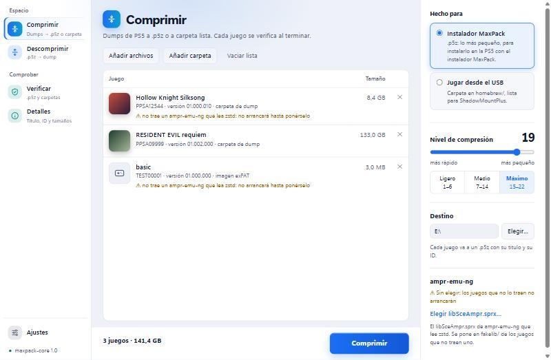

<!-- SPDX-License-Identifier: GPL-3.0-or-later -->
# Guía de MaxPack

MaxPack comprime juegos de PS5 (tu dump, en carpeta o en imagen `.exfat`) para que ocupen menos y se
puedan jugar sin descomprimirlos. Esta guía va de principio a fin: descargar, comprimir en el PC,
llevar el juego a la PS5 y jugarlo. Cada paso es una sola acción.

> **Antes de empezar:** la parte de la consola se ha probado poco. Lo probado y lo que falta está en la
> [sección 8](#8-qué-está-probado-y-qué-falta). Guarda siempre tu dump original.



## Índice

1. [Qué es MaxPack y qué necesitas](#1-qué-es-maxpack-y-qué-necesitas)
2. [El camino rápido](#2-el-camino-rápido)
3. [Descargar e instalar](#3-descargar-e-instalar)
4. [La ventana del PC](#4-la-ventana-del-pc)
5. [MaxPack en la consola](#5-maxpack-en-la-consola)
6. [La línea de comandos](#6-la-línea-de-comandos)
7. [Problemas frecuentes](#7-problemas-frecuentes)
8. [Qué está probado y qué falta](#8-qué-está-probado-y-qué-falta)
9. [Licencias y créditos](#9-licencias-y-créditos)

## 1. Qué es MaxPack y qué necesitas

MaxPack guarda el juego en packs zstd (formato `AMPRZPK1`). En la consola los lee **ampr-emu-ng**
mientras juegas, así que el juego nunca se descomprime entero. Solo quedan sueltos los archivos que el
sistema necesita así: ejecutables y módulos, `sce_sys/`, `fakelib/` y poco más.

Como referencia, en el PC Hollow Knight: Silksong pasó de 8,39 GB a un `.p5z` de 2,33 GB, y
RESIDENT EVIL requiem, de 133,59 GB a 79,32 GB ([informe](informes/fase1.md)).

### Las tres piezas

MaxPack son tres programas, cada uno en su repositorio (todos GPL-3.0). Descargas cada uno de sus
**Releases**.

| Pieza | Dónde corre | Repositorio | Para qué |
|---|---|---|---|
| **MaxPack para el PC** (la ventana y la línea de comandos `maxpack`) | PC | [DeLFuS77/maxpack](https://github.com/DeLFuS77/maxpack) | Comprimir, descomprimir, verificar y ver los detalles de un juego. |
| **MaxPack para la consola** (`maxpack.elf`) | PS5 | [DeLFuS77/maxpack-ps5](https://github.com/DeLFuS77/maxpack-ps5) | Monta los juegos como Kraken Mount, juega un `.p5z` tal cual y trae un instalador. |
| **ampr-emu-ng** (`libSceAmpr.sprx`) | PS5 | [DeLFuS77/ampr-emu-ng](https://github.com/DeLFuS77/ampr-emu-ng) | El runtime que lee los packs mientras juegas. MaxPack para la consola ya lleva el suyo dentro. |

Todo lleva la misma versión: 1.0.0.

### Dos formas de llevar un juego a la PS5

En la ventana se eligen en **Hecho para**:
- **Instalador MaxPack**: un archivo `.p5z` por juego. Es lo más pequeño y se guarda bien en el PC o en
  un USB. Es lo normal.
- **Jugar desde el USB**: una carpeta por juego, lista para montar con ShadowMountPlus o Kraken Mount.

### Qué necesitas

**En el PC**
- Windows de 64 bits, macOS 13 o posterior (chip de Apple o Intel) o Linux de 64 bits con GTK 3 y
  WebKitGTK 4.1.
- Tu juego: un dump de PS5 en carpeta o en imagen `.exfat`. Los PKG, `.ffpkg`, `.ffpfs` y `.ffpfsc`
  todavía no se pueden comprimir.
- Espacio en el destino. MaxPack avisa si hay menos libre de lo que ocupa el juego original.
- Solo si vas a usar ShadowMountPlus o Kraken Mount: el `libSceAmpr.sprx` de la
  [copia de ampr-emu-ng de MaxPack](https://github.com/DeLFuS77/ampr-emu-ng/releases). MaxPack lo pone
  en el `fakelib/` de los juegos que no traen uno que lea zstd.

**En la PS5**
- Una PS5 con jailbreak y un cargador de ELF en el puerto 9021 (elfldr, etaHEN o Payload Manager).
  kstuff tiene que estar cargado.
- Un USB en **exFAT** si algún `.p5z` pasa de 4 GiB: FAT32 no admite archivos tan grandes. Al formatear
  un USB se borra lo que tenga.
- Para abrir la página de MaxPack: el navegador de la PS5, o un móvil o un PC de tu red.

> MaxPack nunca escribe en el juego de origen y no toca claves, cifrado ni DRM. En la consola nunca
> comprime nada: comprimir es cosa del PC.

## 2. El camino rápido

Elige uno.

### A. Jugar un `.p5z` tal cual, con MaxPack en la consola (lo normal)

El `.p5z` se queda en su USB o en su unidad. No se instala.

1. Descarga MaxPack para tu sistema y `maxpack.elf`
   ([sección 3](#3-descargar-e-instalar)).
2. Abre MaxPack en el PC y suelta tus juegos en **Comprimir**.
3. En **Hecho para**, deja **Instalador MaxPack**.
4. Elige el **Destino**: la raíz de un USB en exFAT o una carpeta del PC.
5. Pulsa **Comprimir**. Cada juego se verifica al terminar y queda como `<Título> [<TITLE_ID>].p5z`.
6. Si no los guardaste ya en el USB, copia los `.p5z` a él. Déjalos en la raíz, o en `homebrew/`.
7. Conecta el USB a la PS5.
8. Envía `maxpack.elf` al cargador de ELF (puerto 9021).
9. Abre `http://<IP de la PS5>:8095` en el navegador.
10. Busca el juego en la biblioteca, ábrelo y pulsa **Jugar** (o ábrelo desde la pantalla de inicio de la
    PS5).

La primera vez, MaxPack prepara el juego un rato. Más en la [sección 5](#5-maxpack-en-la-consola).

### B. Instalar el juego en la consola

Para tener el juego en carpeta en el SSD de la PS5 (por ejemplo, para quitar el USB).

1. Haz los pasos 1 a 9 de arriba.
2. En la página, abre la pestaña **Instalar**.
3. Elige el juego y la unidad donde instalarlo.
4. Pulsa **Instalar**.
5. Al acabar, el juego sale en la biblioteca, listo para **Jugar**.

### C. Con ShadowMountPlus o Kraken Mount, sin MaxPack en la consola

1. Haz los pasos 1 y 2 del camino A.
2. En **Hecho para**, elige **Jugar desde el USB**.
3. Como destino, elige la raíz del USB (por ejemplo `E:\`). Cada juego va a `E:\homebrew\<TITLE_ID>`.
4. Si usas ShadowMountPlus, descarga `libSceAmpr.sprx` de las
   [Releases de ampr-emu-ng](https://github.com/DeLFuS77/ampr-emu-ng/releases) y elígelo en **Ajustes**.
   Kraken Mount trae su propio ampr-emu-ng.
5. Pulsa **Comprimir** y conecta el USB a la PS5.
6. Con ShadowMountPlus: añade o vuelve a escanear el juego y deja su modo de fakelib en
   «Predeterminado (Completo)». Con Kraken Mount no hay que hacer nada más.
7. Deja apagada la actualización automática de AMPR de ShadowMountPlus
   ([por qué](#shadowmountplus-cambia-ampr-emu-ng-y-el-juego-no-arranca)).

## 3. Descargar e instalar

### El PC

1. Abre las [Releases de MaxPack](https://github.com/DeLFuS77/maxpack/releases).
2. Descarga el archivo de tu sistema:

| Sistema | Archivo |
|---|---|
| Windows | `maxpack-windows-x64-setup.exe` (instalador) o `maxpack-windows-x64-portable.zip` (portable) |
| macOS con chip de Apple | `.dmg` de Apple silicon |
| macOS con Intel | `.dmg` de Intel |
| Linux | `maxpack-linux-x64.tar.gz` |

Después, según tu sistema:
- **Windows (instalador).** Ejecútalo. Pone MaxPack en tu carpeta de usuario, sin permisos de
  administrador, con su acceso directo. Se desinstala desde «Aplicaciones instaladas».
- **Windows (portable).** Descomprime el zip donde quieras. `MaxPack.exe` y `maxpack-core.exe` tienen
  que estar juntos. Los ajustes se guardan en su carpeta `settings`.
- **macOS.** Abre el `.dmg` y arrastra `MaxPack.app` a Aplicaciones.
- **Linux.** Descomprime el `.tar.gz` y ejecuta `sh install.sh`. Pone MaxPack en el menú de
  aplicaciones y `maxpack` en `~/.local/bin`. `sh install.sh --uninstall` lo quita.

La primera vez, Windows y macOS avisan porque el programa no está firmado:
- **Windows:** sale «Windows protegió su PC». Pulsa **Más información** y luego **Ejecutar de todas
  formas**.
- **macOS:** haz clic derecho en `MaxPack.app` y elige **Abrir**. En macOS 15 o posterior, si no te
  deja, intenta abrirla una vez y luego, en Ajustes del Sistema, Privacidad y seguridad, pulsa **Abrir
  igualmente**.

Solo hay una ventana: abrir MaxPack con juegos (arrastrándolos a su icono, por ejemplo) los añade a la
que ya está abierta. Más detalles de cada sistema: [ventana-pc.md](ventana-pc.md#1-descargar-y-abrir).

### La consola

1. Abre las [Releases de MaxPack para la consola](https://github.com/DeLFuS77/maxpack-ps5/releases).
2. Descarga `maxpack.elf`.
3. No hace falta descargar ampr-emu-ng: `maxpack.elf` lleva dentro su propia copia.

### ampr-emu-ng (solo para ShadowMountPlus o Kraken Mount)

1. Abre las [Releases de ampr-emu-ng](https://github.com/DeLFuS77/ampr-emu-ng/releases).
2. Descarga `libSceAmpr.sprx`.

## 4. La ventana del PC

La barra lateral tiene cuatro secciones de trabajo y los Ajustes. Todo está explicado, con capturas,
en [ventana-pc.md](ventana-pc.md).

### Comprimir ([detalles](ventana-pc.md#2-comprimir))

1. Suelta los juegos en la ventana, o usa **Añadir archivos** o **Añadir carpeta**. Valen carpetas de
   dump e imágenes `.exfat`. **Añadir carpeta** acepta un juego o una carpeta con juegos justo debajo.
2. En **Hecho para**, elige «Instalador MaxPack» (un `.p5z`) o «Jugar desde el USB» (una carpeta en
   `homebrew/`).
3. Elige el **Destino**.
4. Si quieres, cambia el **Nivel de compresión**: del 1 al 22, 19 por defecto, con los atajos
   **Ligero**, **Medio** y **Máximo**. Del 20 al 22 se usa mucha memoria y se tarda bastante más, para
   ahorrar poco más.
5. Pulsa **Comprimir**.

Lo que hace sola:
- Una carpeta ya comprimida se salta («ya está comprimido»).
- Cada juego se verifica al terminar.
- El PC no se duerme mientras hay trabajo, y el progreso sale también en la barra de tareas (Windows)
  o en el Dock (macOS).
- Al final dice cuánto se ahorró y qué hacer ahora.
- **Cancelar** detiene el juego en marcha, borra lo que llevaba escrito y deja el destino como estaba.

### Descomprimir ([detalles](ventana-pc.md#3-descomprimir-y-verificar))

Devuelve un `.p5z` al **dump original (bit a bit)**, con cada archivo comprobado con su SHA-256, o a la
**carpeta para la PS5**. Si el juego era una imagen `.exfat`, el dump original sale como carpeta con
sus archivos, no como imagen.

### Verificar

Lee un `.p5z` o una carpeta comprimida y comprueba que siguen enteros. No cambia nada.

### Detalles

Enseña título, ID, versión, tamaños, archivos, packs y si trae un runtime que lea zstd.

### Ajustes ([detalles](ventana-pc.md#4-ajustes))

Idioma (español o inglés), tema (sistema, claro u oscuro) y el `libSceAmpr.sprx` de ampr-emu-ng para los
juegos que no lo traen. MaxPack solo acepta un `libSceAmpr.sprx` que lea zstd.

## 5. MaxPack en la consola

### Enviar `maxpack.elf`

1. Conecta el USB con tus juegos.
2. Envía `maxpack.elf` al cargador de ELF, puerto 9021. Con `nc`:
   `nc -w 3 <IP de la PS5> 9021 < maxpack.elf`.
3. Espera el aviso de la consola.
4. Abre `http://<IP de la PS5>:8095` en el navegador de la PS5, del móvil o del PC. Hay que usar la IP,
   no un nombre.

Si MaxPack ya estaba cargado, abre la página directamente.

### Qué hace al arrancar

- **Busca juegos** en el SSD interno, en la unidad M.2 y en los USB: carpetas, FPKG (`.pkg`) y `.p5z`.
- **Los registra** en la pantalla de inicio y los **monta al lanzarlos**, como Kraken Mount.
- **Primera vez:** importa las rutas de búsqueda que hubieras añadido a mano en ShadowMountPlus o en
  Kraken Mount, y adopta los juegos que ya registraron, sin duplicarlos.
- No escribe nada en `/data/krakenmount` ni en `/data/shadowmount`: se puede volver a ellos.
- Nunca registra ni monta un título que ya esté instalado en la consola.

### La biblioteca

La página principal lista tus juegos.
- **Buscar:** escribe parte del nombre o del `TITLE_ID`.
- **Filtrar por unidad:** pulsa la pastilla de una unidad (Interno, USB 1…). Otra pulsación los muestra
  todos. **Desmontar** en la pastilla de un USB prepara su retirada.
- **Abrir la ficha:** pulsa un juego.
- **Jugar:** en la ficha, lo arranca en la consola, también desde el móvil. Está apagado si hay otro
  juego abierto, si el juego no está «Listo» o si hay otro montador en marcha.
- **Ocultar:** «Ocultar en la biblioteca» lo quita de la lista, pero sigue montado y en la pantalla de
  inicio. **Mostrar ocultos** (junto al buscador) los enseña, atenuados.
- **Copiar informe:** en la ficha, da un texto con la versión de MaxPack, el firmware, el montador, el
  juego, su origen, su estado, ampr-emu-ng, el último cierre inesperado y las últimas líneas del
  registro. Pégalo en una incidencia ([cómo avisar](#8-qué-está-probado-y-qué-falta)).
- **Recrear caché:** rehace lo que MaxPack guarda de ese juego. Solo hace falta si algo se estropea.

Si un juego se cierra solo, la ficha lo dice («Último cierre inesperado»).

### Jugar un `.p5z` tal cual

Un `.p5z` en una unidad que MaxPack explora sale como un juego más, sin instalarlo. Dónde ponerlo:
la raíz del USB, o `homebrew/` de un USB, de la unidad M.2 o del SSD interno (`/data/homebrew`).

Lo que tienes que saber:
- **El `.p5z` tiene que seguir donde está.** MaxPack lo monta en solo lectura al lanzar. Si lo mueves de
  unidad, MaxPack lo reconoce (avisa «movido a…»).
- **En el SSD interno solo se copian los archivos sueltos** del juego (ejecutables, `sce_sys/`…), no
  los packs, que se leen del propio `.p5z`. Hace falta que quepa lo suelto más 256 MiB. Si no cabe, el
  juego sale con «Error», dice cuánto falta y se monta solo cuando lo liberas.
- **Un `.p5z` dañado** o con más de 256 volúmenes no es un juego: sale en «Archivos .p5z que no se
  pueden jugar».
- **Si el mismo juego está dos veces**, gana la carpeta, luego el FPKG y por último el `.p5z`. El otro
  sale como duplicado.
- El nombre del archivo puede llevar tildes, ™ o japonés. Solo no valen los caracteres de control.
- Al lanzarlo, la consola dice «ampr-emu-ng: v0.5.1 (p5z) running».

### Instalar un juego (pestaña Instalar)

1. Abre la pestaña **Instalar**.
2. Elige el juego. Sale con lo que ahorra y lo que ocupará.
3. Elige la unidad. Cada una dice si el juego cabe; si no cabe, no empieza la copia.
4. Pulsa **Instalar**.

Qué instala:
- un `.p5z`: copia los packs tal cual y solo descomprime los archivos pequeños que van sueltos;
- tal cual, sin comprimir nada: carpetas e imágenes `.exfat`, `.ffpkg`, `.ffpfs` y `.ffpfsc`.
  Una `.ffpkg`, `.ffpfs` o `.ffpfsc` tiene que llevar el ID en el nombre (por ejemplo
  `Silksong-PPSA12544.ffpkg`). MaxPack no monta las imágenes: las juega ShadowMountPlus.

Dónde busca: en cada USB y en el almacenamiento ampliado (en la raíz y un nivel por debajo), y en
`/data/maxpack/`. Si algo no aparece, escribe su ruta a mano.

Otras cosas:
- **Reemplazar:** si el juego ya está en la consola, la página dice qué se borrará y cuánto ocupa, y
  pide confirmación. Lo viejo solo se borra cuando lo nuevo está instalado y verificado.
- **Pausar y Seguir:** si se corta (USB quitado, reposo), el juego sale en **Instalaciones a medias**,
  con **Seguir** y **Descartar**.
- **Borrar el `.p5z`:** la casilla relee el juego entero antes de borrar el `.p5z`.
- **Verificar y Desinstalar** los juegos instalados con MaxPack. Cierra el juego antes: con un juego
  abierto no deja desinstalar ni reemplazar.

Si un juego instalado también está en un USB como `.p5z`, el instalado (en carpeta) gana.

### Ajustes de la página

- **Rutas de escaneo:** dónde busca juegos.
- **Rutas excluidas:** MaxPack nunca abre esas rutas.
- **Librerías de MaxPack al lanzar:** en la ficha de un juego en carpeta sin empaquetar, se puede apagar
  para un juego que deba ir tal cual. Un `.pkg`, un `.p5z` o una carpeta zstd o LZ4 no pueden ir sin
  ellas.
- Los emuladores de DLC y PlayGo incluidos, la limpieza de juegos que desaparecen y otros ajustes
  heredados de Kraken Mount.
- **Purgar caché**, **Recrear todo** y **Detener MaxPack**.

### El icono de MaxPack

MaxPack pone su propio icono en la pantalla de inicio de la PS5.
- Si MaxPack no está en marcha, ábrelo: muestra «Iniciando MaxPack...» y arranca en unos segundos.
- Si dice «maxpack.elf aún no está guardado», envía `maxpack.elf` una vez al puerto 9021 y repite.

### Convivir con ShadowMountPlus y Kraken Mount

MaxPack no monta mientras corre ShadowMountPlus o Kraken Mount. Lo dice con un aviso y la página dice
«solo instala». No rompe nada: sigue la página y el instalador (lo instalado se registra en
ShadowMountPlus). Cuando el otro se cierra, MaxPack vuelve a montar en unos segundos.

Ten en cuenta:
- **Elige uno para montar.** Si arrancas los dos, MaxPack espera.
- El icono de MaxPack no se registra mientras corre otro montador. Llega cuando se cierra.
- Con ShadowMountPlus, el juego tiene que llevar ampr-emu-ng en su `fakelib/`. Deja apagado
  `auto_update_ampr` ([por qué](#shadowmountplus-cambia-ampr-emu-ng-y-el-juego-no-arranca)).

### Volver a ShadowMountPlus o a Kraken Mount

1. En la página de MaxPack, pulsa **Detener MaxPack**.
2. Arranca ShadowMountPlus o Kraken Mount como siempre.

Tus juegos, su caché y su configuración siguen como estaban. Para volver a MaxPack, ciérralos y envía
`maxpack.elf` otra vez.

### Dónde tienen que estar los juegos

Cada juego en carpeta va en `homebrew/<TITLE_ID>`, en la raíz de la unidad:

| Unidad | En la PS5 | En el PC (ejemplo) |
|---|---|---|
| Almacenamiento interno | `/data/homebrew/<TITLE_ID>` | — |
| USB | `/mnt/usb0/homebrew/<TITLE_ID>` (o `usb1`…`usb7`) | `E:\homebrew\<TITLE_ID>` |
| Almacenamiento ampliado | `/mnt/ext0/homebrew/<TITLE_ID>` (o `ext1`) | — |

### Copiar archivos por FTP

Si copias juegos a la consola por FTP, pon el cliente en **modo binario** (en FileZilla:
Transferencia, Tipo de transferencia, Binario). Si no, los archivos sin extensión, como
`sce_sys/keystone`, fallan con «504 STOR in ASCII mode».

## 6. La línea de comandos

La ventana hace todo lo que la mayoría necesita. La línea de comandos sirve para guiones, para medir un
juego antes de comprimirlo (`analyze`, que la ventana no tiene) o si prefieres escribir comandos.

**Dónde está:**
- **Windows:** `MaxPack.exe` con argumentos hace de `maxpack`. Está en
  `%LOCALAPPDATA%\Programs\MaxPack` (con el instalador) o en la carpeta del zip portable.
  `maxpack-core.exe`, a su lado, también vale.
- **Linux:** después de `sh install.sh`, `maxpack` (en `~/.local/bin`).
- **macOS:** `/Applications/MaxPack.app/Contents/MacOS/maxpack`.
- **Compilándolo:** `maxpack`, como cuenta el [README](../README.md#compilar).

Los ejemplos usan `maxpack`. En Windows, escribe `MaxPack.exe` (o su ruta completa) en su lugar. Sin
argumentos, `MaxPack` abre la ventana; `maxpack --help` muestra el uso.

```
maxpack analyze <carpeta|imagen.exfat> [opciones]
maxpack pack <carpeta|imagen.exfat> -o <salida> [opciones]
maxpack unpack <juego.p5z> --folder|--original -o <carpeta> [--threads N]
maxpack info <juego.p5z>
maxpack info --json <carpeta|imagen.exfat|juego.p5z>
maxpack info --play <juego.p5z>
maxpack icon <carpeta|imagen.exfat|juego.p5z> -o <icono.png>
maxpack verify <juego.p5z | carpeta> [--against <origen>] [--threads N]
maxpack --version
maxpack --capabilities
```

Códigos de salida: 0 bien, 1 error, 2 uso incorrecto y 130 cancelado.

### `pack`: comprimir

```
maxpack pack "D:\dumps\MiJuego.exfat" -o "E:\homebrew\PPSA00000" --runtime "D:\ampr-emu-ng\libSceAmpr.sprx"
maxpack pack "D:\dumps\MiJuego.exfat" -o "D:\juegos\MiJuego [PPSA00000].p5z" --p5z --runtime "D:\ampr-emu-ng\libSceAmpr.sprx"
```

| Opción | Qué hace | Ejemplo |
|---|---|---|
| `-o SALIDA` | Dónde dejar el resultado: con `--folder`, una carpeta nueva o vacía; con `--p5z`, un archivo que no exista, en una carpeta que sí exista. | `-o "E:\homebrew\PPSA00000"` |
| `--folder` | Salida en carpeta, lista para la consola. Es lo que hace si no dices nada. | `--folder` |
| `--p5z` | Salida en un solo archivo `.p5z`. | `--p5z` |
| `--level N` | Nivel de zstd, de 1 a 22 (19 por defecto). | `--level 22` |
| `--threads N` | Hilos (por defecto, todos los de la CPU). El resultado es el mismo con cualquier número. | `--threads 8` |
| `--runtime ARCHIVO` | El `libSceAmpr.sprx` de ampr-emu-ng, que se pone en `fakelib/`. | `--runtime "D:\ampr-emu-ng\libSceAmpr.sprx"` |
| `--keep-loose GLOB` | Deja suelto también lo que case. Se puede repetir. `*` y `?` valen dentro de una carpeta; `**`, para cualquier número de carpetas. | `--keep-loose "**/*.bnk"` |
| `--max-file-size N` | Solo con `--p5z`: si el `.p5z` va a pasar de N bytes, para y lo borra. | `--max-file-size 4294967295` (FAT32) |
| `--volume-limit N` | Para pruebas: cada volumen de los packs ocupa como mucho N bytes (de 262208 a 4294901760, que es el valor por defecto). Sirve para tener varios volúmenes con un juego pequeño; para jugar no hace falta. | `--volume-limit 524288` |
| `--progress json` | Una línea JSON por evento en stdout; el texto para personas sigue en stderr. | `--progress json` |
| `--control stdin` | Lee la entrada: la línea `cancel`, o cerrar la entrada, cancela y borra lo escrito. | `--control stdin` |

Lo que garantiza:
- Nunca escribe en el origen, y la salida no puede ser el juego ni estar dentro de él.
- No acepta una salida que no esté vacía, ni un `.p5z` que ya exista.
- Se niega con juegos ya empaquetados y con rutas que solo se diferencian en mayúsculas.
- Un empaquetado cortado no se monta, y un `.p5z` cortado o dañado se detecta al abrirlo.
- Con las mismas opciones, el resultado es idéntico byte a byte.

Avisos que puede dar al terminar:
- `aviso: el runtime de fakelib/libSceAmpr.sprx no parece leer packs zstd: usa el libSceAmpr.sprx de ampr-emu-ng (--runtime)`
- `aviso: sce_sys/param.json no da el TITLE_ID del juego (titleId): MaxPack no aceptará este .p5z`

Con `--progress json`, las líneas son así:

```
{"event":"progress","phase":"packing","done":3137495,"total":3137495}
{"event":"result","ok":true,"original_size":3147695,"output_size":2106626,"loose_bytes":10200,"packed_bytes":3137495,"stored_bytes":2066945,"volumes":1,"runtime_without_zstd":true}
```

`--control stdin` está pensado para una interfaz. A mano, escribe `cancel` y pulsa Enter. Si la entrada
ya está cerrada (por ejemplo, con `< /dev/null`), cancela en el acto.

### `unpack`: descomprimir un `.p5z`

| Opción | Qué hace | Ejemplo |
|---|---|---|
| `--folder` | Saca la carpeta para la consola, igual que `pack --folder`. | `maxpack unpack "D:\juegos\MiJuego.p5z" --folder -o "E:\homebrew\PPSA00000"` |
| `--original` | Reconstruye el dump original bit a bit y comprueba cada SHA-256. | `maxpack unpack "D:\juegos\MiJuego.p5z" --original -o "D:\dumps\MiJuego"` |
| `-o CARPETA` | Una carpeta nueva o vacía. | `-o "D:\dumps\MiJuego"` |
| `--threads N` | Hilos. | `--threads 8` |
| `--progress json`, `--control stdin` | Como en `pack`. | `--progress json` |

### `verify`: comprobar

| Uso | Qué hace | Ejemplo |
|---|---|---|
| Con un `.p5z` | Comprueba cada archivo con su SHA-256. | `maxpack verify "D:\juegos\MiJuego.p5z"` |
| Con una carpeta | Comprueba los packs y los índices. | `maxpack verify "E:\homebrew\PPSA00000"` |
| `--against ORIGEN` | Solo con carpetas: la compara además con el juego original. | `maxpack verify "E:\homebrew\PPSA00000" --against "D:\dumps\MiJuego.exfat"` |
| `--threads N` | Hilos. | `--threads 8` |
| `--progress json`, `--control stdin` | Como en `pack`. | `--control stdin` |

Al acabar dice, por ejemplo, `verify: 216 correctos, 0 con fallos (0 s)`. Si algún archivo falla, sale
con el código 1.

### `info` e `icon`: lo que dice un juego

| Orden | Qué hace | Ejemplo |
|---|---|---|
| `info` | Título, ID, versión, archivos, packs y tamaño de un `.p5z`, para personas. | `maxpack info "D:\juegos\MiJuego.p5z"` |
| `info --json` | Lo mismo de un `.p5z`, una carpeta o un `.exfat`, en una línea JSON. Es lo que lee la ventana. | `maxpack info --json "D:\dumps\MiJuego.exfat"` |
| `info --play` | Lo que la consola necesita para jugar un `.p5z` sin instalarlo, en JSON. Es cosa de desarrollo. | `maxpack info --play "D:\juegos\MiJuego.p5z"` |
| `icon` | Guarda el `sce_sys/icon0.png` del juego. Sale con el código 1 si no tiene. | `maxpack icon "D:\dumps\MiJuego.exfat" -o icono.png` |

La línea de `info --json` lleva `kind` (`folder`, `exfat` o `p5z`), `title_id`, `version`, `name`,
`original_size`, `install_size`, `p5z_size`, `files`, `packed_files`, `volumes`, `has_runtime`,
`has_zstd_runtime` y `packed`.

### `analyze`: medir antes de comprimir

Mide cuánto ahorraría cada forma de comprimir un juego, sin escribir nada:

```
maxpack analyze "D:\dumps\MiJuego.exfat" --json informe.json
```

| Opción | Qué hace | Ejemplo |
|---|---|---|
| `--sample N%` | Qué parte del juego se comprime para medir (por defecto el 2 %, al menos 1 GiB). | `--sample 5%` |
| `--full` | Mide todo el juego, sin muestra. Tarda más, pero es exacto. | `--full` |
| `--json ARCHIVO` | Guarda también el informe en JSON. No puede ir dentro del juego. | `--json informe.json` |
| `--threads N` | Hilos (por defecto, todos los de la CPU). | `--threads 8` |
| `--keep-loose GLOB` | Como en `pack`. | `--keep-loose "**/*.bnk"` |
| `--no-dedup` | No hace el pase de deduplicación, que lee todo el juego. | `--no-dedup` |
| `--no-transport` | No mide el `.p5z` de transporte (zstd 19, ventana larga). | `--no-transport` |
| `--list` | Solo lista los archivos y si irían sueltos o empaquetados, sin medir. | `maxpack analyze "D:\dumps\MiJuego.exfat" --list` |

El progreso sale por stderr y el informe por stdout. Cómo leerlo:
[README](../README.md#cómo-leer-el-informe).

### Otras

| Orden | Qué hace | Ejemplo |
|---|---|---|
| `--version` | La versión del motor y de zstd y zlib. | `maxpack --version` → `maxpack 1.0.0 (zstd 1.5.6, zlib 1.3.1)` |
| `--capabilities` | Lo que sabe hacer esta versión, en JSON. La ventana lo usa para saber si su `maxpack-core` le vale. | `maxpack --capabilities` |
| `--help` | El uso, con todas las opciones (también `-h` o `help`). | `maxpack --help` |

## 7. Problemas frecuentes

Las frases entre comillas son las que ves en pantalla: en la ventana, en la línea de comandos, en la
página de MaxPack o en la consola.

### El juego no aparece en MaxPack para la consola

1. ¿Está en una unidad que MaxPack explora? Mira [dónde tienen que estar](#dónde-tienen-que-estar-los-juegos).
   Un `.p5z` vale en la raíz del USB o en `homebrew/`.
2. ¿Hay otro montador en marcha? Si la página dice «otro montador» o «solo instala», MaxPack espera a
   que ShadowMountPlus o Kraken Mount se cierren.
3. ¿Está en «Archivos .p5z que no se pueden jugar»? Entonces está dañado: [mira abajo](#un-p5z-dañado).
4. ¿Está oculto? Pulsa **Mostrar ocultos**.
5. ¿Está en una ruta excluida? Mira **Rutas excluidas** en Ajustes.
6. ¿El mismo juego está también en carpeta o en FPKG? Gana esa copia, y el `.p5z` sale como duplicado.
7. ¿El título está instalado en la consola? MaxPack no registra ni monta una copia de un título
   instalado: sale con «Error» y la ficha lo explica.

### Otro montador en marcha

Lo que ves: aviso «ShadowMount+ está en ejecución» o «Kraken Mount está en marcha; MaxPack no monta
juegos hasta que se cierre», y la página dice «solo instala».

Qué hacer: cierra el otro montador (en Kraken Mount, **Detener**) y espera unos segundos. MaxPack
vuelve a montar solo. Si quieres que monte MaxPack, no arranques los dos a la vez.

### «puerto 8095 ocupado» o MaxPack ya estaba cargado

- «MaxPack: puerto 8095 ocupado, no se ha iniciado…»: hay otra copia en marcha, por ejemplo el
  `maxpack.elf` antiguo del instalador de la fase 2 de MaxPack (se llamaba igual y usaba el mismo
  puerto). Quítalo de toda lista de carga automática (la del cargador, la de etaHEN o la de kstuff),
  reinicia la consola y envía solo el nuevo.
- Si MaxPack ya estaba cargado, abre la página directamente.

### «No cabe: faltan …» o el juego sale con «Error» por espacio

Lo que ves: el juego con «Error» y, en la ficha, cuánto falta; o, en **Instalar**, la unidad con «No
cabe: faltan …».

Qué hacer: haz sitio en esa unidad. Para jugar un `.p5z` desde el SSD interno hace falta el tamaño de
sus archivos sueltos más 256 MiB; si lo liberas, el juego se monta solo. O pon el `.p5z` en un USB.

### Un `.p5z` dañado

Lo que ves: el archivo sale en «Archivos .p5z que no se pueden jugar», con «Dañado o incompleto», y un
aviso «No se puede jugar <archivo>: está dañado o incompleto». Un fallo de lectura de un momento (un
USB que se reinicia) no cuenta: MaxPack lo reintenta antes.

Qué hacer:
1. Verifica el `.p5z` en el PC con **Verificar**.
2. Si falla, copia el archivo otra vez al USB.
3. Si sigue fallando, vuelve a comprimir el juego.

### El juego se cierra solo

Lo que ves: la ficha dice «Último cierre inesperado».

Qué hacer: en la ficha, pulsa **Copiar informe** y pégalo en una incidencia
([cómo avisar](#cómo-contar-un-resultado)).

### Cómo copiar un informe de fallo

1. Abre la página (`http://<IP de la PS5>:8095`) desde el móvil o el PC.
2. Abre la ficha del juego.
3. Pulsa **Copiar informe**. Sale «Informe copiado».
4. Pega el texto donde lo vayas a contar.

Desde el navegador de la PS5, si no puede copiar, el texto sale seleccionado debajo: cópialo a mano.
También lo tienes en `http://<IP de la PS5>:8095/api/report/<TITLE_ID>`. El registro entero está en
`/data/maxpack/maxpack.log` y al final de la página.

### La página tarda o no responde tras el reposo

Espera unos segundos: vuelve sola. Si no, envía `maxpack.elf` otra vez.

### ShadowMountPlus cambia ampr-emu-ng y el juego no arranca

ShadowMountPlus tiene la opción `auto_update_ampr`. Si la enciendes, cambia ampr-emu-ng por el
`ampr_emu` antiguo de drakmor, que no lee los packs zstd de MaxPack, y los juegos comprimidos dejan de
arrancar ([issue #214](https://github.com/drakmor/ShadowMountPlus/issues/214)). Viene apagada: déjala
así.

Con ShadowMountPlus, en su modo de fakelib predeterminado («Completo») se usa el `libSceAmpr.sprx` que
lleva el propio juego en `fakelib/`, y añade su backport si hace falta. Si funciona, al arrancar el
juego sale «ampr-emu-ng: v… (zstd) running».

### El juego no aparece en ShadowMountPlus

1. **¿Está en `homebrew/`?** Si lo comprimiste para «Jugar desde el USB» en otra carpeta, MaxPack te lo
   dice al terminar: «ShadowMountPlus solo los ve en homebrew/». Muévelo a `homebrew/<TITLE_ID>`.
2. **¿Lo instalaste desde MaxPack para la consola?** Mira la página:
   - «ShadowMountPlus no está en marcha: los juegos se registrarán cuando arranque»: carga
     ShadowMountPlus.
   - «Pendiente en ShadowMountPlus: …»: ShadowMountPlus aplazó el escaneo (por ejemplo, porque hay un
     juego abierto). MaxPack lo reintenta cada minuto. Para hacerlo a mano, añade la ruta del juego en
     ShadowMountPlus.
3. **¿Usas Kraken Mount?** Entonces ShadowMountPlus no debe estar en marcha.

Si aparece pero no arranca:
- Lo más probable es el runtime: mira [El runtime no lee zstd](#el-runtime-no-lee-zstd-falta-ampr-emu-ng)
  y que el modo de fakelib del juego sea «Predeterminado (Completo)».
- Un archivo que el juego abre con `mmap` no puede ir empaquetado. Se deja suelto volviendo a empaquetar
  con `--keep-loose "<ruta o patrón>"` (solo en la línea de comandos).
- Qué anotar si falla: [probar-en-ps5.md](probar-en-ps5.md#4-qué-comprobar-diseño-68).

### FTP: «504 STOR in ASCII mode»

Pon el cliente en modo binario. En FileZilla: Transferencia, Tipo de transferencia, Binario. Los
archivos sin extensión, como `sce_sys/keystone`, fallan en modo ASCII.

### FAT32 y los 4 GiB

Lo que ves en la ventana:
- «El destino es FAT32», antes de empezar, si el destino es FAT32 y el juego original pasa de 4 GiB.
- «el .p5z llegó a 4 GiB, que no cabe en FAT32: se paró y se borró», si seguiste y no cupo.

Qué hacer:
- **Usar carpeta** cambia a «Jugar desde el USB», cuyas partes caben en FAT32.
- **Seguir igualmente** lo intenta. Si el `.p5z` va a pasar de 4 GiB menos un byte, MaxPack para y borra
  lo escrito.
- Lo mejor: un USB en exFAT, que no tiene ese límite.

En la línea de comandos, `--max-file-size 4294967295` hace lo mismo que **Seguir igualmente**.

### No hay espacio en el PC

Lo que ves:
- «puede no caber en el destino», antes de empezar. El resultado suele ocupar menos, así que puedes
  pulsar **Empezar igualmente**.
- «no caben lo nuevo y lo de ahora a la vez: elige otro destino o haz sitio», con **Reemplazar**: ese
  juego no empieza.

Qué hacer: haz sitio o elige otro destino.

### El juego ya está en el destino (Reemplazar)

Lo que ves: «Ya está en el destino», con lo que se borraría y cuánto ocupa, y tres botones:
**Cancelar**, **Saltar** y **Reemplazar**.

Si eliges **Reemplazar**, lo nuevo se escribe aparte, en `<destino>.maxpack-tmp`, y se verifica; solo
entonces se borra lo de antes. Por eso tienen que caber los dos a la vez. Si algo falla, lo de antes
sigue intacto.

### El runtime no lee zstd (falta ampr-emu-ng)

Esto importa si vas a jugar con ShadowMountPlus o Kraken Mount. MaxPack para la consola lleva su propio
ampr-emu-ng.

Lo que ves:
- En la ventana: «Falta ampr-emu-ng», o «no trae un ampr-emu-ng que lea zstd: no arrancará hasta
  ponérselo».
- Al terminar: «hecho, pero su libSceAmpr.sprx no lee zstd: no arrancará hasta ponerle el de
  ampr-emu-ng».
- En Ajustes, si eliges otro archivo: «Ese libSceAmpr.sprx no lee zstd: no es el de ampr-emu-ng».
- En la línea de comandos: `aviso: el runtime de fakelib/libSceAmpr.sprx no parece leer packs zstd`.

Qué hacer:
1. Descarga `libSceAmpr.sprx` de las [Releases de ampr-emu-ng](https://github.com/DeLFuS77/ampr-emu-ng/releases)
   y elígelo en **Ajustes**.
2. Vuelve a comprimir el juego.
3. Si ya no tienes el dump, **Descomprimir** el `.p5z` a «Dump original (bit a bit)» lo recupera.

### Un `.p5z` sin TITLE_ID

Lo que ves: «su param.json no da el ID del juego (TITLE_ID)» en la ventana, o
`aviso: sce_sys/param.json no da el TITLE_ID del juego (titleId)` en la línea de comandos.

Qué hacer: comprueba que el dump está completo y que su `sce_sys/param.json` trae el `titleId`.

### «maxpack-core de otra versión» o «falta maxpack-core»

Lo que ves: la ventana no deja empezar ningún trabajo.

Qué hacer: pon junto a MaxPack el `maxpack-core` que venía con ella. Lo más fácil es volver a instalar
MaxPack o descomprimir otra vez el zip portable entero.

### Cancelar

- **En la ventana**, **Cancelar** (o cerrar la ventana con trabajo en marcha) borra lo que llevaba
  escrito y deja el destino como estaba; con **Reemplazar**, lo de antes sigue intacto. Los juegos que
  esperaban no empiezan, y los ya hechos se quedan. Puede tardar unos segundos. Si algo no se puede
  borrar, la fila lo dice, con la ruta: «no se pudo borrar lo escrito a medias».
- **En la consola**, **Pausar** detiene una instalación sin perder lo hecho. En **Instalaciones a
  medias**, **Seguir** continúa y **Descartar** borra lo copiado.
- **En la línea de comandos**, `--control stdin` permite cancelar con la línea `cancel`. El motor borra
  lo que estaba escribiendo y sale con el código 130.

### Otros avisos de la ventana

- «el destino es el propio juego, o está dentro de él: elige otro destino».
- «otro juego de la lista va al mismo sitio»: dos juegos con el mismo ID hacia el mismo destino.
- «el destino ya no está (¿se quitó el USB?)».
- «lo nuevo no pasó la verificación y se borró»: vuelve a intentarlo y, si se repite, prueba con otro
  destino.

La lista completa está en [ventana-pc.md](ventana-pc.md#5-avisos).

## 8. Qué está probado y qué falta

### Probado en una PS5 real

Firmware 13.60, ShadowMountPlus 1.7beta12, 24/11/2026
([probar-en-ps5.md](probar-en-ps5.md)):
- Hollow Knight: Silksong, empaquetado con MaxPack en carpeta zstd y montado con ShadowMountPlus,
  arranca con nuestro ampr-emu-ng, guarda y vuelve a cargar la partida.
- ShadowMountPlus, con el modo de fakelib predeterminado («Predeterminado (Completo)»), conserva el
  `libSceAmpr.sprx` del juego y añade su backport.
- MaxPack para la consola, en su primera versión (solo montar), montó, lanzó y limpió ese juego 3
  veces, y volver a ShadowMountPlus funcionó.

### Probado en el PC

- **Con juegos reales** ([informe](informes/fase1.md)): Silksong (empaquetar, verificar y reconstruir el
  dump original, con cero fallos; el `ampr_emu.index` salió idéntico al del dump) y RESIDENT EVIL
  requiem (133 GB, con archivos de hasta 72 GB; empaquetar en `.p5z` y verificar, con cero fallos).
- **En cada cambio, en GitHub Actions:** el motor se compila y pasa sus pruebas en Windows y Linux; la
  ventana se compila y pasa las suyas en Windows, Linux y macOS; los paquetes se instalan, comprimen
  una imagen de prueba y se desinstalan.

### Sin probar todavía en una consola

- **Jugar un `.p5z` tal cual** (el modo `p5z`), desde USB, M.2 y SSD interno.
- Lo más nuevo de MaxPack para la consola: la biblioteca, **Jugar** desde la página, ocultar y mostrar,
  **Copiar informe**, el instalador, las rutas excluidas, convivir con ShadowMountPlus y Kraken Mount, y
  su icono. Existe el código y se prueba en el PC, pero no se ha ejecutado en una PS5.
- La velocidad de un `.p5z` frente a una carpeta empaquetada.
- El instalador de Windows con doble clic y el asistente en pantalla. Si algo no va, usa el zip
  portable y cuéntalo.

La lista de pruebas pendientes en la consola está en
[`docs/pruebas-consola.md`](https://github.com/DeLFuS77/maxpack-ps5/blob/main/docs/pruebas-consola.md)
y los juegos ya probados, en
[`docs/compatibilidad.md`](https://github.com/DeLFuS77/maxpack-ps5/blob/main/docs/compatibilidad.md),
ambos en el repositorio de MaxPack para la consola.

### Cómo contar un resultado

1. En la página de MaxPack, abre la ficha del juego y pulsa **Copiar informe**. Trae la fila hecha para
   la lista de compatibilidad.
2. Abre una incidencia en el repositorio que corresponda: PC en
   [DeLFuS77/maxpack](https://github.com/DeLFuS77/maxpack/issues), consola en
   [DeLFuS77/maxpack-ps5](https://github.com/DeLFuS77/maxpack-ps5/issues) y el runtime en
   [DeLFuS77/ampr-emu-ng](https://github.com/DeLFuS77/ampr-emu-ng/issues).
3. Pega el informe y di si funcionó, con el juego, su versión y tu firmware.

Cuenta también lo que funciona: ayuda a llenar la lista de compatibilidad.

## 9. Licencias y créditos

**MaxPack** es software libre con la licencia GPL-3.0-or-later ([LICENSE](../LICENSE)), de DeLFuS77, y
no tiene ninguna garantía. Sus tres piezas (PC, consola y ampr-emu-ng) son GPL-3.0. La ventana parte de
[NXPress](https://github.com/DeLFuS77/NXPress), del mismo autor.

**Lo que va dentro de MaxPack para el PC:**
- [zstd](https://github.com/facebook/zstd) 1.5.6 (Meta): BSD o GPLv2, a elegir.
- [zlib](https://github.com/madler/zlib) 1.3.1 (Jean-loup Gailly y Mark Adler): licencia zlib.
- La ventana, en Go: [Wails](https://github.com/wailsapp/wails) v2 (MIT); en Windows, go-webview2 (MIT),
  go-ole (MIT) y go-toast (MIT o Unlicense); en Linux, godbus (BSD); golang.org/x/net, x/sys y x/text
  (BSD); y otras librerías pequeñas con licencias MIT, BSD o Apache-2.0. La lista con versiones está en
  [gui/go.mod](../gui/go.mod).
- La página de la ventana se ve con el navegador web del sistema (WebView2, WebKitGTK o WebKit), que no
  va dentro de MaxPack.

**Lo que va dentro de MaxPack para la consola** (avisos completos en `THIRD_PARTY_NOTICES` de
[maxpack-ps5](https://github.com/DeLFuS77/maxpack-ps5)):
- [Kraken Mount](https://github.com/quer3q/kraken-mount), de quer3q (GPL-3.0-or-later): la base de
  MaxPack para la consola, que conserva su historial y su licencia.
- [ampr-emu-ng](https://github.com/DeLFuS77/ampr-emu-ng): el runtime. Es una copia propia de
  [ampr-emu-ng](https://github.com/quer3q/ampr-emu-ng), de quer3q, que a su vez es un fork de
  [ampr_emu](https://github.com/drakmor/ampr_emu), de drakmor (GPL-3.0). La incluida es
  `v0.5.1-maxpack.1`: la v0.5.1 de quer3q con el modo `.p5z`.
- [dlc_emu](https://github.com/drakmor/dlc_emu) y [pgo_stub](https://github.com/drakmor/pgo_stub), de
  drakmor: los emuladores de DLC y PlayGo.
- [ShadowMountPlus](https://github.com/drakmor/ShadowMountPlus), de drakmor (GPL-3.0): de ahí vienen el
  registro en la pantalla de inicio, la capa `fakelib` y los backports.
- [PS5 Dump Forge](https://github.com/quer3q/ps5-dump-forge), de quer3q (GPL-3.0): su decodificador
  Kraken, y los mismos packs zstd que escribe MaxPack.
- [ps5-payload-sdk](https://github.com/ps5-payload-dev/sdk) (GPL-3.0), [zstd](https://github.com/facebook/zstd),
  [zlib](https://zlib.net) y [SQLite](https://www.sqlite.org).

[ampr_emu](https://github.com/drakmor/ampr_emu) también es de donde viene el formato del índice
`ampr_emu.index`, que MaxPack genera para cada juego. [ps5upload](https://github.com/phantomptr/ps5upload),
de phantomptr (GPL-3.0), es otra herramienta de la escena.

## Más documentación

- [ventana-pc.md](ventana-pc.md): la ventana del PC, con capturas.
- [probar-en-ps5.md](probar-en-ps5.md): probar a mano en la consola un juego empaquetado.
- [formato-p5z.md](formato-p5z.md): el formato del `.p5z`.
- [research-notes.md](research-notes.md): lo investigado sobre la escena y los formatos.
- [README](../README.md): compilar MaxPack y leer el informe de `analyze`.
- [MaxPack para la consola](https://github.com/DeLFuS77/maxpack-ps5) y su
  [DESIGN.md](https://github.com/DeLFuS77/maxpack-ps5/blob/main/DESIGN.md).
- [ampr-emu-ng y el modo p5z](https://github.com/DeLFuS77/ampr-emu-ng/blob/main/docs/p5z-mode.md).
