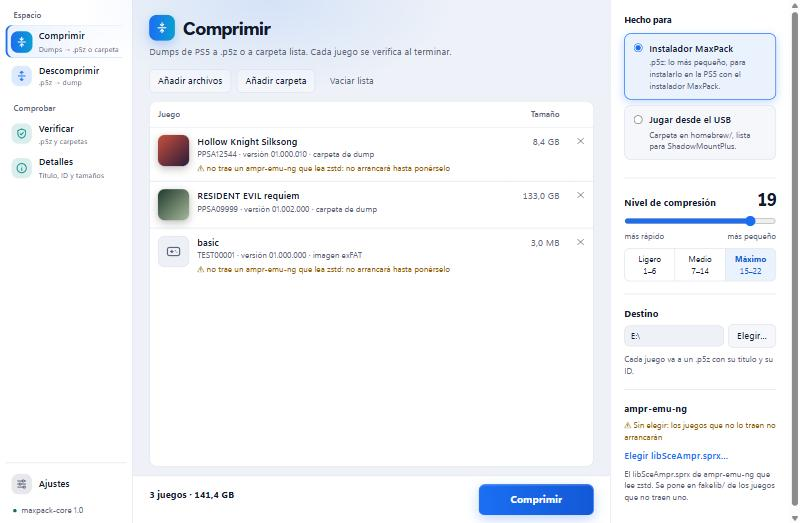

<!-- SPDX-License-Identifier: GPL-3.0-or-later -->
# MaxPack guide

MaxPack compresses PS5 games (your own dump, as a folder or as an image: `.exfat`, `.ffpkg`, `.ffpfs`
or `.ffpfsc`) so they take less space and can be played without being decompressed. This guide goes from start to finish: download,
compress on the PC, take the game to the PS5 and play it. Every step is a single action.

> **Before you start:** playing a `.p5z` and the library have been tested on one PS5 (firmware 13.60) with
> three games, but the console installer has not been tested on a real PS5 yet. What is tested and what is
> missing is in [section 8](#8-what-is-tested-and-what-is-missing). Always keep your original dump. MaxPack is for
> backups of games you own, and you use it at your own risk: see [section 10](#10-legal-and-disclaimer).



## Contents

1. [What MaxPack is and what you need](#1-what-maxpack-is-and-what-you-need)
2. [The quick way](#2-the-quick-way)
3. [Download and install](#3-download-and-install)
4. [The PC window](#4-the-pc-window)
5. [MaxPack on the console](#5-maxpack-on-the-console)
6. [The command line](#6-the-command-line)
7. [Common problems](#7-common-problems)
8. [What is tested and what is missing](#8-what-is-tested-and-what-is-missing)
9. [Licences and credits](#9-licences-and-credits)
10. [Legal and disclaimer](#10-legal-and-disclaimer)

## 1. What MaxPack is and what you need

MaxPack stores the game in zstd packs (format `AMPRZPK1`). On the console, **ampr-emu-ng** reads them
while you play, so the game is never fully decompressed. Only the files the system needs as plain
files stay loose: executables and modules, `sce_sys/`, `fakelib/` and little else.

For reference, on the PC Starfall Odyssey went from 8.39 GB to a 2.33 GB `.p5z`, and
Iron Harbor from 133.59 GB to 79.32 GB ([report](reports/phase1.md)).

### The three pieces

MaxPack is three programs, each in its own repository (all GPL-3.0). You download each one from its
**Releases**.

| Piece | Where it runs | Repository | What it is for |
|---|---|---|---|
| **MaxPack for the PC** (the window and the `maxpack` command line) | PC | [DeLFuS77/maxpack](https://github.com/DeLFuS77/maxpack) | Compress, decompress, verify and inspect a game. |
| **MaxPack for the console** (`maxpack.elf`) | PS5 | [DeLFuS77/maxpack-ps5](https://github.com/DeLFuS77/maxpack-ps5) | Mounts games like Kraken Mount, plays a `.p5z` as it is and has an installer. |
| **ampr-emu-ng** (`libSceAmpr.sprx`) | PS5 | [DeLFuS77/ampr-emu-ng](https://github.com/DeLFuS77/ampr-emu-ng) | The runtime that reads the packs while you play. MaxPack for the console and the PC window already carry it inside: you only download it for the `maxpack` command line. |

MaxPack for the PC is version 1.0.1 and MaxPack for the console 1.0.0; both carry ampr-emu-ng
v0.5.1-maxpack.1 inside.

### Two ways to take a game to the PS5

In the window, you choose in **Made for**:
- **MaxPack installer**: one `.p5z` file per game. It is the smallest and keeps well on the PC or on a
  USB drive. This is the normal choice.
- **Play from the USB**: one folder per game, ready to mount with ShadowMountPlus or Kraken Mount.

### What you need

**On the PC**
- 64-bit Windows, macOS 13 or later (Apple silicon or Intel) or 64-bit Linux with GTK 3 and
  WebKitGTK 4.1.
- Your game: a PS5 dump as a folder or as an image in one of the formats ShadowMountPlus mounts:
  `.exfat`, `.ffpkg` (UFS2), `.ffpfs` (PFS) or `.ffpfsc` (a PFS container, usually compressed, with one
  of the others inside). MaxPack reads them itself, with nothing to mount and no temporary space, and
  the result is the same as from the dump folder ([source-images.md](source-images.md)). PKGs cannot be
  compressed yet.
- Space at the destination. MaxPack warns you if there is less free space than the original game takes
  (the game, not its image: an `.ffpfsc` is compressed and usually takes less than the game in it).
- Nothing else for the runtime: the window comes with
  [MaxPack's copy of ampr-emu-ng](https://github.com/DeLFuS77/ampr-emu-ng) (`libSceAmpr.sprx`) and puts
  it in the `fakelib/` of the games that do not carry one that reads zstd.

**On the PS5**
- A jailbroken PS5 and an ELF loader on port 9021 (elfldr, etaHEN or Payload Manager). kstuff must be
  loaded.
- A **exFAT** USB drive if any `.p5z` is over 4 GiB: FAT32 does not take files that big. Formatting a
  USB drive erases what is on it.
- To open the MaxPack page: the PS5 browser, or a phone or a PC on your network.

> MaxPack never writes to the source game and does not touch keys, encryption or DRM. On the console
> it never compresses anything: compressing is done on the PC.

## 2. The quick way

Pick one.

### A. Play a `.p5z` as it is, with MaxPack on the console (the normal way)

The `.p5z` stays on its USB drive or its disk. It is not installed.

1. Download MaxPack for your system and `maxpack.elf`
   ([section 3](#3-download-and-install)).
2. Open MaxPack on the PC and drop your games on **Compress**.
3. In **Made for**, leave **MaxPack installer**.
4. Pick the **Destination**: the root of an exFAT USB drive, or a folder on the PC.
5. If you want the originals gone once their copy is checked, tick **Delete the originals once
   checked** (to the recycle bin; Settings can make it for good).
6. Press **Compress**. Each game is verified when it finishes and ends up as `<Title> [<TITLE_ID>].p5z`.
6. If you did not save them on the USB drive already, copy the `.p5z` files to it. Leave them in the
   root, or in `homebrew/`.
7. Plug the USB drive into the PS5.
8. Send `maxpack.elf` to the ELF loader (port 9021).
9. Open `http://<PS5 IP>:8095` in a browser.
10. Find the game in the library, open it and press **Play** (or open it from the PS5 home screen).

The first time, MaxPack prepares the game for a while. More in [section 5](#5-maxpack-on-the-console).

### B. Install the game on the console

To have the game as a folder on the PS5 SSD (for example, to unplug the USB drive).

1. Do steps 1 to 9 above.
2. On the page, open the **Install** tab.
3. Pick the game and the drive to install it on.
4. Press **Install**.
5. When it finishes, the game shows in the library, ready to **Play**.

### C. With ShadowMountPlus or Kraken Mount, without MaxPack on the console

1. Do steps 1 and 2 of way A.
2. In **Made for**, choose **Play from the USB**.
3. As the destination, pick the root of the USB drive (for example `E:\`). Each game goes to
   `E:\homebrew\<TITLE_ID>`.
4. There is no runtime to download: the window puts the ampr-emu-ng that comes with it
   (`libSceAmpr.sprx`) in the `fakelib/` of each game that does not carry one. Kraken Mount comes with
   its own ampr-emu-ng too.
5. Press **Compress** and plug the USB drive into the PS5.
6. With ShadowMountPlus: add or rescan the game and leave its fakelib mode on "Default (Full)". With
   Kraken Mount there is nothing more to do.
7. Leave ShadowMountPlus's AMPR auto-update off
   ([why](#shadowmountplus-replaces-ampr-emu-ng-and-the-game-does-not-start)).

## 3. Download and install

### The PC

1. Open the [MaxPack Releases](https://github.com/DeLFuS77/maxpack/releases).
2. Download the file for your system:

| System | File |
|---|---|
| Windows | `maxpack-windows-x64-setup.exe` (installer) or `maxpack-windows-x64-portable.zip` (portable) |
| macOS with Apple silicon | the Apple silicon `.dmg` |
| macOS with Intel | the Intel `.dmg` |
| Linux | `maxpack-linux-x64.tar.gz` |

Then, depending on your system:
- **Windows (installer).** Run it. It puts MaxPack in your user folder, without administrator
  rights, with a shortcut. If you want, tick its places in the Explorer: the right-click menu, Send to
  and opening `.p5z` files with a double click (all off unless you tick them; Settings changes them
  later). Uninstall it from "Installed apps"; that takes them away too.
- **Windows (portable).** Unzip it anywhere. `MaxPack.exe` and `maxpack-core.exe` must stay together.
  Settings are saved in its `settings` folder, which has a short `README.txt` saying what is kept there.
- **macOS.** Open the `.dmg` and drag `MaxPack.app` to Applications.
- **Linux.** Unpack the `.tar.gz` and run `sh install.sh`. It puts MaxPack in the applications menu
  and `maxpack` in `~/.local/bin`. `sh install.sh --uninstall` removes it.

The first time, Windows and macOS warn you because the program is not signed:
- **Windows:** "Windows protected your PC" appears. Press **More info**, then **Run anyway**.
- **macOS:** right-click `MaxPack.app` and choose **Open**. On macOS 15 or later, if that does not
  work, try to open it once, then in System Settings, Privacy & Security, press **Open Anyway**.

There is only one window: opening MaxPack with games (dragging them to its icon, Send to, the
right-click menu or a double click on a `.p5z`, for example) adds them to the window that is already
open, which comes to the front. Folders and images go to Compress, and a `.p5z` to Details. More details
for each system: [pc-window.md](pc-window.md#1-download-and-open).

### The console

1. Open the [MaxPack for the console Releases](https://github.com/DeLFuS77/maxpack-ps5/releases).
2. Download `maxpack.elf`.
3. You do not need to download ampr-emu-ng: `maxpack.elf` has its own copy inside.

### ampr-emu-ng (only for the command line)

The window and `maxpack.elf` already carry it. You only need it to give it to the `maxpack` command
line (`--runtime`), or to use another release in the window (**Settings**, **Choose another…**):

1. Open the [ampr-emu-ng Releases](https://github.com/DeLFuS77/ampr-emu-ng/releases).
2. Download `libSceAmpr.sprx`.

## 4. The PC window

The sidebar has four work sections and Settings. Everything is explained, with screenshots, in
[pc-window.md](pc-window.md).

### Compress ([details](pc-window.md#2-compress))

1. Drop the games on the window, or use **Add files** or **Add folder**. Dump folders and images are
   fine: `.exfat`, `.ffpkg`, `.ffpfs` and `.ffpfsc`, the ones ShadowMountPlus mounts. A game kept as
   an image goes to a `.p5z` in one step: no dumping it again, no other tool and no temporary space.
   **Add folder** takes several folders at once, and each one can be a game or a folder with games
   right below it.
2. In **Made for**, choose "MaxPack installer" (one `.p5z`) or "Play from the USB" (a folder in
   `homebrew/`).
3. Pick the **Destination**.
4. If you want, change the **Compression level**: 1 to 22, 19 by default, with the shortcuts
   **Light**, **Medium** and **Maximum**. 20 to 22 use a lot of memory and take much longer, to save
   little more. To choose with numbers, **Compare the levels on this PC** (under the level, or
   **Compare levels** under a game) compresses a sample of the game at levels 3, 9, 15 and 19 and
   shows, for each, the size of the `.p5z` (or of the folder), what it saves and how long compressing
   the whole game takes on this PC; **Use** on a row sets that level. It writes nothing, and **Cancel**
   or closing the card stops it.
5. If you want, tick **Add repair data** and choose **1 %**, **5 %** (what it proposes) or **10 %** (see
   [Repair data](#repair-data) below). Only for a `.p5z`.
6. Press **Compress**.

What it does by itself:
- A folder that is already compressed is skipped ("it is compressed already").
- A dump that lacks files of the original game says so on its row ("3 files of the original game are
  missing") before anything starts, and is compressed all the same: dump it again if you can (see
  [Whether a dump is complete](#whether-a-dump-is-complete)). A copy that lacks files its dump tool
  wrote, or has them cut short, says so too ("2 files the dump tool wrote are missing"): copy it again.
- What dump tools leave behind (a `decrypted/` folder, `.auth_info` files) is left out, when the game's
  own list of the original package's files proves it is not the game's; Settings can keep it.
- Each game is written apart (`<name>.maxpack-tmp`) and verified, and only then takes its name.
- Before it starts, it checks that the whole queue fits on the destination drive, and says so with the
  numbers if it may not. It counts each game's own size, as `maxpack-core` reads it, not what its image
  takes: what is made of an `.ffpfsc` may take more than the `.ffpfsc` did.
- Games you add to Compress while it works join the queue.
- The PC does not go to sleep while there is work, and progress also shows on the taskbar (Windows) or
  in the Dock (macOS).
- With **Add repair data**, once each `.p5z` is made, verified and in its place, it makes its repair data
  next to it (a step of its own in its bar). If that fails or you cancel it, the game is still done (its
  `.p5z` is good) and its row says why; nothing of the set is left behind.
- At the end it says how much was saved, how long it took, what saved the most, how much repair data it
  made, and what to do next; **Copy report** there copies a text for an issue, with no game names. For a
  game that was an image, what was saved is against the image's file, what the disk got back: an
  `.ffpfsc` is compressed already, so it is less than against the game in it.
- **Cancel** stops the game in progress, deletes what it had written and leaves the destination as it
  was.

### Decompress ([details](pc-window.md#3-decompress-and-verify))

Turns a `.p5z` back into the **Original dump (bit for bit)**, with every file checked against its
SHA-256, or into the **Folder for the PS5**. If the game was an image (`.exfat`, `.ffpkg`, `.ffpfs` or
`.ffpfsc`), the original dump comes out as a folder with its files, not as an image.

### Verify

Reads a `.p5z` or a compressed folder and checks that it is still whole. It changes nothing. An image is
not checked here, as before: compress it, and what is made of it is verified. Under a `.p5z`
with repair data it says how much it can repair ("Repair data: 5 % — can repair up to 200 blocks of
1.3 MB, 268.8 MB in all"); a `.p5z` that Verify finds damaged and that has repair data of its own gets
**Repair**. **Add repair data** and **Repair the damaged ones**, on the right, do it for the whole list.
See [Repair data](#repair-data). Under a game made from a dump that carried the list of the original
package's files it also says whether that dump was complete ("Complete: all 1234 files of the original
package", or how many are missing); without it, from the list the dump tool wrote, whether the copy
had every file it wrote ("All 95 files the dump tool wrote are here", or "Damaged copy: ...").

### Details

Shows the title, ID, version, sizes, files, packs and whether it carries a runtime that reads zstd, and
whether it is complete: **Complete** says yes, how many files of the original package are missing, or
why it cannot tell; **Not in the original package** and **Left by dump tools** say what of it is not
the game's and what it takes. A dump without the original package's list but with its dump tool's shows
**Dump tool's list** instead (every file it wrote is there, or what is missing or of another size) and
**Not in the dump tool's list**; it never says complete from it. An image says what it is (exFAT, UFS2 or PFS image, or PFS container and the image inside it) and what its
file takes, with "PFSC compression" when it is compressed: its original size is the game's.
**Copy report** under a game copies a text for an issue on GitHub, without its name or ID. A `.p5z` is a
card that also says what it saved and its repair data (how much, or none), with **Verify** and
**Decompress**, which take it to those sections.
A double click on a `.p5z` opens it here, when MaxPack opens `.p5z` files (see below).

### Rename

Names `.p5z` files, dump folders and images by what each holds, with the template of
Settings > File names (for example `{title} [{id}] [{region}] [v{version}]`). The new names show before
anything changes; **Rename** applies them. An image keeps its extension, unless it is another kind than
its extension says (a renamed image): then it gets the extension of what it is, so its name says it
(MaxPack for the console, for one, finds images by their extension). A name already taken, a file in
use or a game that cannot be read is skipped and said; nothing is replaced. The repair data of a `.p5z`
is renamed with it, all or nothing.

### Settings ([details](pc-window.md#4-settings))

Language (11 to choose from, or **System**), theme (System, Light or Dark) and the runtime for the games
that lack one: the ampr-emu-ng that comes with MaxPack ("Built in: ampr-emu-ng v0.5.1-maxpack.1"), or a
`libSceAmpr.sprx` you pick with **Choose another…**; **Use the built-in one** goes back to it. MaxPack
only accepts a `libSceAmpr.sprx` that reads zstd.

- **While working:** **Low priority** (the engine runs below the other programs, so the PC stays
  usable), **Threads to compress** with **Measure this PC** (about half a minute: it compresses
  generated data with a quarter, half, three quarters and all of the processor's threads at the level
  of Compress, measures the disk of the destination with a temporary file it deletes, and keeps the
  fewest threads that go as fast as the most, which Compress then uses; **Use them all** goes back to
  the default), **Repair data for each .p5z** (off by default, 1, 5 or 10 %: what Compress starts with),
  **Delete the originals once checked** (off by default) and **Delete them for good, not to the recycle
  bin**. What is removed is written in `maxpack.log`, in the settings folder. **Leave out what dump
  tools leave behind** (on by default): the `decrypted/` folder and the `.auth_info` files some dump
  tools leave stay out of what Compress makes, when the game's own list of the original package's files
  proves they are not the game's; a game without that list keeps them.
- **File names:** the template of the names of the `.p5z` files and the originals unpacked, with
  `{title}`, `{id}`, `{version}` and `{region}`, three ready-made ones and a preview. `{title} [{id}]`
  is the default, the names of before. A folder for the console keeps its `TITLE_ID`.
- **Windows Explorer** (Windows only, each off until you turn it on, for you only, no administrator):
  - **Right-click menu:** **Compress with MaxPack** on folders and images (`.exfat`, `.ffpkg`,
    `.ffpfs`, `.ffpfsc`), **Verify with MaxPack** and **Details** on `.p5z` files. On Windows 11 they
    are under **Show more options**. On the images it is only that entry: the program that opens them
    and their icon stay as they were.
  - **Send to › MaxPack:** to give it several games at once.
  - **Open .p5z files with MaxPack:** a double click shows the card of the game in Details. If another
    program already opens them, choose MaxPack once in **Open with › Choose another app › Always**.

  The portable version writes nothing in Windows and leaves them off. Uninstalling MaxPack takes them
  away. [Details](pc-window.md#windows-explorer).
- **Internet:** MaxPack's window goes on the internet for nothing.
- **About:** the versions, **Copy report**, and the links to report a bug or a game.

### Repair data

A `.p5z` can carry standard **PAR2** repair data next to it, and MaxPack repairs a damaged `.p5z` with
it back to the exact bytes it was made with. Nothing else is needed: `maxpack-par2` (par2cmdline-turbo)
comes with MaxPack, next to `maxpack-core`.

- **What it is:** two files next to the `.p5z`, named after it: `<name>.p5z.par2` (a small index) and
  `<name>.p5z.volA+B.par2` (the recovery data). Keep them in the same folder as the `.p5z`, and copy them
  with it. Any PAR2 tool (par2cmdline, MultiPar, QuickPar) can read them too.
- **How much:** 1, 5 or 10 % of the `.p5z`. That is what it takes, and the most it can repair: the
  `.p5z` is cut into about 4000 blocks (of about 25 MB for a game of 100 GB, 32 MiB at most), and each
  damaged spot, from one bad byte to a whole block, uses up one block of repair data. 5 % of 4000 blocks
  repairs up to 200 damaged blocks anywhere in the file.
- **Making it** reads the `.p5z` once more and takes about as long as reading it at 600-700 MB/s on a
  fast PC (about 10 s for 5.6 GB, about 3 minutes for 100 GB), with up to 960 MiB of memory.
- **Repairing:** in **Verify**, a `.p5z` the engine finds damaged and that has repair data of its own
  gets **Repair**. Its drive needs room for a whole copy of it (MaxPack checks it first, and says so with
  the numbers). The repaired `.p5z` is verified before it takes the damaged one's place; if it cannot be
  repaired (too much damage), the `.p5z` stays exactly as it was. If MaxPack is closed or the PC stops in
  the middle, the next start offers to put the `.p5z` back (the repaired one if it was already verified,
  else the damaged one as it was).
- **A set of another file:** repair data is only used for the `.p5z` it was made for (same size, same
  start of the file). Repair data with the `.p5z`'s name that is of another file (an older `.p5z` of the
  same name, say) is shown as "repair data of another file" and never used nor replaced: delete it by
  hand, then **Add repair data**.
- **Renamed:** **Rename** renames the repair data with its `.p5z`. Inside, the set still has the name the
  `.p5z` had when it was made; MaxPack gives par2 the `.p5z` itself, so it still verifies and repairs. In
  MultiPar or QuickPar, after a rename, add the `.p5z` by hand when they say the file is missing.
- **On the console:** MaxPack for the console ignores the `.par2` files: it only lists `.p5z` files,
  images and game folders. You do not need to copy them to the console; keep them with the `.p5z` on the
  PC or on the USB drive.
- **On the command line:** the `maxpack` command line does not make or use repair data; `maxpack-par2`
  does, see [Repair data with par2](#repair-data-with-par2).

## 5. MaxPack on the console

### Send `maxpack.elf`

1. Plug in the USB drive with your games.
2. Send `maxpack.elf` to the ELF loader, port 9021. With `nc`:
   `nc -w 3 <PS5 IP> 9021 < maxpack.elf`.
3. Wait for the console notification.
4. Open `http://<PS5 IP>:8095` in the browser of the PS5, a phone or a PC. Use the IP, not a name.

If MaxPack was already loaded, open the page directly.

### What it does at start

- **It looks for games** on the internal SSD, on the M.2 drive and on USB drives: folders, FPKG
  (`.pkg`) and `.p5z`.
- **It registers them** on the home screen and **mounts them when you launch them**, like Kraken Mount.
- **The first time:** it imports the search paths you had added by hand in ShadowMountPlus or in
  Kraken Mount, and adopts the games they had already registered, without duplicating them.
- It writes nothing to `/data/krakenmount` or `/data/shadowmount`: you can go back to them.
- It never registers or mounts a title that is already installed on the console.

### The library

The main page lists your games.
- **Search:** type part of the name or the `TITLE_ID`.
- **Filter by drive:** press the pill of a drive (Internal, USB 1...). Pressing again shows them all.
  **Unmount** on a USB pill gets it ready to be unplugged.
- **Open the sheet:** press a game.
- **Play:** in the sheet, it starts the game on the console, also from a phone. It is off if another
  game is open, if the game is not "Ready" or if another mounter is running.
- **Hide:** "Hide from the library" removes it from the list, but it stays mounted and on the home
  screen. **Show hidden** (next to the search box) shows hidden games, dimmed.
- **Copy report:** in the sheet, gives a text with the MaxPack version, the firmware, the mounter, the
  game, its source, its state, ampr-emu-ng, the last crash and the last lines of the log. Paste it in
  an issue ([how to report](#how-to-report-a-result)).
- **Rebuild cache:** redoes what MaxPack stores for that game. Only needed if something breaks.

If a game closes by itself, the sheet says so ("Last crash").

### Play a `.p5z` as it is

A `.p5z` on a drive that MaxPack scans shows up as one more game, without installing it. Where to put
it: the root of the USB drive, or `homebrew/` of a USB drive, of the M.2 drive or of the internal SSD
(`/data/homebrew`).

What you need to know:
- **The `.p5z` has to stay where it is.** MaxPack mounts it read-only at launch. If you move it to
  another drive, MaxPack recognises it (it says "moved to...").
- **On the internal SSD only the loose files** of the game are copied (executables, `sce_sys/`...),
  not the packs, which are read from the `.p5z` itself. The loose files plus 256 MiB must fit. If they
  do not, the game shows "Error", says how much is missing and mounts by itself once you free space.
- **A damaged `.p5z`** or one with more than 256 volumes is not a game: it shows under ".p5z files
  that cannot be played".
- **If the same game exists twice,** the folder wins, then the FPKG and last the `.p5z`. The other one
  shows as a duplicate.
- The file name may have accents, ™ or Japanese. Only control characters are not allowed.
- When you launch it, the console says "ampr-emu-ng: v0.5.1 (p5z) running".

### Install a game (Install tab)

1. Open the **Install** tab.
2. Pick the game. It shows what it saves and what it will take.
3. Pick the drive. Each one says whether the game fits; if it does not, the copy does not start.
4. Press **Install**.

What it installs:
- a `.p5z`: it copies the packs as they are and only decompresses the small files that go loose;
- as they are, without compressing anything: folders and `.exfat`, `.ffpkg`, `.ffpfs` and `.ffpfsc`
  images. A `.ffpkg`, `.ffpfs` or `.ffpfsc` must have the ID in its name (for example
  `StarfallOdyssey-PPSA01234.ffpkg`). MaxPack does not mount the images: ShadowMountPlus plays them.

Where it looks: on every USB drive and on extended storage (in the root and one level down), and in
`/data/maxpack/`. If something does not show up, type its path by hand.

Other things:
- **Replace:** if the game is already on the console, the page says what will be deleted and how much
  it takes, and asks for confirmation. The old copy is deleted only when the new one is installed and
  verified.
- **Pause and Resume:** if it is interrupted (USB drive removed, rest mode), the game shows under
  **Unfinished installs**, with **Resume** and **Discard**.
- **Delete the `.p5z`:** the checkbox "Delete the .p5z once it is installed and verified" rereads the
  whole game before deleting the `.p5z`.
- **Verify and Uninstall** the games installed with MaxPack. Close the game first: with a game open,
  it does not let you uninstall or replace.

If an installed game is also on a USB drive as a `.p5z`, the installed one (a folder) wins.

### Page settings

- **Scan paths:** where it looks for games.
- **Excluded paths:** MaxPack never opens those paths.
- **MaxPack libraries at launch:** in the sheet of an unpacked folder game, it can be turned off for a
  game that must run as it is. A `.pkg`, a `.p5z` or a zstd or LZ4 folder cannot run without them.
- The bundled DLC and PlayGo emulators, cleaning up games that disappear and other settings inherited
  from Kraken Mount.
- **Purge cache**, **Rebuild all** and **Stop MaxPack**.

### The MaxPack icon

MaxPack puts its own icon on the PS5 home screen.
- If MaxPack is not running, open it: it shows "Starting MaxPack..." and starts in a few seconds.
- If it says "maxpack.elf is not saved yet", send `maxpack.elf` once to port 9021 and try again.

### Living with ShadowMountPlus and Kraken Mount

MaxPack does not mount while ShadowMountPlus or Kraken Mount is running. It tells you with a
notification and the page says "MaxPack only installs". Nothing breaks: the page and the installer keep
working (what you install is registered in ShadowMountPlus). When the other one closes, MaxPack mounts
again within a few seconds.

Keep in mind:
- **Pick one to mount.** If you start both, MaxPack waits.
- The MaxPack icon is not registered while another mounter runs. It arrives when that one closes.
- With ShadowMountPlus, the game must carry ampr-emu-ng in its `fakelib/`. Leave `auto_update_ampr`
  off ([why](#shadowmountplus-replaces-ampr-emu-ng-and-the-game-does-not-start)).

### Go back to ShadowMountPlus or Kraken Mount

1. On the MaxPack page, press **Stop MaxPack**.
2. Start ShadowMountPlus or Kraken Mount as usual.

Your games, their cache and their settings stay as they were. To go back to MaxPack, close them and
send `maxpack.elf` again.

### Where games must be

Each folder game goes in `homebrew/<TITLE_ID>`, in the root of the drive. The `.par2` files of the repair
data of a `.p5z` are ignored on the console: there is no need to copy them there.

| Drive | On the PS5 | On the PC (example) |
|---|---|---|
| Internal storage | `/data/homebrew/<TITLE_ID>` | - |
| USB | `/mnt/usb0/homebrew/<TITLE_ID>` (or `usb1`...`usb7`) | `E:\homebrew\<TITLE_ID>` |
| Extended storage | `/mnt/ext0/homebrew/<TITLE_ID>` (or `ext1`) | - |

### Copy files over FTP

If you copy games to the console over FTP, set the client to **binary mode** (in FileZilla: Transfer,
Transfer type, Binary). Otherwise files with no extension, such as `sce_sys/keystone`, fail with
"504 STOR in ASCII mode".

## 6. The command line

The window does everything most people need. The command line is for scripts, for measuring in detail
how each way of compressing a game would do (`analyze`, which the window does not have; the window does
compare the levels and measure the PC) or if you prefer typing commands.

**Where it is:**
- **Windows:** `MaxPack.exe` with arguments acts as `maxpack`. It is in
  `%LOCALAPPDATA%\Programs\MaxPack` (with the installer) or in the folder of the portable zip.
  `maxpack-core.exe`, next to it, also works.
- **Linux:** after `sh install.sh`, `maxpack` (in `~/.local/bin`).
- **macOS:** `/Applications/MaxPack.app/Contents/MacOS/maxpack`.
- **Building it yourself:** `maxpack`, as the [README](../README.md#build-from-source) explains.

The examples use `maxpack`. On Windows, type `MaxPack.exe` (or its full path) instead. With no
arguments, `MaxPack` opens the window; `maxpack --help` shows the usage.

```
maxpack analyze <folder|image> [options]
maxpack analyze <folder|image> --levels [L,L,...] [options]
maxpack pack <folder|image> -o <output> [options]
maxpack unpack <game.p5z> --folder|--original -o <folder> [--threads N]
maxpack info <game.p5z>
maxpack info --json <folder|image|game.p5z>
maxpack info --play <game.p5z>
maxpack icon <folder|image|game.p5z> -o <icon.png>
maxpack verify <game.p5z | folder> [--against <source>] [--threads N]
maxpack measure [<folder>] [options]
maxpack --version
maxpack --capabilities
```

An image is an `.exfat`, `.ffpkg`, `.ffpfs` or `.ffpfsc`; MaxPack tells which by its contents, so a
renamed one works too. A damaged image stops with the reason (see
[source-images.md](source-images.md#what-stops-it)).

Exit codes: 0 success, 1 error, 2 wrong usage and 130 cancelled.

### `pack`: compress

```
maxpack pack "D:\dumps\MyGame.exfat" -o "E:\homebrew\PPSA00000" --runtime "D:\ampr-emu-ng\libSceAmpr.sprx"
maxpack pack "D:\dumps\MyGame.exfat" -o "D:\games\MyGame [PPSA00000].p5z" --p5z --runtime "D:\ampr-emu-ng\libSceAmpr.sprx"
```

| Option | What it does | Example |
|---|---|---|
| `-o OUTPUT` | Where to put the result: with `--folder`, a new or empty folder; with `--p5z`, a file that does not exist, in a folder that does. | `-o "E:\homebrew\PPSA00000"` |
| `--folder` | Folder output, ready for the console. It is what you get if you say nothing. | `--folder` |
| `--p5z` | Output in a single `.p5z` file. | `--p5z` |
| `--level N` | zstd level, 1 to 22 (19 by default). | `--level 22` |
| `--threads N` | Threads (by default, all the CPU's). The result is the same with any number. | `--threads 8` |
| `--runtime FILE` | The `libSceAmpr.sprx` of ampr-emu-ng, which is put in `fakelib/`. | `--runtime "D:\ampr-emu-ng\libSceAmpr.sprx"` |
| `--keep-loose GLOB` | Also leave loose whatever matches. Can be repeated. `*` and `?` work inside one folder; `**`, across any number of folders. | `--keep-loose "**/*.bnk"` |
| `--max-file-size N` | Only with `--p5z`: if the `.p5z` is going to pass N bytes, it stops and deletes it. | `--max-file-size 4294967295` (FAT32) |
| `--volume-limit N` | For testing: each pack volume takes at most N bytes (from 262208 to 4294901760, the default). Lets a small game have several volumes; you do not need it to play. | `--volume-limit 524288` |
| `--leave-out-leftovers` | Leaves out what dump tools leave behind (`decrypted/`, `*.auth_info`, the entitlement files), only when the game's `sce_sys/playgo-hash-table.dat` proves it is not the game's; without one, everything stays and it says so. See [Whether a dump is complete](#whether-a-dump-is-complete). | `--leave-out-leftovers` |
| `--progress json` | One JSON line per event on stdout; the text for people stays on stderr. | `--progress json` |
| `--control stdin` | Reads the input: the line `cancel`, or closing the input, cancels and deletes what was written. | `--control stdin` |

What it guarantees:
- It never writes to the source, and the output cannot be the game or inside it.
- It does not accept an output that is not empty, or a `.p5z` that already exists.
- It refuses games that are already packed and paths that differ only in letter case.
- An interrupted pack does not mount, and an interrupted or damaged `.p5z` is detected when opened.
- With the same options, the result is identical byte for byte.

Warnings it may print at the end:
- `warning: the fakelib/libSceAmpr.sprx runtime does not seem to read zstd packs: use ampr-emu-ng's libSceAmpr.sprx (--runtime)`
- `warning: sce_sys/param.json gives no TITLE_ID for the game (titleId): MaxPack's installer will not accept this .p5z` (the last part appears only with `--p5z`)
- `warning: the dump is incomplete: 3 of the 1234 files of the original package are missing: what was made of it lacks them too`
- `warning: damaged copy: 2 of the 95 files the dump tool wrote are missing, 1 has another size: what was made of it lacks them too`
- `note: kept: 1 file (7.00 KB) that looks like what dump tools leave behind: only the game's sce_sys/playgo-hash-table.dat proves it is not the game's (--leave-out-leftovers)`

With `--progress json`, the lines look like this:

```
{"event":"progress","phase":"packing","done":3137495,"total":3137495}
{"event":"result","ok":true,"original_size":3147695,"output_size":2106626,"loose_bytes":10200,"packed_bytes":3137495,"stored_bytes":2066945,"volumes":1,"runtime_without_zstd":true}
```

`--control stdin` is meant for a user interface. By hand, type `cancel` and press Enter. If the input
is already closed (for example with `< /dev/null`), it cancels at once.

### `unpack`: decompress a `.p5z`

| Option | What it does | Example |
|---|---|---|
| `--folder` | Extracts the folder for the console, the same as `pack --folder`. | `maxpack unpack "D:\games\MyGame.p5z" --folder -o "E:\homebrew\PPSA00000"` |
| `--original` | Rebuilds the original dump bit for bit and checks every SHA-256. | `maxpack unpack "D:\games\MyGame.p5z" --original -o "D:\dumps\MyGame"` |
| `-o FOLDER` | A new or empty folder. | `-o "D:\dumps\MyGame"` |
| `--threads N` | Threads. | `--threads 8` |
| `--progress json`, `--control stdin` | As in `pack`. | `--progress json` |

### `verify`: check

| Use | What it does | Example |
|---|---|---|
| With a `.p5z` | Checks every file against its SHA-256. | `maxpack verify "D:\games\MyGame.p5z"` |
| With a folder | Checks the packs and the indexes. | `maxpack verify "E:\homebrew\PPSA00000"` |
| `--against SOURCE` | Folders only: also compares it with the original game. | `maxpack verify "E:\homebrew\PPSA00000" --against "D:\dumps\MyGame.exfat"` |
| `--threads N` | Threads. | `--threads 8` |
| `--progress json`, `--control stdin` | As in `pack`. | `--control stdin` |

When it ends it prints, for example, `verify: 216 OK, 0 failed (0 s)`, and then whether the dump it was
made of is complete (`complete: all 1234 files of the original package`, or how many are missing, or
`not checked: ...`; see [Whether a dump is complete](#whether-a-dump-is-complete)). If any file fails,
it exits with code 1; a dump that was not complete is no failure of the `.p5z`.

### `info` and `icon`: what a game says

| Command | What it does | Example |
|---|---|---|
| `info` | Title, ID, version, files, packs and size of a `.p5z`, for people. | `maxpack info "D:\games\MyGame.p5z"` |
| `info --json` | The same for a `.p5z`, a folder or an image, in one JSON line. It is what the window reads. | `maxpack info --json "D:\dumps\MyGame.exfat"` |
| `info --play` | What the console needs to play a `.p5z` without installing it, in JSON. It is for development. | `maxpack info --play "D:\games\MyGame.p5z"` |
| `icon` | Saves the game's `sce_sys/icon0.png`. Exits with code 1 if it has none. | `maxpack icon "D:\dumps\MyGame.exfat" -o icon.png` |

Example of `info` on a small test `.p5z` (the numbers are those of a tiny test game; yours will be bigger):

```
Title:      (no name)
ID:         TEST00001   version 01.000.000
Files:      213 (3 loose, 210 packed), original 3.15 MB
Packs:      zstd level 19, 3.14 MB -> 2.07 MB in 1 volumes
.p5z:       2.09 MB
```

The `info --json` line carries `kind` (`folder`, `p5z`, `exfat`, `ufs2` for an `.ffpkg`, `pfs` for an
`.ffpfs`, or `pfsc` for an `.ffpfsc`), `inner` (for `pfsc`, the kind of the image inside, else `""`),
`compressed` (whether reading it decompresses PFSC blocks), `title_id`, `version`, `name`,
`content_id` (from `param.json`, also of a `.p5z` or an image; its first two letters are the region,
and it is `""` when `param.json` gives none), `original_size`, `install_size`, `p5z_size`, `files`,
`packed_files`, `volumes`, `has_runtime`, `has_zstd_runtime`, `packed` and `completeness` (below).

### Whether a dump is complete

A PS5 package lists the files of its image in `sce_sys/playgo-hash-table.dat`: one 64-bit hash per
path (the hash of the PS5 flat path table, of the path in upper case), and no names. When a dump still
carries it, MaxPack checks the dump's files against it, in `analyze`, `info --json`, `pack` and
`verify`. It only reads the table: nothing is written, and nothing stops because of what it finds.

- **Missing** are files the list has and the dump does not. Only their number is known: the list has
  no names. A dump with missing files makes a `.p5z` that lacks them too; dump the game again if you
  can.
- **Extra** are files the dump has and the list does not, such as the emulators a dump tool adds
  (`fakelib/`, `dlc_emu.ini`). OS junk (`Thumbs.db`, `.DS_Store`, `._*`, `__MACOSX/`...) is not
  counted, nor is anything in `sce_sys/` that the list does not have: a dump puts there the package's
  own entries (`param.json`, the PlayGo tables...), which are not files of the image.
- **Leftovers** are the extra files dump tools are known to leave: a `decrypted/` folder at the root
  (the raw copies of the executables), `*.auth_info` files next to the executables, and
  `entitlements.txt` and `entitlement_key.dat` at the root. `pack --leave-out-leftovers` (on in the
  window) leaves them out, only when the list proves they are not the game's: a file the list has is
  the game's, whatever its name.
- `sce_sys/about/right.sprx` is not counted, listed or not: package builders add their own.
- **Without the table, the dump tool's list.** Most dumps do not carry the table, but most carry the
  list their dump tool wrote: `ampr_emu.index` at the root (every file it wrote, with its size; the
  index ampr_emu and ampr-emu-ng read). Then the dump is checked against it, and `source` says so
  (`dump_index`; `playgo` for the table). It proves less: that the copy has every file the dump tool
  wrote, with the size it wrote (`missing`, `size_mismatch`), which finds a copy cut short or damaged.
  It does not prove the dump tool got every file of the game, so MaxPack never says "complete" from it:
  "all 95 files the dump tool wrote are here", or "damaged copy: ...".
  - Not counted, as a fine dump differs from its list in them: release files (`*.nfo`, `*.sfv`,
    `*.diz`), the emulators you change (`fakelib/`, `fakelib2/`, `dlc_emu.ini`), what the game writes
    while it runs (anything under a `Saved/` folder, `*.log`), the runtime's files (`ampr_commands.bin`,
    `apr_emu.log`) and the list itself. The dates are never compared: copies and archives change them.
  - Extra are the files the list does not have (added after the dump, such as backports in
    `fakelib/`); leftovers are only said by their names: the dump tool writes them too, so this list
    does not prove they are not the game's, and `--leave-out-leftovers` keeps them.
  - The table wins when there is one. A `.p5z` keeps the dump tool's list (the original
    `ampr_emu.index`) and says the same as the dump it was made of; a compressed folder carries
    MaxPack's own list, which is not used.
- **Not checked**: a dump without either list (`no_table`), with a table in another format
  (`unknown_format`) or whose size does not match its count (`damaged`), and no dump tool's list; or
  with a dump tool's list that cannot be trusted: damaged (`dump_index_damaged`), one of which nothing
  is there or that most files disagree with in size, as another game's or version's would
  (`dump_index_mismatch`), or one whose files are in AMPRPAK4 or zstd packs, not loose
  (`dump_index_packed`). Then the leftovers by those names are said, but kept.

The `completeness` object of `info --json` (and of `analyze --json`, and of the result line of `verify`
and `pack` with `--progress json`, without the paths):

```
"completeness":{"checkable":true,"reason":"","source":"playgo","listed":1234,"present":1231,"missing":3,"size_mismatch":0,"extra_count":2,"extra_bytes":10240,"leftover_count":1,"leftover_bytes":8192,"extra_paths":["decrypted/eboot.bin","dlc_emu.ini"]}
```

`extra_paths` are the first 20 extra files, by path. A `.p5z` is checked against the table it carries
(the table is one of the game's files), with the files of the dump it was made of; a compressed folder,
with its loose files and the ones in its packs.

### `analyze`: measure before compressing

Measures how much each way of compressing a game would save, without writing anything:

```
maxpack analyze "D:\dumps\MyGame.exfat" --json report.json
```

| Option | What it does | Example |
|---|---|---|
| `--sample N%` | How much of the game is compressed to measure (2 % by default, at least 1 GiB). | `--sample 5%` |
| `--full` | Measures the whole game, with no sample. Slower, but exact. | `--full` |
| `--json FILE` | Also saves the report as JSON. It cannot be inside the game. | `--json report.json` |
| `--threads N` | Threads (by default, all the CPU's). | `--threads 8` |
| `--keep-loose GLOB` | As in `pack`. | `--keep-loose "**/*.bnk"` |
| `--no-dedup` | Skips the deduplication pass, which reads the whole game. | `--no-dedup` |
| `--no-transport` | Does not measure the transport `.p5z` (zstd 19, long window). | `--no-transport` |
| `--list` | Only lists the files and whether they would go loose or packed, without measuring. | `maxpack analyze "D:\dumps\MyGame.exfat" --list` |

Progress goes to stderr and the report to stdout. How to read it:
[analyze-report.md](analyze-report.md). "Saved" is against the game; for a compressed image (an
`.ffpfsc`, or an `.ffpfs` with compressed files), which takes less than the game in it, the report says
so and also compares the `.p5z` estimate with the image file.

### `analyze --levels`: compare the levels on this PC

Tells, for a few zstd levels, the size the game would take and how long compressing it takes on this
PC, without writing anything:

```
maxpack analyze "D:\dumps\MyGame.exfat" --levels
maxpack analyze "D:\dumps\MyGame.exfat" --levels 1,6,12,19 --json levels.json
```

It reads the sample of `analyze` (2 % of what is packed, at least 1 GiB) once, as `pack` reads a game,
to know how fast the game is read; compresses the loose files as a `.p5z` does (zstd 19, long window,
frames of up to 32 MiB; at least 256 MiB of them); and then packs the sample at each level with the
same code and the same threads as `pack`, into nothing. For each level it says the size of the `.p5z`,
what it saves, the size of the folder for the console, and the time to compress the whole game: the
loose files, then the packs at the speed the sample was packed or read at, whichever is slower. At
level 19 the size is exactly what `analyze` estimates for `v1-l19` (the same sample, extrapolated the
same way); with `--full` it is exactly what `pack` makes of the packs. For a compressed image, a line
under the table compares each `.p5z` with the image file too ("Against the image file: level 3
-78.8 %, level 19 -83.2 %"), as "saved" is against the game in it.

| Option | What it does | Example |
|---|---|---|
| `--levels [LIST]` | The levels, 1 to 22 separated by commas (3, 9, 15 and 19 by default). | `--levels 1,6,12,19` |
| `--sample N%`, `--full` | As in `analyze`. A bigger sample is more exact and takes longer. | `--sample 5%` |
| `--threads N` | Threads (by default, all the CPU's): the times are for this many. | `--threads 16` |
| `--keep-loose GLOB` | As in `pack`. | `--keep-loose "**/*.bnk"` |
| `--json FILE` | Also saves the table as JSON (`levels`, with `level`, `p5z_size`, `folder_size`, `p5z_seconds`, `folder_seconds` and `rate` in bytes a second). | `--json levels.json` |
| `--progress json`, `--control stdin` | As in `pack`: one `level` line per level as it is measured, and the table in the `result` line. | |

The sizes are estimates from the sample; the times assume the game is read about as fast as its sample
was (a game on a hard drive reads faster whole than its scattered sample, so its times may come out
longer than they are).

### `measure`: measure this PC

Measures how fast this PC compresses, with no game, and the disk of a folder:

```
maxpack measure "E:\games"
```

It compresses generated data (like a game's: noise, text, structured records and zeros) with the same
code as `pack` at 25, 50, 75 and 100 % of the CPU's threads, each for about 3 seconds, and recommends the
fewest threads that are less than 5 % slower than the fastest (`--threads` for `pack`). With a folder
(the destination), it writes a temporary file there (`.maxpack-measure.tmp`, synced to the disk as it
goes), reads it back past the system's cache and deletes it, each for at most 3 seconds; that file is
the only thing it writes, and it goes even when cancelled or when something fails. It takes about half
a minute.

| Option | What it does | Example |
|---|---|---|
| `<folder>` | Also measures its disk (writes, then reads). | `"E:\games"` |
| `--level N` | zstd level (19 by default). | `--level 12` |
| `--seconds S` | About how long each part lasts, 0.1 to 60 (3 by default). | `--seconds 5` |
| `--json FILE` | Also saves the result as JSON (`trials`, `recommended_threads`, `fastest_threads`, `disk`). | `--json measure.json` |
| `--progress json`, `--control stdin` | As in `pack`: one `trial` line per count of threads. | |

### Repair data with par2

The `maxpack` command line does not make or use repair data: `maxpack-par2` (par2cmdline-turbo, next to
`maxpack-core`: in the folder of MaxPack on Windows and Linux, in `MaxPack.app/Contents/MacOS` on macOS)
does, with the usual `par2` commands. What the window does, by hand (`-n1` gives one recovery file; the
window also chooses the blocks, with `-s` and `-c`, about 4000 of them, and `-m960`):

| Use | Command |
|---|---|
| Make 5 % | `maxpack-par2 create -r5 -n1 "MyGame.p5z.par2" "MyGame.p5z"` |
| Check it | `maxpack-par2 verify "MyGame.p5z.par2"` |
| Check one that was renamed | `maxpack-par2 verify "New name.p5z.par2" "New name.p5z"` |
| Repair it | `maxpack-par2 repair "MyGame.p5z.par2"`, then `maxpack verify "MyGame.p5z"` |

`repair` keeps the damaged file as `MyGame.p5z.1` and writes the repaired one as `MyGame.p5z`: once
`maxpack verify` says it is good, delete the `.1`. Do not use `-p`, which deletes the damaged one
before you could check the repaired one. For a renamed `.p5z`, par2 writes the repaired file under the
name the set has inside: the window avoids that by repairing in a folder of its own, so use the window
for those, or rename the file back first.

### Others

| Command | What it does | Example |
|---|---|---|
| `--version` | The engine's version and the zstd and zlib versions. | `maxpack --version` prints `maxpack 1.0.0 (zstd 1.5.6, zlib 1.3.1)` |
| `--capabilities` | What this version can do, in JSON. The window uses it to know whether its `maxpack-core` is good enough. | `maxpack --capabilities` |
| `--help` | The usage, with all the options (also `-h` or `help`). | `maxpack --help` |

## 7. Common problems

The phrases in quotes are the ones you see on screen: in the window, on the command line, on the
MaxPack page or on the console.

### The game does not show up in MaxPack for the console

1. Is it on a drive that MaxPack scans? See [where games must be](#where-games-must-be). A `.p5z` works
   in the root of the USB drive or in `homebrew/`.
2. Is another mounter running? If the page says "Another mounter is running" or "only installs",
   MaxPack waits for ShadowMountPlus or Kraken Mount to close.
3. Is it under ".p5z files that cannot be played"? Then it is damaged: [see below](#a-damaged-p5z).
4. Is it hidden? Press **Show hidden**.
5. Is it in an excluded path? Check **Excluded paths** in Settings.
6. Is the same game also there as a folder or an FPKG? That copy wins, and the `.p5z` shows as a
   duplicate.
7. Is the title installed on the console? MaxPack does not register or mount a copy of an installed
   title: it shows "Error" and the sheet explains why.

### Another mounter is running

What you see: a notification "MaxPack: ShadowMount+ is running; ..." or "MaxPack: Kraken Mount is
running; MaxPack mounts no games until it stops", and the page says "only installs".

What to do: close the other mounter (in Kraken Mount, **Stop**) and wait a few seconds. MaxPack mounts
again by itself. If you want MaxPack to mount, do not start both at once.

### "port 8095 busy" or MaxPack was already loaded

- "MaxPack: port 8095 busy, not started...": another copy is running, for example the old
  `maxpack.elf` of MaxPack's phase-2 installer (it had the same name and used the same port). Remove
  it from every autoload list (the loader's, etaHEN's or kstuff's), restart the console and send only
  the new one.
- If MaxPack was already loaded, open the page directly.

### "Does not fit: ... more needed" or the game shows "Error" for lack of space

What you see: the game with "Error" and, in the sheet, how much is missing; or, in **Install**, the
drive with "Does not fit: ... more needed".

What to do: free space on that drive. To play a `.p5z` from the internal SSD you need the size of its
loose files plus 256 MiB; if you free it, the game mounts by itself. Or put the `.p5z` on a USB drive.

### A damaged `.p5z`

What you see: the file shows under ".p5z files that cannot be played", with "Damaged or incomplete",
and a notification "<file> cannot be played: it is damaged or incomplete". A momentary read failure (a
USB drive that resets) does not count: MaxPack retries first.

What to do:
1. Verify the `.p5z` on the PC with **Verify**.
2. If it fails and it has repair data, press **Repair** under it.
3. Else, copy the file to the USB drive again.
4. If it still fails, compress the game again.

### Repair: "too much damage for its repair data"

The damaged spots need more blocks than the repair data has (it says how many more). The `.p5z` is as it
was. Copy it again from where it came from, or compress the game again; next time choose a bigger share
of repair data (10 %).

### "Repair data of another file is next to it"

The `.par2` files with the name of this `.p5z` were made for another file (an older `.p5z` with the same
name, for example): they are never used, nor replaced. Delete them by hand, then **Add repair data**.

### "A repair cut short left its folder"

MaxPack was closed or stopped while it repaired. Close and open MaxPack: it offers to put the `.p5z` back
where it was (the repaired one if it was already verified, else the damaged one as it was). A folder
named `<name>.p5z.maxpack-repair` that it keeps has a copy of a `.p5z` that is also in its place: look
at both before you delete it.

### The game closes by itself

What you see: the sheet says "Last crash".

What to do: in the sheet, press **Copy report** and paste it in an issue
([how to report](#how-to-report-a-result)).

### How to copy a crash report

1. Open the page (`http://<PS5 IP>:8095`) from a phone or a PC.
2. Open the game's sheet.
3. Press **Copy report**. It says "Report copied".
4. Paste the text where you will report it.

From the PS5 browser, if it cannot copy, the text appears selected below: copy it by hand. You also
have it at `http://<PS5 IP>:8095/api/report/<TITLE_ID>`. The whole log is in
`/data/maxpack/maxpack.log` and at the bottom of the page.

### The page is slow or does not answer after rest mode

Wait a few seconds: it comes back by itself. If not, send `maxpack.elf` again.

### ShadowMountPlus replaces ampr-emu-ng and the game does not start

ShadowMountPlus has the option `auto_update_ampr`. If you turn it on, it replaces ampr-emu-ng with
drakmor's old `ampr_emu`, which does not read MaxPack's zstd packs, and compressed games stop starting
([issue #214](https://github.com/drakmor/ShadowMountPlus/issues/214)). It comes off: leave it that
way.

With ShadowMountPlus, its default fakelib mode ("Full") uses the `libSceAmpr.sprx` that the game
itself carries in `fakelib/`, and adds its backport if needed. If it works, when the game starts you
see "ampr-emu-ng: v... (zstd) running".

### The game does not show up in ShadowMountPlus

1. **Is it in `homebrew/`?** If you compressed it for "Play from the USB" into another folder, MaxPack
   tells you when it finishes: "ShadowMountPlus only sees them in homebrew/". Move it to
   `homebrew/<TITLE_ID>`.
2. **Did you install it from MaxPack for the console?** Look at the page:
   - if it says ShadowMountPlus is not running and the games will be registered when it starts: load
     ShadowMountPlus.
   - "Pending in ShadowMountPlus: ...": ShadowMountPlus put the scan off (for example, because a game
     is open). MaxPack retries every minute. To do it by hand, add the game's path in
     ShadowMountPlus.
3. **Do you use Kraken Mount?** Then ShadowMountPlus must not be running.

If it shows up but does not start:
- Most likely it is the runtime: see
  [The runtime does not read zstd](#the-runtime-does-not-read-zstd-ampr-emu-ng-is-missing) and check
  that the game's fakelib mode is "Default (Full)".
- A file that the game opens with `mmap` cannot be packed. Leave it loose by packing again with
  `--keep-loose "<path or pattern>"` (command line only).
- What to write down if it fails: [test-on-ps5.md](test-on-ps5.md#4-what-to-check-design-68).

### FTP: "504 STOR in ASCII mode"

Set the client to binary mode. In FileZilla: Transfer, Transfer type, Binary. Files with no extension,
such as `sce_sys/keystone`, fail in ASCII mode.

### FAT32 and the 4 GiB limit

What you see in the window:
- "The destination is FAT32", before starting, if the destination is FAT32 and the original game is
  over 4 GiB.
- "the .p5z reached 4 GiB, which FAT32 does not take: it stopped and was deleted", if you went on and
  it did not fit.

What to do:
- **Use a folder** switches to "Play from the USB", whose parts fit in FAT32.
- **Go on anyway** tries it. If the `.p5z` is going to pass 4 GiB minus one byte, MaxPack stops and
  deletes what it wrote.
- Best: a USB drive in exFAT, which has no such limit.

On the command line, `--max-file-size 4294967295` does the same as **Go on anyway**.

### Not enough space on the PC

What you see:
- "may not fit in the destination", before starting. The result usually takes less, so you can press
  **Start anyway**. What it counts is the size of the game, not of its image: an `.ffpfsc` is
  compressed, so the game in it is usually bigger than the file.
- "the new one and the one there do not fit at once: choose another destination or make room", with
  **Replace**: that game does not start.

What to do: free space or pick another destination.

### The game is already at the destination (Replace)

What you see: "It is already there", with what would be deleted and how much it takes, and three
buttons: **Cancel**, **Skip** and **Replace**.

If you choose **Replace**, the new one is written apart, in `<destination>.maxpack-tmp`, and verified;
only then is the old one deleted. That is why both have to fit at once. If anything fails, the old one
stays intact.

### The runtime does not read zstd (ampr-emu-ng is missing)

This only matters for folders made for "Play from the USB" and played with ShadowMountPlus or Kraken
Mount. A `.p5z` is never warned: MaxPack for the console puts its own ampr-emu-ng in when it plays
one. And the window puts the ampr-emu-ng that comes with it in every game that lacks one, so you only
see this if you chose in **Settings** a file that does not read zstd, or if the window could not write
its copy to its folder (then Settings says "Not chosen").

What you see:
- In the window: "ampr-emu-ng is missing", or "carries no ampr-emu-ng that reads zstd: it will not
  start until given one".
- When it finishes: "done, but its libSceAmpr.sprx does not read zstd: it will not start until given
  the one of ampr-emu-ng".
- In Settings, if you pick another file: "That libSceAmpr.sprx does not read zstd: it is not the one of
  ampr-emu-ng. Choose another."
- On the command line: `warning: the fakelib/libSceAmpr.sprx runtime does not seem to read zstd packs`.

What to do:
1. In **Settings**, press **Use the built-in one**. If Settings shows no built-in one, download
   `libSceAmpr.sprx` from the [ampr-emu-ng Releases](https://github.com/DeLFuS77/ampr-emu-ng/releases)
   and choose it there.
2. Compress the game again.
3. If you no longer have the dump, **Decompress** the `.p5z` to "Original dump (bit for bit)" to get it
   back.

### A `.p5z` without TITLE_ID

What you see: "its param.json does not give the ID of the game (TITLE_ID)" in the window, or
`warning: sce_sys/param.json gives no TITLE_ID for the game (titleId)` on the command line.

What to do: check that the dump is complete and that its `sce_sys/param.json` has the `titleId`.

### "maxpack-core of another version" or "maxpack-core missing"

What you see: the window does not let you start any job.

What to do: put next to MaxPack the `maxpack-core` that came with it. The easiest way is to reinstall
MaxPack or to unzip the whole portable zip again.

### Copies left by a run that did not end

If MaxPack was closed by a crash or a power cut while it worked, it left the copy it was making apart,
as `<name>.maxpack-tmp` (or an old one it was replacing, as `<name>.maxpack-old`). The next time it
opens it lists them with their size and offers to delete them; they are not games you can use.

### The originals stay

With **Delete the originals once checked**, an original stays when its new copy failed, was cancelled
or could not take its name, and also when it cannot go to the recycle bin: a network folder or a USB
drive has none, and a big game may not fit in the recycle bin of its drive (on Windows it holds 5 to
10 % of the drive by default). Tick "Delete for good the ones that cannot go to the recycle bin" before
the queue starts, or choose **Delete them for good** in Settings.

### Cancelling

- **In the window,** **Cancel** (or closing the window while work is running) deletes what had been
  written and leaves the destination as it was; with **Replace**, the old one stays intact. Games that
  were waiting do not start, and the ones already done stay. It can take a few seconds. If something
  cannot be deleted, the row says so, with the path: "what was half written could not be deleted".
- **On the console,** **Pause** stops an install without losing what was done. Under **Unfinished
  installs**, **Resume** goes on and **Discard** deletes what was copied.
- **On the command line,** `--control stdin` lets you cancel with the line `cancel`. The engine deletes
  what it was writing and exits with code 130.

### "N files of the original game are missing"

The dump carries the list of the original package's files (`sce_sys/playgo-hash-table.dat`) and some
of them are not in it: the dump, or its copy to the PC, did not finish. MaxPack compresses it all the
same, and what it makes lacks them too. What to do: dump the game again, or copy it again from the
console, and check it in Details before compressing. The list has no names, so MaxPack cannot say
which files they are. See [Whether a dump is complete](#whether-a-dump-is-complete).

### "N files the dump tool wrote are missing" or "not the size the dump tool wrote"

The dump has no list of the original package's files, so MaxPack checked it against the list its dump
tool wrote (`ampr_emu.index`), and the copy lacks some of those files, or has some of another size: the
copy from the console to the PC, or between drives, did not finish or was damaged. MaxPack compresses it
all the same, and what it makes lacks them too. What to do: copy the dump again from the console, or
from where it was whole, and check it in Details. See
[Whether a dump is complete](#whether-a-dump-is-complete).

### Other window warnings

- "the destination is the game itself, or inside it: choose another destination".
- "another game of the list goes to the same place": two games with the same ID going to the same
  destination.
- "the destination is gone (was the USB taken out?)".
- "the new one failed its verification and was deleted": try again and, if it happens again, try
  another destination.

The full list is in [pc-window.md](pc-window.md#6-warnings).

## 8. What is tested and what is missing

### Tested on a real PS5

24 Nov 2026, one PS5 on firmware 13.60 ([test-on-ps5.md](test-on-ps5.md)). Games are identified by letters,
not by name:
- **Playing a `.p5z` as it is**, with MaxPack for the console and its ampr-emu-ng, with three games:
  - Game A: 7.8 to 2.3 GiB (-70 %), 1 volume, internal SSD, Fakelib Full. It plays, saves and loads.
  - Game B: 69.0 to 33.2 GiB (-51 %), 9 volumes, M.2 SSD over USB-C, Full. Played without problems.
  - Game C: 124.4 to 74.1 GiB (-40 %), 19 volumes, same M.2 SSD, with only ampr-emu-ng in its `fakelib/`
    (what Fakelib Off does; set by hand during the test, then with the 1.0.0 setting). It reaches the main
    menu and opens its saves. With the dump's backport libraries it showed a black screen, and with the
    bundled PlayGo stub it stalled at the add-on check.
- **A zstd-packed folder** of game A under ShadowMountPlus 1.7beta12: it boots, saves and loads. The
  default fakelib mode ("Default (Full)") keeps the game's `libSceAmpr.sprx` and adds its backport.
- **The library, launching and cleaning up** from MaxPack for the console worked with those games.
- **Drives:** reads from the M.2 SSD took about 2 ms each. A mechanical USB hard drive was far too slow
  for a large `.p5z`.

Every game tried is in the
[compatibility list](https://github.com/DeLFuS77/maxpack-ps5/blob/main/docs/compatibility.md) of the
console repository, which identifies games only by these numbers.

### Tested on the PC

- **With real games** ([report](reports/phase1.md)): Starfall Odyssey (pack, verify and rebuild the original
  dump, with zero failures; the `ampr_emu.index` came out identical to the dump's) and
  Iron Harbor (133 GB, with files up to 72 GB; pack to `.p5z` and verify, with zero failures).
- **Images** ([source-images.md](source-images.md)): `.ffpfs` and `.ffpfsc` made by MkPFS 1.1.0 (with an
  exFAT, a UFS2 and a PFS image inside) and images from MaxPack's own generators read exactly the
  game's files and pack to the same `.p5z` as the dump folder. No `.ffpkg` made by UFS2Tool or FreeBSD's
  `newfs`/`makefs` has been tried yet, only ones that follow FreeBSD's layout, made by the generator.
  The window's tests take them as a user does (a folder with an image given to Compress, the plan, the
  queue to a `.p5z` and to a folder, the image deleted once its `.p5z` is verified, Details, Rename) with
  the real engine.
- **On every change, in GitHub Actions:** the engine is built and passes its tests on Windows and Linux;
  the window is built and passes its tests on Windows, Linux and macOS; the packages are installed,
  compress a test image and are uninstalled.
- **Repair data:** the tests pack a test image to a `.p5z` with 5 % of repair data, damage it in several
  places, repair it and check that its bytes are the ones made; with more damage than it can repair, the
  `.p5z` stays as it was; making the set cancelled leaves nothing; a renamed `.p5z` still repairs; and the
  set of another file is never used. They run with the real `maxpack-par2` in GitHub Actions on Windows,
  Linux and macOS, and were run on Windows by hand.

### Not tested on a console yet

- **The console installer** (the Install tab): it has not been tested on a real PS5.
- A side-by-side timing of a `.p5z` against a packed folder, and more games, firmwares and drives.
- The Windows installer with a double click and the on-screen wizard. If something does not work, use
  the portable zip and report it.

The list of console tests still pending is in
[`docs/console-tests.md`](https://github.com/DeLFuS77/maxpack-ps5/blob/main/docs/console-tests.md) and the games
already tested are in
[`docs/compatibility.md`](https://github.com/DeLFuS77/maxpack-ps5/blob/main/docs/compatibility.md),
both in the MaxPack for the console repository.

### How to report a result

1. On the MaxPack page, open the game's sheet and press **Copy report**. It includes the row ready for
   the compatibility list.
2. Open an issue in the matching repository: PC in
   [DeLFuS77/maxpack](https://github.com/DeLFuS77/maxpack/issues), console in
   [DeLFuS77/maxpack-ps5](https://github.com/DeLFuS77/maxpack-ps5/issues) and the runtime in
   [DeLFuS77/ampr-emu-ng](https://github.com/DeLFuS77/ampr-emu-ng/issues). You can write in English or
   Spanish.
3. Paste the report and say whether it worked, with your firmware, drive and Fakelib mode. You do not
   need to name the game.

Report what works too: it helps fill the compatibility list.

## 9. Licences and credits

**MaxPack** is free software under the GPL-3.0-or-later licence ([LICENSE](../LICENSE)), by DeLFuS77,
and comes with no warranty. Its three pieces (PC, console and ampr-emu-ng) are GPL-3.0. The window is
based on [NXPress](https://github.com/DeLFuS77/NXPress), by the same author.

**What is inside MaxPack for the PC:**
- [zstd](https://github.com/facebook/zstd) 1.5.6 (Meta): BSD or GPLv2, your choice.
- [zlib](https://github.com/madler/zlib) 1.3.1 (Jean-loup Gailly and Mark Adler): zlib licence.
- [ampr-emu-ng](https://github.com/DeLFuS77/ampr-emu-ng) `v0.5.1-maxpack.1` (GPL-3.0-or-later): the
  `libSceAmpr.sprx` that the window puts in `fakelib/`, MaxPack's own copy of quer3q's ampr-emu-ng with
  the `.p5z` mode.
- The window, in Go: [Wails](https://github.com/wailsapp/wails) v2 (MIT); on Windows, go-webview2
  (MIT), go-ole (MIT) and go-toast (MIT or Unlicense); on Linux, godbus (BSD); golang.org/x/net, x/sys
  and x/text (BSD); and other small libraries under MIT, BSD or Apache-2.0 licences. The list with
  versions is in [gui/go.mod](../gui/go.mod).
- The window's page is shown with the system's web view (WebView2, WebKitGTK or WebKit), which is not
  inside MaxPack.

**What is inside MaxPack for the console** (full notices in `THIRD_PARTY_NOTICES` of
[maxpack-ps5](https://github.com/DeLFuS77/maxpack-ps5)):
- [Kraken Mount](https://github.com/quer3q/kraken-mount), by quer3q (GPL-3.0-or-later): the base of
  MaxPack for the console, which keeps its history and its licence.
- [ampr-emu-ng](https://github.com/DeLFuS77/ampr-emu-ng): the runtime. It is its own copy of
  [ampr-emu-ng](https://github.com/quer3q/ampr-emu-ng), by quer3q, which in turn is a fork of
  [ampr_emu](https://github.com/drakmor/ampr_emu), by drakmor (GPL-3.0). The one included is
  `v0.5.1-maxpack.1`: quer3q's v0.5.1 with the `.p5z` mode.
- [dlc_emu](https://github.com/drakmor/dlc_emu) and [pgo_stub](https://github.com/drakmor/pgo_stub), by
  drakmor: the DLC and PlayGo emulators.
- [ShadowMountPlus](https://github.com/drakmor/ShadowMountPlus), by drakmor (GPL-3.0): the home screen
  registration, the `fakelib` layer and the backports come from there.
- [PS5 Dump Forge](https://github.com/quer3q/ps5-dump-forge), by quer3q (GPL-3.0): its Kraken decoder,
  and the same zstd packs that MaxPack writes.
- [ps5-payload-sdk](https://github.com/ps5-payload-dev/sdk) (GPL-3.0),
  [zstd](https://github.com/facebook/zstd), [zlib](https://zlib.net) and
  [SQLite](https://www.sqlite.org).

[ampr_emu](https://github.com/drakmor/ampr_emu) is also where the `ampr_emu.index` index format comes
from, which MaxPack generates for each game. The hash of the PS5 flat path table and the layout of
`playgo-hash-table.dat`, with which MaxPack tells whether a dump is complete, are adapted from
[ProsperoPkgTool](https://github.com/pearlxcore/ProsperoPkgTool), by pearlxcore (MIT). [ps5upload](https://github.com/phantomptr/ps5upload), by
phantomptr (GPL-3.0), is another tool of the scene.

MaxPack is not affiliated with or endorsed by Sony Interactive Entertainment. It is for compressing
your own game dumps and homebrew; no game content is included or distributed with it. The full legal
notice is in [section 10](#10-legal-and-disclaimer).

## 10. Legal and disclaimer

> [!IMPORTANT]
> MaxPack is for backups of games you own. Piracy is not supported.

- **Your own games only.** MaxPack (the PC app, MaxPack for the console and MaxPack's copy of
  ampr-emu-ng) is meant for backups of games you own, dumped from your own console, and for homebrew.
- **No content included.** It includes and distributes no games, firmware, keys or other copyrighted
  content, and it does not help you obtain any.
- **No circumvention.** It does not bypass, remove or weaken encryption, keys or DRM. It compresses,
  stores and serves the files of a dump, and never touches keys, encryption or DRM.
- **Piracy is not supported.** Issues, reports and questions about pirated content will not be
  answered.
- **No warranty.** It is free software provided "as is", without warranty of any kind, under the GNU
  General Public License v3.0 or later (see its sections 15 and 16). You use it at your own risk.
- **No liability.** The authors and contributors are not responsible for data loss, lost or damaged
  saves, damage to your console or your storage, bans of accounts or consoles, or any other problem
  that comes from using it. Keep your original dumps and back up your saves.
- **Not affiliated.** MaxPack is not affiliated with, endorsed or sponsored by Sony Interactive
  Entertainment. "PlayStation" and "PS5" are trademarks of their respective owners, as are any other
  names mentioned.

## More documentation

- [pc-window.md](pc-window.md): the PC window, with screenshots.
- [test-on-ps5.md](test-on-ps5.md): trying a packed game by hand on the console.
- [p5z-format.md](p5z-format.md): the `.p5z` format.
- [analyze-report.md](analyze-report.md): how to read the `analyze` report.
- [design/maxpack.md](design/maxpack.md): the full design.
- [README](../README.md): download, quick start and building MaxPack.
- [MaxPack for the console](https://github.com/DeLFuS77/maxpack-ps5) and its
  [DESIGN.md](https://github.com/DeLFuS77/maxpack-ps5/blob/main/DESIGN.md).
- [ampr-emu-ng and the p5z mode](https://github.com/DeLFuS77/ampr-emu-ng/blob/main/docs/p5z-mode.md).
