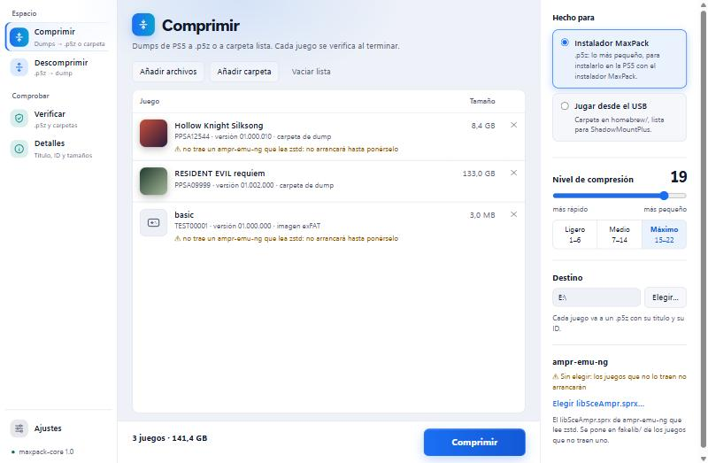
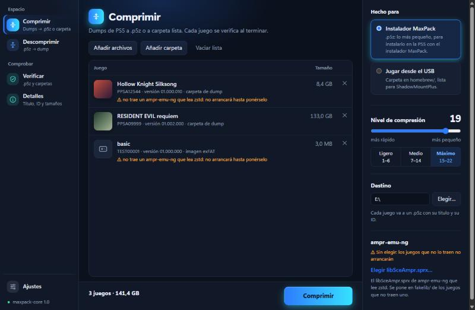
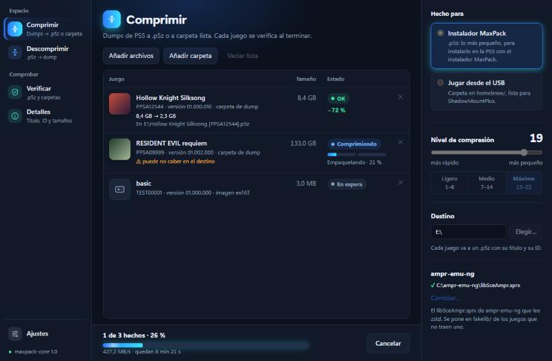
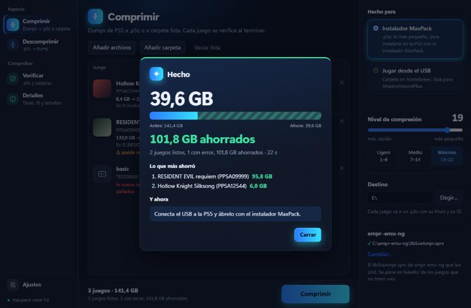

<!-- SPDX-License-Identifier: GPL-3.0-or-later -->
# The MaxPack window for the PC

MaxPack has a window for Windows, macOS and Linux. It does the same as the command line
(`maxpack pack`, `unpack`, `verify` and `info`), without typing commands: you drop the games, choose
what you want them for and press **Compress**.

## 1. Download and open

The releases are in **Releases** at https://github.com/DeLFuS77/maxpack/releases. Download the package
for your system (the installer or the portable zip on Windows, the `.dmg` or the `.tar.gz` on macOS,
the `.tar.gz` on Linux) and, if you want to check it, compare its SHA-256 with the one in
`SHA256SUMS`, on the same page. Every package carries `LICENSE` and `THIRD_PARTY_NOTICES` (the
licences of the third-party software they include).

Then follow the steps for your system.

**Windows**
- `maxpack-windows-x64-setup.exe` is the installer. It installs MaxPack in your user folder, without
  administrator rights, with a shortcut, and you uninstall it from "Installed apps". A page of its own
  offers MaxPack's places in the Windows Explorer (the right-click menu, Send to and opening `.p5z`
  files), each off until you tick it: see [Windows Explorer](#windows-explorer). The uninstaller takes
  them all away.
- `maxpack-windows-x64-portable.zip` is the portable version: unzip it anywhere and open
  `MaxPack.exe`. It has a `settings` folder next to it, and while that is there MaxPack keeps all its
  data (settings, window size and position) in it and nothing in your user profile. It is handy for a
  USB drive. It writes nothing in Windows: no notifications and no places in the Explorer.
- `MaxPack.exe` and `maxpack-core.exe` must stay together. The window uses `maxpack-core.exe` to do
  its work, and if it is missing the window tells you what is missing. If the one there is of another
  version (an old one that does not do everything the window needs), the window says "maxpack-core of
  another version" and does not let you start: put next to MaxPack the `maxpack-core` that came with
  it.

> Neither the installer nor `MaxPack.exe` is signed: Windows SmartScreen will warn you the first time
> ("Windows protected your PC"). Press **More info** and **Run anyway**.

> The Windows installer is checked automatically on every build (silent install with its places in the
> Explorer, compress a test image and uninstall), but it has not been tested by hand yet with a double
> click and the on-screen wizard. If something does not work, use the portable zip and report it.

**macOS**
- Open the `.dmg` and drag `MaxPack.app` to Applications. The `.tar.gz` carries the same app.
- The app is not notarized. The first time, open it with a right click, **Open**. On macOS 15 or
  later, if that does not work, try to open it once, then in System Settings, Privacy & Security,
  press **Open Anyway**.
- The Apple silicon and Intel versions are different: choose the one for your Mac.

**Linux**
- Unpack the `.tar.gz` and run `sh install.sh`. It puts MaxPack in the applications menu, with its
  icon, and `maxpack` in `~/.local/bin`. `sh install.sh --uninstall` removes it.
- It needs GTK 3 and WebKitGTK 4.1, which almost every desktop has.

On all three systems, opening MaxPack with games or folders (dragging them to the icon, Send to, the
right-click menu or a double click on a `.p5z` on Windows, the Finder, or the command line) adds them to
the window that is already open, which comes to the front: there is only one. With none open, the window
opens with them. Folders and `.exfat` images go to **Compress** and a `.p5z` to **Details**, unless the
right-click menu asked for another section. With command-line options (`MaxPack pack ...`, `MaxPack
--version`) it behaves like `maxpack`, as always.

## 2. Compress

1. Drop games or folders here, or use **Add files** and **Add folder**. PS5 dump folders and `.exfat`
   images are fine. **Add folder** takes several folders at once (on Linux, when `zenity` is there;
   else one at a time), and each one can be a game or a folder with games right below it; several
   dropped at once are each taken the same way. Each game shows its title, ID, version and size. A folder that is already
   compressed (with packs) is not compressed again: it shows "it is compressed already" and is
   skipped; to check it, use **Verify**.
2. Choose **Made for**.
3. Choose the compression **level**, 1 to 22 (19 by default), or one of the shortcuts **Light**,
   **Medium** and **Maximum**. 20 to 22 use a lot of memory and take much longer to gain little.
   **Compare the levels on this PC** (under the level, for the first game of the list) or **Compare
   levels** (under each game) shows what each level gives that game here (see below).
4. Choose the **Destination** and press **Compress**. Each game is verified when it finishes.
5. If you want, tick **Delete the originals once checked** (see below).
6. If you want, tick **Add repair data** and choose **1 %**, **5 %** or **10 %** (see below). Only for a
   `.p5z`: for "Play from the USB" it is off, and says why.

**Compare the levels on this PC.** A card compresses a sample of the game (2 % of what is packed, at
least 1 GiB, read once) at levels 3, 9, 15 and 19, with the same code and the same threads as Compress,
and fills a table as each level is measured: the level, the size of the `.p5z` (or of the folder, when
**Made for** is "Play from the USB"), what it saves and how long compressing the whole game takes on
this PC. The level in use is highlighted, and **Use** on a row sets that level once all are measured.
Nothing is written. **Cancel**, Escape or closing the card stops it; nothing else starts meanwhile. The
sizes are estimates from the sample; the times assume the game is read about as fast as its sample was,
so a game on a hard drive may compress faster than they say. It is `maxpack analyze --levels` (see
the [guide](guide.md#analyze---levels-compare-the-levels-on-this-pc)).

Before anything starts, MaxPack adds up what the games may take on each drive (each one at most its
original size, with its repair data when it gets some) and, if the queue may not fit, says so with the
numbers: "up to 322.4 GB needed, 118.2 GB free". You can choose another destination or **Start anyway**: a game that fills its drive fails,
and its original stays as it was.

While a queue runs, games you add to the same section join it: they show as **Queued**, are done after
the others with the same options, and count in the progress, the time left and the summary at the end.
The **✕** of a game that has not started takes it out of the queue. Games added to another section wait
there, as before.

**Every output is written apart.** The new `.p5z` or folder is written as `<name>.maxpack-tmp`, hidden
on Windows, and verified there; only then does it take its name. Something that came to that name
meanwhile is never replaced: the game says so and the new copy goes. If MaxPack is closed by a crash or
a power cut in the middle, the next time it opens it offers to delete what was left apart, with its
size; **Not now** asks again the next time.

**Delete the originals once checked** (off by default; Settings has the default, and the box next to
Compress the choice for this run): each original goes to the recycle bin (the Recycle Bin of Windows,
the Trash of macOS, the trash of Linux), or for good if Settings says so, only once its new copy is
made, verified and in its place. Never when decompressing or verifying, and never when anything failed
or was cancelled.
- Before the queue starts, MaxPack lists the originals that go, with their size, when one of them is a
  folder or cannot go to the recycle bin. **Keep the originals** starts the queue without deleting any.
- Some drives have no recycle bin (network folders, USB drives), and a game can be bigger than the
  recycle bin of its drive holds (on Windows it is 5 to 10 % of the drive by default). Those are
  kept, unless you tick "Delete for good the ones that cannot go to the recycle bin".
- Each game says what became of its original, the summary at the end tells how much went to the
  recycle bin (its space comes back once it is emptied), and the log of the window (`maxpack.log`, in
  its settings folder; Settings shows where) keeps every original removed.

**Add repair data** (off by default; Settings has the default and keeps the share; 5 % the first time)
gives each `.p5z` a standard PAR2 set next to it, so a damaged `.p5z` can be repaired back to the exact
bytes it was made with (see [Repair data](#5-repair-data)). Once the `.p5z` is made, verified and in its
place, its bar gets a third step, **Repair data**, with its progress; Cancel stops it too. If making it
fails or is cancelled, the game is still done (its `.p5z` is good), its row says why, and no part of the
set is left: `maxpack-par2` makes it in `<name>.p5z.maxpack-par2`, and its files take their names next to
the `.p5z` only once they are all made. Each `.p5z` done says what its set takes ("7.8 GB → 3.3 GB ·
repair data 168.4 MB"), and the card at the end counts the repair data made and the games left without
it. A new `.p5z` that replaces an old one of the same name takes the old one's set away with it.

While there is work, the PC does not go to sleep. Progress also shows on the taskbar (Windows) or in
the Dock (macOS), and when it ends the system notifies you. The portable version of Windows does not
notify: to send notifications it would have to register in the Windows registry, and the portable one
writes nothing there.

Cancelling, or closing the window while work is running, stops the current game without leaving
anything half made or unverified:
- what it had written is deleted, and the destination is left as it was: without the game if it was
  not there, or empty if it was an empty folder; with **Replace**, the old one stays intact;
- `maxpack-core` finishes what it has in hand first and then deletes, so with a big game or a slow USB
  drive it can take a few seconds;
- if you close the window, `maxpack-core` is not cut off: it goes on by itself until it has deleted
  everything, even if the window is already gone;
- if something cannot be deleted (for example, a file open in another program), the row says so, with
  the path, so you can delete it yourself.

When it ends, the result shows. If the queue compressed and saved space, the size before squeezes down
to the size now, with a bar that shrinks, and the GB saved count up. Below, you see what saved the most
and what to do next. If the system asks for less motion, the final numbers show without animation.

### Made for: MaxPack installer

This is the normal choice. Each game is saved in **one `.p5z` file** named `<Title> [<TITLE_ID>].p5z`.
It is the smallest and keeps well on the PC or on a USB drive. It needs no runtime from you: MaxPack for
the console puts its own ampr-emu-ng in when it plays it, and the window puts the one that comes with it
in the `.p5z` of a game that does not carry one.

Afterwards:
1. Copy the `.p5z` files to a USB drive.
2. Plug the USB drive into the PS5 and open it with MaxPack for the console, which is the payload from
   [DeLFuS77/maxpack-ps5](https://github.com/DeLFuS77/maxpack-ps5) (`maxpack.elf`;
   [how its installation works](ps5-installer.md)). It plays the `.p5z` as it is, or installs the game
   in `<drive>/homebrew/<TITLE_ID>` still compressed on the console.

### Made for: Play from the USB

Each game is saved in **a folder ready for the console**, with the zstd packs that ampr-emu-ng serves.
- If the destination is the root of a drive (for example `E:\` or a USB drive), each game goes to
  `<destination>/homebrew/<TITLE_ID>`.
- If you choose any other folder, each game goes inside it, with its `<TITLE_ID>`.

Afterwards:
1. Put the folders in `homebrew/` on the USB drive or on the internal storage of the PS5. If you made
   them in another folder, move them there: ShadowMountPlus only looks in `homebrew/`.
2. ShadowMountPlus will see and mount them. Since they do not go through the installer, you set each
   game's fakelib mode in ShadowMountPlus, so that it does not change ampr-emu-ng:
   [test-on-ps5.md](test-on-ps5.md). Kraken Mount comes with its own ampr-emu-ng.

## 3. Decompress and verify

- **Decompress** turns a `.p5z` back into:
  - the **Original dump (bit for bit)**, with every file checked against its SHA-256; or
  - the **Folder for the PS5**, the same one that "Play from the USB" produces.
- **Verify** reads a `.p5z` or a compressed folder and checks that it is still whole. It changes
  nothing. Under a `.p5z` with repair data it says what it can repair; a damaged one with repair data of
  its own gets **Repair**, and **Add repair data** and **Repair the damaged ones** do it for the list (see
  [Repair data](#5-repair-data)).
- **Details** shows what a game says: title, ID, version, sizes, files, packs and whether it carries a
  runtime that reads zstd. **Copy report** under each game copies a text for an issue on GitHub (see
  [Copy report](#copy-report)). A `.p5z` shows as a card with what it saved against the original, its
  volumes and its repair data (how much, or none), and two buttons: **Verify** and **Decompress** take it to those sections, where you start
  them. A `.p5z` opened with a double click (see [Windows Explorer](#windows-explorer)) opens here.
- **Rename**, in Check, names `.p5z` files, dump folders and `.exfat` images by what each one holds,
  with the template of Settings > File names. Add them and each shows its new name before anything
  changes; **Rename** applies it. A name that something else in the folder already has, two games of
  the list that would get the same name, a file another program has open and a game that cannot be
  read are skipped, and the row says why. Nothing is ever replaced, and the game stays in its folder.
  A folder for the console keeps its `TITLE_ID`. The repair data of a `.p5z` is renamed with it, all or
  nothing; a name of it that is taken blocks the rename as the name of the `.p5z` does.

## 4. Settings

- **Language** and **Theme** (System, Light or Dark). The window speaks English, Russian, Chinese,
  German, Spanish, French, Japanese, Portuguese (Brazil), Italian, Korean and Arabic (written from right to
  left), each shown by its own name. Until you choose one it uses the language of your system, or English
  if the window does not have it; **System** goes back to that. The window's notice and its question when
  you close it with games at work follow the language too.
- **Runtime for the games that lack one.** The zstd packs are served by ampr-emu-ng, and some dumps
  carry none, or an old `libSceAmpr.sprx` that does not read them. For those games MaxPack puts the
  `libSceAmpr.sprx` of ampr-emu-ng in their `fakelib/`, in both modes. MaxPack comes with its own
  (Settings shows "Built in: ampr-emu-ng v0.5.1-maxpack.1"), which it writes to its settings folder and
  uses by itself: there is nothing to download. **Choose another…** takes a `libSceAmpr.sprx` of your
  own instead, which MaxPack remembers; **Use the built-in one** goes back to the one that comes with it.
  - A `.p5z` is never warned about the runtime: MaxPack for the console puts its own ampr-emu-ng in
    when it plays one. The warnings below are only for folders made for "Play from the USB".
  - MaxPack checks that the one you choose reads zstd (the one of ampr-emu-ng carries the mark
    `AMPRZPK1`). If it does not, it does not accept it and asks for another: with it, the game would be
    compressed and verified fine, but it would not start.
  - If a game still comes out with a runtime that does not read zstd, its row says so when it ends, and
    the summary counts how many games will not start until you give them the one of ampr-emu-ng.
  - If a folder needs one and there is none (the built-in one could not be written and Settings has
    none), MaxPack asks for it once before starting.
  - If you go on without it, it warns you that the game will not start until it has ampr-emu-ng, and
    lets you go on.

- **While working.** **Low priority** runs `maxpack-core` below the other programs, so the PC stays
  usable while it works (below normal on Windows, `nice` on macOS and Linux); it goes a little slower
  when the other programs need the processor. **Threads to compress** says how many threads Compress
  gives `maxpack-core`: all of the processor's (the default), or the ones **Measure this PC** found.
  The measure takes about half a minute and needs no game: a card shows how fast generated data
  compresses with a quarter, half, three quarters and all the threads, at the level of Compress, then
  the speed of the disk of the destination (a temporary file is written there, read back and deleted;
  with no destination chosen, only the processor is measured), and keeps the fewest threads that are
  less than 5 % slower than the fastest: on a PC whose last threads add little, Compress goes as fast
  and leaves the PC freer. **Use them all** goes back to all of them. Decompress and Verify always use
  all of them. **Cancel**, Escape or closing the card stops it, and the threads stay as they were.
  **Repair data for each .p5z** is the default of the box next to Compress, with its share (1, 5 or
  10 %). **Delete the originals once checked** is the default of the box next to Compress, and **Delete
  them for good, not to the recycle bin** skips the recycle bin.
- **File names.** The name of each `.p5z` and of each original dump unpacked comes from a template:
  `{title}`, `{id}`, `{version}` (the one of `param.json`, such as 01.000.021) and `{region}` (USA,
  EUR, JPN, ASIA or KOR, from the first two letters of the content ID). A bracket whose placeholders
  are all empty goes. The default, `{title} [{id}]`, gives the names of before; the other two add the
  version, and the region and the version. You can write your own; the preview shows what it gives with
  a game of your lists, or with an invented one. A folder for the console keeps its `TITLE_ID`, which
  the console looks for. The region is known for every kind of game: `maxpack-core` reads the content
  ID of its `param.json`, also inside a `.p5z` or an `.exfat` image; a game whose `param.json` gives
  none has no region, and its bracket goes.
- **Windows Explorer** (Windows only): the right-click menu, Send to › MaxPack and opening `.p5z`
  files with MaxPack, each a switch, off until you turn it on. See [Windows Explorer](#windows-explorer).
- **Internet.** MaxPack's window goes on the internet for nothing; see
  [What goes on the internet](../README.md#what-goes-on-the-internet).
- **About** has **Copy report** and the links to report a bug or a game.

### Windows Explorer

Three places of MaxPack in the Explorer, each one off until you turn it on in Settings, or tick it in the
installer. Each is for you only (it is written in your part of the registry, or in your own Send to
folder), needs no administrator, and goes away when you turn it off or uninstall MaxPack.

- **Right-click menu.** **Compress with MaxPack** on a folder or an `.exfat` image, and **Verify with
  MaxPack** and **Details** on a `.p5z`, each with MaxPack's icon. Several files chosen at once go to the
  window together. On Windows 11 they are under **Show more options** (or Shift+F10): its compact menu
  only takes the entries of apps installed as packages, which MaxPack is not. The menu speaks the
  language of the window, and changes with it.
- **Send to › MaxPack.** MaxPack in the Send to menu of a right click: the files and folders chosen go to
  the window, folders and images to Compress and `.p5z` files to Details.
- **Open .p5z files with MaxPack.** A double click on a `.p5z` opens its card in **Details**. MaxPack is
  also in **Open with** and in Settings › Apps › Default apps. If another program already opens `.p5z`
  files, MaxPack leaves it, as Windows wants: choose MaxPack once in **Open with › Choose another app ›
  Always**, and Settings tells you while that is still to do.

If MaxPack is moved (or another copy put a place there), Settings says the place is for another copy:
turn it on and it points to this one. The **portable version** writes nothing in Windows, neither in
the registry nor in your folders: its switches stay off and Settings says why. Install MaxPack to have
them.

### Copy report

A plain text for an issue on GitHub: MaxPack's version, the engine's, the system and its version, the
CPU threads, the memory, the settings that matter (mode, level, threads, runtime built in or your own,
low priority, the originals, the template of the names) and, for the games it is about, what each one is,
its sizes, its volumes and how it ended. It never has a game's name, its title ID or a path. For a
`.p5z` (or a game just compressed) it ends with the row for the
[compatibility list](https://github.com/DeLFuS77/maxpack-ps5/blob/main/docs/compatibility.md), with the
sizes and the volumes filled in and a `?` for what only the console knows. **Report a bug** and **Report
a game** open the forms of [maxpack-ps5](https://github.com/DeLFuS77/maxpack-ps5/issues) in your
browser.

## 5. Repair data

A `.p5z` can carry standard **PAR2** repair data next to it, and MaxPack repairs a damaged `.p5z` with it
back to the exact bytes it was made with. `maxpack-par2` (par2cmdline-turbo, built from its source) comes
with MaxPack, next to `maxpack-core`; a build of the window without it offers no repair data, and says
why.

- **The files.** `<name>.p5z.par2` (a small index) and `<name>.p5z.volA+B.par2` (the recovery data),
  next to the `.p5z`. Keep them with it and copy them with it. Any PAR2 tool reads them.
- **How much.** 1, 5 or 10 % of the `.p5z`: what the set takes, and the most it can repair. The `.p5z` is
  cut into about 4000 blocks, each a whole number of 4 KiB (so a bad sector is in one block) and 32 MiB
  at most; each damaged spot, from one byte to a whole block, uses up one block of the set. Under a
  `.p5z` with repair data, Verify says it: "Repair data: 5 % — can repair up to 200 blocks of 1.3 MB,
  268.8 MB in all".
- **Its own set only.** A set is used only for the `.p5z` it protects: one file of its size and of the
  MD5 of its first 16 KiB (or, when those 16 KiB are damaged, of the MD5 of some of its other blocks).
  Files named as its set that are of another file show "repair data of another file" and are never
  used, nor replaced; ones that cannot be read show so.
- **Repair.** When Verify finds a `.p5z` damaged and it has repair data of its own, **Repair** shows
  under it; **Repair the damaged ones** does it for all of them in the list. MaxPack first checks that
  the drive of the `.p5z` has room for a whole copy of it (plus a margin), and if not, says so with the
  numbers and does not start. The `.p5z` is moved (on its own drive, so at once) into
  `<name>.p5z.maxpack-repair`, where `maxpack-par2` repairs it as par2 does: it keeps the damaged one as
  `<name>.1` and writes the repaired one. `maxpack-core` verifies the repaired one before it takes the
  `.p5z`'s place, and only then does the damaged one go. If it cannot be repaired (too much damage: the
  row says how many more blocks were needed), what was repaired does not verify, or you cancel, the
  `.p5z` goes back exactly as it was. The bar has two steps, **Repairing** and **Verifying**.
- **A repair cut short.** The folder of the repair has a file that says how far it went. At the next
  start MaxPack offers to put the `.p5z` back: the repaired one if it was already verified, else the
  damaged one as it was. A folder that may have a copy of a `.p5z` that is also in its place is kept,
  and said: look at both. Nothing is ever deleted without asking.
- **Add repair data.** In Verify, **Add repair data** gives a set, of the share chosen above it, to every
  `.p5z` in the list: each is verified by `maxpack-core` first, and only a good one gets one. One that
  already has its own of that share keeps it; of another share, it is replaced.
- **Rename.** Rename takes the set with its `.p5z`. The set keeps, inside, the name the `.p5z` had when
  it was made; MaxPack gives `maxpack-par2` the `.p5z` itself, so a renamed one still verifies and
  repairs. In MultiPar or QuickPar, after a rename, add the `.p5z` by hand when they say the file is
  missing.
- **Copy report** says the share of repair data of Settings, never a name.
- **On the console.** MaxPack for the console ignores the `.par2` files: there is no need to copy them
  there.
- **By hand.** The `par2` commands that do the same are in the
  [guide](guide.md#repair-data-with-par2).

## 6. Warnings

- **FAT32.** FAT32 does not take files over 4 GiB, and a `.p5z` can go over that. If the destination is
  FAT32 and the original game is over 4 GiB, MaxPack tells you before starting:
  - **Use a folder** switches to "Play from the USB", whose parts fit in FAT32;
  - **Go on anyway** tries it. MaxPack never writes more to the `.p5z` than fits in FAT32 (4 GiB minus
    one byte): before going over, it stops, deletes what it wrote and tells you it does not fit.

  With an exFAT USB drive there is no limit.
- **Space.** If what the queue may take on a drive is more than is free there, MaxPack says so before
  it starts, with the numbers, and you can choose another destination or **Start anyway**. With
  **Replace**, the new one and the old one have to fit at the same time: if they do not, that game does
  not start.
- **Replace.** If the game is already at the destination, MaxPack asks before touching anything. If you
  accept, the new one is written apart, in `<destination>.maxpack-tmp` (as every new one is), verified,
  and only then is the old one set aside and deleted. If you cancel, or anything fails (for example, you pull out the USB
  drive), the old one stays intact and with no leftovers.
- **The source is never the destination.** If they are the same, or the destination is inside the
  source game, it asks for another.
- **Two games with the same ID** going to the same destination are flagged before starting.
- **No ID.** If a game's `param.json` does not give its ID (TITLE_ID), MaxPack warns you before
  starting with "MaxPack installer": MaxPack for the console does not accept a `.p5z` without one. A
  `param.json` with a BOM or with padding at the end is read fine.
- MaxPack never writes to the source game and does not touch keys, encryption or DRM.
