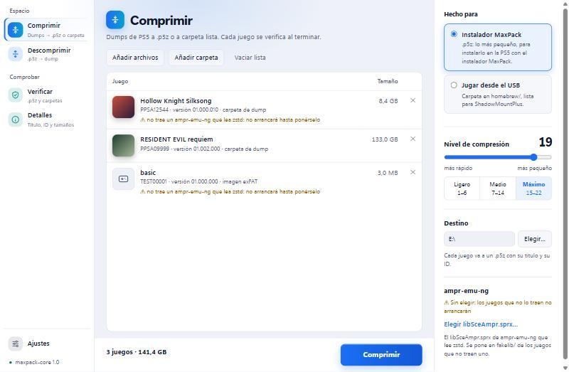
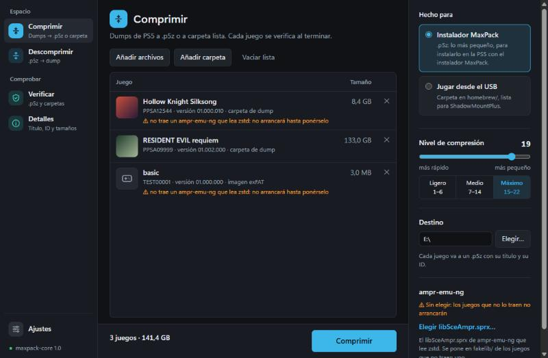
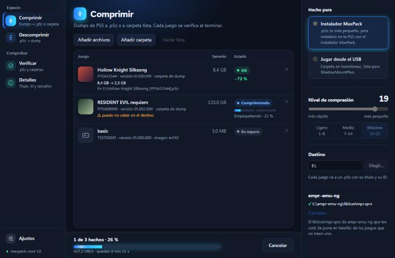
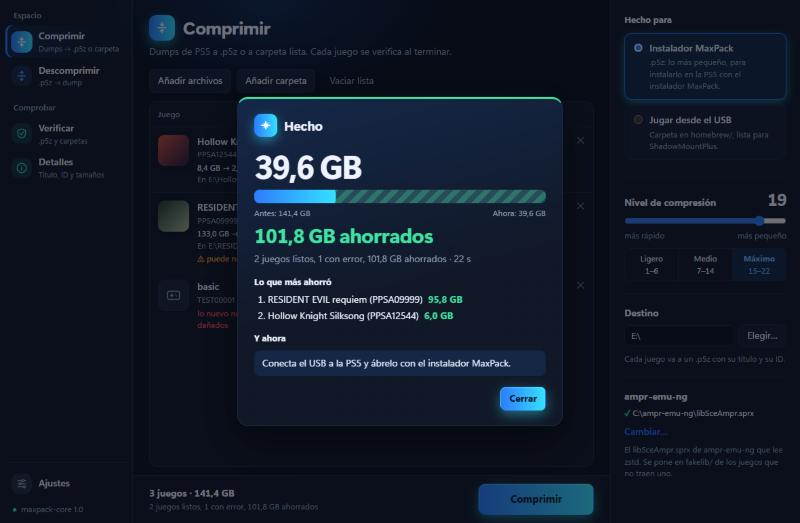

<!-- SPDX-License-Identifier: GPL-3.0-or-later -->
# La ventana de MaxPack para el PC

MaxPack tiene una ventana para Windows, macOS y Linux. Hace lo mismo que la línea de comandos
(`maxpack pack`, `unpack`, `verify` e `info`), sin escribir comandos: sueltas los juegos, eliges
para qué los quieres y pulsas **Comprimir**.

## 1. Descargar y abrir

Cuando haya versiones publicadas, estarán en **Releases** del repositorio. Mientras tanto, GitHub
Actions construye la ventana en cada cambio, como un artefacto por sistema (`maxpack-windows-x64`,
`maxpack-linux-x64`, `maxpack-macos-apple-silicon` y `maxpack-macos-intel`):
1. En https://github.com/DeLFuS77/maxpack abre **Actions**, el último trabajo `build` en verde y, abajo,
   **Artifacts**.
2. Hace falta tener sesión iniciada en GitHub, y los artefactos caducan pasado un tiempo.
3. Cada artefacto baja como un zip que envuelve el paquete de verdad: descomprímelo y dentro está lo que
   sigue (el instalador, el `.dmg`, el `.tar.gz`...).

Después, sigue los pasos de tu sistema.

**Windows**
- `maxpack-windows-x64-setup.exe` es el instalador. Instala MaxPack en tu carpeta de usuario, sin
  permisos de administrador, con su acceso directo, y lo desinstalas desde «Aplicaciones instaladas».
- `maxpack-windows-x64-portable.zip` es la versión portable: descomprímela donde quieras y abre
  `MaxPack.exe`. Lleva una carpeta `settings` al lado, y mientras esté ahí MaxPack guarda todo lo
  suyo (ajustes, tamaño y posición de la ventana) en ella y nada en tu usuario. Es lo cómodo para un USB.
- `MaxPack.exe` y `maxpack-core.exe` tienen que estar juntos. La ventana usa `maxpack-core.exe` para
  trabajar, y si falta te dice qué falta. Si el que hay es de otra versión (uno antiguo que no hace
  todo lo que la ventana necesita), te dice «maxpack-core es de otra versión» y no deja empezar: pon
  junto a MaxPack el `maxpack-core` que venía con ella.

> Ni el instalador ni `MaxPack.exe` están firmados: Windows SmartScreen avisará la primera vez
> («Windows protegió su PC»). Pulsa **Más información** y **Ejecutar de todas formas**.

> El instalador de Windows se comprueba en cada compilación de forma automática (instalar en silencio,
> comprimir una imagen de prueba y desinstalar), pero todavía no se ha probado a mano con doble clic y
> el asistente en pantalla. Si algo no va, usa el zip portable y cuéntalo.

**macOS**
- Abre el `.dmg` y arrastra `MaxPack.app` a Aplicaciones. El `.tar.gz` lleva la misma app.
- La app no está notarizada. La primera vez ábrela con clic derecho, **Abrir**. En macOS 15 o
  posterior, si no te deja, intenta abrirla una vez, y luego en Ajustes del Sistema, Privacidad y
  seguridad, pulsa **Abrir igualmente**.
- Las versiones de Apple silicon e Intel son distintas: elige la de tu Mac.

**Linux**
- Descomprime el `.tar.gz` y ejecuta `sh install.sh`. Pone MaxPack en el menú de aplicaciones, con su
  icono, y `maxpack` en `~/.local/bin`. `sh install.sh --uninstall` lo quita.
- Necesita GTK 3 y WebKitGTK 4.1, que casi todos los escritorios traen.

En los tres sistemas, abrir MaxPack con juegos o carpetas (arrastrándolos al icono, o desde el
Explorador, el Finder o la línea de comandos) los añade a la ventana que ya está abierta: solo hay una.
Con opciones de línea de comandos (`MaxPack pack ...`, `MaxPack --version`) se comporta como `maxpack`.

## 2. Comprimir

1. Suelta aquí juegos o carpetas, o usa **Añadir archivos** y **Añadir carpeta**. Valen las carpetas de
   dump de PS5 y las imágenes `.exfat`. En cada juego se ve su título, ID, versión y tamaño. Una
   carpeta ya comprimida (con packs) no se vuelve a comprimir: sale como «ya está comprimido» y se
   salta; para comprobarla, usa **Verificar**.
2. Elige **Hecho para**.
3. Elige el **nivel** de compresión, del 1 al 22 (19 por defecto), o uno de los atajos **Ligero**,
   **Medio** y **Máximo**. Del 20 al 22 usa mucha memoria y tarda bastante más para ganar poco.
4. Elige el **destino** y pulsa **Comprimir**. Cada juego se verifica al terminar.

Mientras hay trabajo el PC no se duerme. El progreso sale también en la barra de tareas (Windows) o en
el Dock (macOS), y al terminar el sistema te avisa. La versión portable de Windows no avisa: para
mandar avisos tendría que apuntarse en el registro de Windows, y la portable no lo hace.

Cancelar, o cerrar la ventana con trabajo en marcha, para el juego actual sin dejar nada a medias ni
sin verificar:
- lo que llevaba escrito se borra, y el destino queda como estaba: sin el juego si no estaba, o vacía
  si era una carpeta vacía; con **Reemplazar**, lo viejo queda intacto;
- `maxpack-core` acaba primero lo que tiene entre manos y luego borra, así que en un juego grande o un
  USB lento puede tardar unos segundos;
- si cierras la ventana, `maxpack-core` no se corta: sigue solo hasta haberlo borrado, aunque la
  ventana ya se haya ido;
- si algo no se puede borrar (por ejemplo, un archivo abierto en otro programa), la fila lo dice,
  con la ruta, para que lo borres tú.

### Hecho para: Instalador MaxPack

Es lo normal. Cada juego se guarda en **un archivo `.p5z`** que se llama `<Título> [<TITLE_ID>].p5z`.
Es lo más pequeño y se guarda bien en el PC o en un USB.

Después:
1. Copia los `.p5z` a un USB.
2. Conecta el USB a la PS5 y ábrelo con el instalador MaxPack (`maxpack.elf`):
   [instalador-ps5.md](instalador-ps5.md). El instalador deja el juego en
   `<unidad>/homebrew/<TITLE_ID>` y sigue comprimido en la consola.

### Hecho para: Jugar desde el USB

Cada juego se guarda en **una carpeta lista para la consola**, con los packs zstd que sirve ampr-emu-ng.
- Si el destino es la raíz de una unidad (por ejemplo `E:\` o un USB), cada juego va a
  `<destino>/homebrew/<TITLE_ID>`.
- Si eliges cualquier otra carpeta, cada juego va dentro de ella, con su `<TITLE_ID>`.

Después:
1. Pon las carpetas en `homebrew/` del USB o del almacenamiento interno de la PS5. Si las hiciste en
   otra carpeta, muévelas ahí: ShadowMountPlus solo mira en `homebrew/`.
2. ShadowMountPlus las verá y las montará: [probar-en-ps5.md](probar-en-ps5.md).

## 3. Descomprimir y verificar

- **Descomprimir** devuelve un `.p5z` a:
  - el **dump original**, bit a bit, con cada archivo comprobado con su SHA-256; o
  - la **carpeta para la PS5**, la misma que sale de «Jugar desde el USB».
- **Verificar** lee un `.p5z` o una carpeta comprimida y comprueba que siguen enteros. No cambia nada.
- **Detalles** enseña lo que dice un juego: título, ID, versión, tamaños, archivos, packs y si trae un
  runtime que lea zstd.

## 4. Ajustes

- **Idioma** (español o inglés) y **tema** (sistema, claro u oscuro).
- **Runtime para los juegos que no lo traen.** Los packs zstd los sirve ampr-emu-ng, y algunos dumps
  traen un `libSceAmpr.sprx` antiguo que no los lee. Para esos juegos MaxPack pone el
  `libSceAmpr.sprx` de ampr-emu-ng en su `fakelib/`. Descárgalo de
  https://github.com/quer3q/ampr-emu-ng, elígelo en Ajustes y MaxPack lo recuerda. **Quitar** lo olvida.
  - MaxPack comprueba que el que eliges lee zstd (el de ampr-emu-ng lleva la marca `AMPRZPK1`). Si no
    la lleva, no lo acepta y te pide otro: con él, el juego se comprimiría y se verificaría bien, pero
    no arrancaría.
  - Si aun así un juego sale con un runtime que no lee zstd, su fila lo dice al terminar, y el resumen
    cuenta cuántos juegos no arrancarán hasta que les pongas el de ampr-emu-ng.
  - Si un juego lo necesita y en Ajustes no hay ninguno, MaxPack lo pide una vez antes de empezar.
  - Si sigues sin él, te avisa de que ese juego no arrancará hasta que tenga ampr-emu-ng, y te deja
    seguir.

## 5. Avisos

- **FAT32.** FAT32 no admite archivos de más de 4 GiB, y un `.p5z` puede pasar de eso. Si el destino es
  FAT32 y el juego original pasa de 4 GiB, MaxPack te lo dice antes de empezar:
  - **Usar carpeta** cambia a «Jugar desde el USB», cuyas partes caben en FAT32;
  - **Seguir igualmente** lo intenta. MaxPack nunca escribe en el `.p5z` más de lo que cabe en FAT32
    (4 GiB menos un byte): antes de pasarse, para, borra lo escrito y te dice que no cabe.

  Con un USB en exFAT no hay límite.
- **Espacio.** Comprueba que el destino tenga sitio para el resultado. Con **Reemplazar** tienen que
  caber el nuevo y el viejo a la vez.
- **Reemplazar.** Si el juego ya está en el destino, MaxPack pregunta antes de tocar nada. Si aceptas,
  lo nuevo se escribe aparte, en `<destino>.maxpack-tmp`, se verifica, y solo entonces se aparta y se
  borra lo viejo. Si cancelas, o algo falla (por ejemplo, quitas el USB), lo viejo queda intacto y
  sin restos.
- **El origen nunca es el destino.** Si coinciden, o el destino está dentro del juego de origen, pide
  otro.
- **Dos juegos con el mismo ID** hacia el mismo destino se avisan antes de empezar.
- **Sin ID.** Si el `param.json` de un juego no da su ID (TITLE_ID), MaxPack lo avisa antes de empezar
  en «Instalador MaxPack»: el instalador MaxPack no acepta un `.p5z` sin él. Un `param.json` con BOM o
  con relleno al final se lee bien.
- MaxPack no escribe nunca en el juego de origen y no toca claves, cifrado ni DRM.
